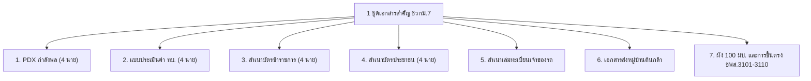
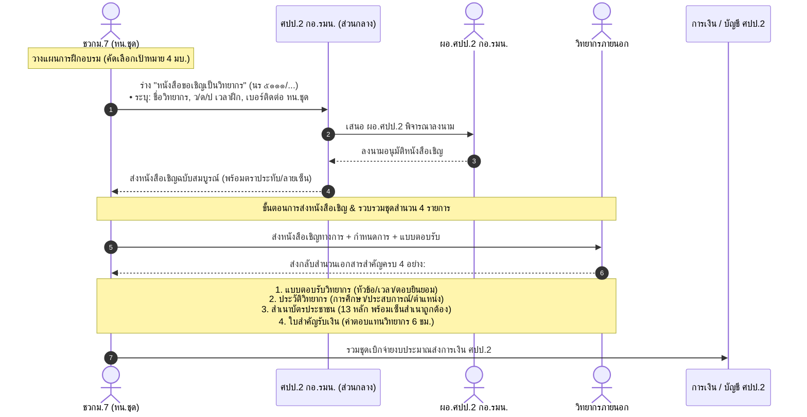
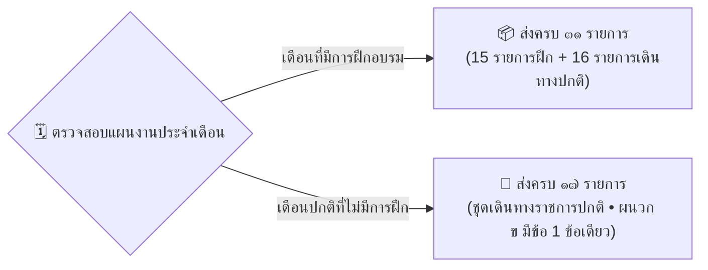
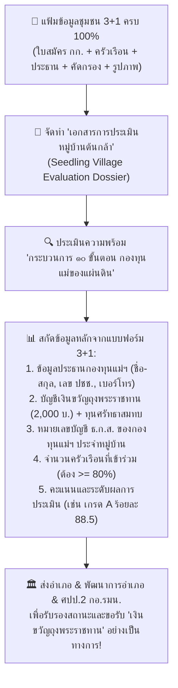
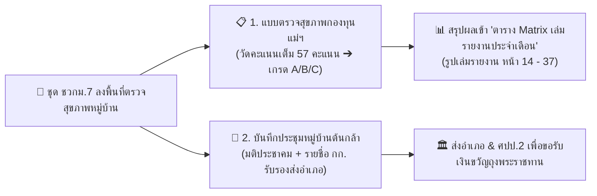
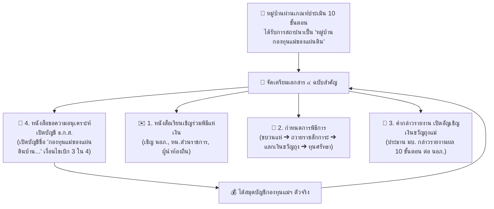
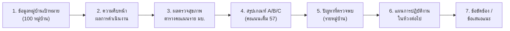
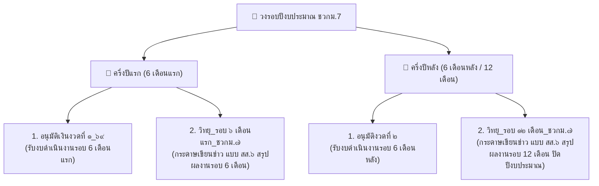
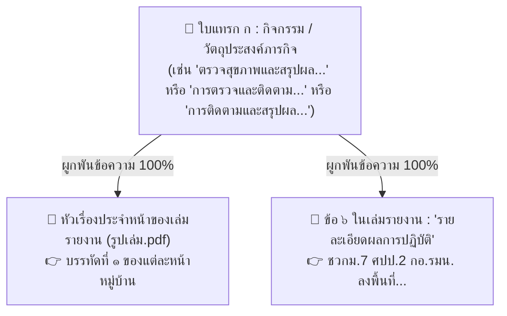

# 🧠 BRAIN.md - ระบบสมองและความจำถาวร ชุด ชวกม.7 (Master Cognitive Knowledge Engine)
> **หน่วยปฏิบัติการ:** ชุดวิทยากรขบวนการหมู่บ้านกองทุนแม่ของแผ่นดิน ที่ 7 (ชวกม.7)  
> **หน่วยบังคับบัญชา:** ศูนย์ประสานการปฏิบัติที่ 2 กองอำนวยการรักษาความมั่นคงภายในราชอาณาจักร (ศปป.2 กอ.รมน.) / กอ.รมน.ภาค 3 สย.1  
> **อัปเดตล่าสุด:** 5 พฤศจิกายน 2569  
> **สถานะ:** Active Production / Immortal Knowledge Base  

---

## 👥 1. โครงสร้างกำลังพล ชวกม.7 (Personnel Roster - 4 นาย)

| ลำดับ | ตำแหน่งในชุด | ยศ - ชื่อ - สกุล | ตำแหน่งปกติ / สังกัด | เลขประจำตัว ปชช. | หมายเหตุเอกสาร |
| :---: | :--- | :--- | :--- | :---: | :--- |
| **1** | **หน.ชวกม.7** | **ร.อ. วีระชัย บุญทะจิตต์** | นยส. ป.4 พัน.4 | `2-6201-00016-59-7` | มี PDX เต็ม / แบบประเมิน ทบ.101-157 ครบ |
| **2** | **รอง หน.ชวกม.7** | **จ.ส.อ. ณัฐชัย รักษาวงษ์** | ป.4 พัน.4 | `x-xxxx-xxxxx-xx-x` | มีแบบประเมิน ทบ.101-158 / รอสแกน PDX |
| **3** | **จนท.ประจำชุด** | **จ.ส.ท. อานนท์ บุญเกตุ** | ป.4 พัน.4 | `x-xxxx-xxxxx-xx-x` | รอสแกน PDX & แบบประเมิน ทบ.101-158 |
| **4** | **จนท.ประจำชุด** | **ส.อ. กิตติ รุ่งเรือง** | ป.4 พัน.4 | `x-xxxx-xxxxx-xx-x` | รอสแกน PDX & แบบประเมิน ทบ.101-158 |

---

## 📂 2. มาตรฐานชุดเอกสารสำคัญประจำภารกิจ (1 ชุด ต้องมี 7 หมวด)

ตามระเบียบการจัดทำสำนวนเอกสารและการเงินราชการของ ชวกม.7 ใน 1 ชุดปฏิบัติงานสมบูรณ์ ประกอบด้วย 7 หมวด:



### รายละเอียดการตรวจสอบสถานะ (Forensic Inventory Status):

| หมวด | รายการเอกสาร | สถานะในระบบ | หลักฐาน / ไฟล์อ้างอิง | สิ่งที่ต้องเติมเต็ม |
| :---: | :--- | :---: | :--- | :--- |
| **1** | **PDX ทั้ง 4 นาย** | 🟡 **มีแล้ว 1 / ขาด 3** | ร.อ. วีระชัย (`PDX_BIOGRAPHY_CLONE_1TO1.pdf`) | สแกน PDX ของ จ.ส.อ. ณัฐชัย, จ.ส.ท. อานนท์, ส.อ. กิตติ |
| **2** | **แบบประเมิน ทั้ง 4 นาย** | 🟡 **มีแล้ว 2 / ขาด 2** | ร.อ. วีระชัย (ทบ.101-157), จ.ส.อ. ณัฐชัย (ทบ.101-158) | แบบประเมินรายบุคคลของ จ.ส.ท. อานนท์ และ ส.อ. กิตติ |
| **3** | **สำเนาบัตรข้าราชการ** | 🔴 **รออัปโหลด** | มีเฉพาะบัตรวิทยากรใน `บัตร วิทยากร.pdf` | สำเนาบัตรประจำตัวข้าราชการทหารครบทั้ง 4 นาย |
| **4** | **สำเนาบัตรประชาชน** | 🔴 **รออัปโหลด** | มีเฉพาะบัตรผู้ประกอบการเลี้ยงอาหาร (`caterer_id_card.jpeg`) | สำเนาบัตรประชาชนของกำลังพล ชวกม.7 ทั้ง 4 นาย |
| **5** | **สำเนาเล่มทะเบียนรถ** | 🟡 **มีคำสั่ง / ขาดภาพเล่ม** | มีคำสั่ง ศปป.2 กอ.รมน. ที่ 20/2564 อนุมัติทะเบียนรถใน `ขอใช้รถ พ.ค.69.pdf` | ภาพสแกนหน้าเล่มทะเบียนรถจริง (เล่มคู่มือจดทะเบียนสีฟ้า) |
| **6** | **เอกสารส่งหมู่บ้านต้นกล้า** | 🟢 **สมบูรณ์ 100%** | มีครบทั้งแบบประเมินบ้านต้นกล้า บ.หนองบัว, บ.เก้ารวมไทยฯ, และบัญชี 40 มบ.ต้นกล้า ปี 69 | สมบูรณ์แล้ว |
| **7** | **พื้นที่ 100 มบ. & ชพส. ดูแล** | 🟢 **สมบูรณ์ 100%** | อยู่ใน `100 หมู่บ้านของ กกล..pdf` (ชพส. 3101 - 3110 รวม 10 ชุด 100 มบ.) | สมบูรณ์แล้ว (ถอดรหัสเชื่อมโยงครบถ้วน) |

---

## 🗺️ 3. การแบ่งมอบพื้นที่รับผิดชอบ 100 หมู่บ้าน (ชพส. 3101 - ชพส. 3110)

รับผิดชอบพื้นที่ 2 จังหวัด 9 อำเภอ ชายแดนไทย-เมียนมา:

| หน่วย ชพส. | ที่ตั้ง บก.ชุด | อำเภอ / จังหวัด | จำนวน มบ. | ตัวอย่างหมู่บ้านเป้าหมาย |
| :---: | :--- | :--- | :---: | :--- |
| **ชพส. 3101** | อาคารเอนกประสงค์ บ.คีรีราษฎร์ ต.คีรีราษฎร์ | อ.พบพระ จ.ตาก | 10 | บ.วาเล่ย์ใต้, บ.วาเล่ย์เหนือ, บ.ร่มเกล้าเจริญสุข ม.13 |
| **ชพส. 3102** | อาคารเอนกประสงค์ บ.วาเล่ย์ ต.วาเล่ย์ | อ.พบพระ จ.ตาก | 10 | บ.มอเกอร์ไทย ม.1, บ.ห้วยน้ำนัก ม.4, บ.หมื่นฤาชัย ม.5 |
| **ชพส. 3103** | อาคารเอนกประสงค์ บ.ห้วยหินฝน ต.แม่ปะ | อ.แม่สอด จ.ตาก | 10 | บ.แม่กุหลวง ม.1, บ.แม่กุใหม่ท่าซุง ม.9, บ.หนองบัว ม.7 |
| **ชพส. 3104** | อาคารเอนกประสงค์ บ.พะละ ต.ขะเนจื้อ | อ.แม่ระมาด จ.ตาก | 10 | บ.วังผา ม.4, บ.แม่จะเราบ้านทุ่ง ม.6, บ.ห้วยบงใหม่ ม.7 |
| **ชพส. 3105** | อาคารเอนกประสงค์ บ.แม่ต้าน ต.แม่ต้าน | อ.ท่าสองยาง จ.ตาก | 10 | บ.แม่หละไทย ม.1, บ.แม่หละยาง ม.2, บ.ห้วยนกกก ม.4 |
| **ชพส. 3106** | อาคารเอนกประสงค์ บ.กาศ ต.บ้านกาศ | อ.แม่สะเรียง / อ.สบเมย จ.แม่ฮ่องสอน | 10 | บ.แม่คะตวน ม.2, บ.ห้วยกองมูล ม.4, บ.ซื่อมื่อ ม.6 |
| **ชพส. 3107** | อาคารเอนกประสงค์ บ.แม่สุริน ต.ขุนยวม | อ.ขุนยวม จ.แม่ฮ่องสอน | 10 | บ.แม่เงา ม.2, บ.ประตูเมือง ม.3, บ.นาหัวแหลม ม.7 |
| **ชพส. 3108** | อาคารเอนกประสงค์ บ.กุงไม้สัก ต.ปางหมู | อ.เมืองแม่ฮ่องสอน จ.แม่ฮ่องสอน | 10 | บ.นาป่าแปก ม.4, บ.รักไทย ม.6, บ.ห้วยโป่งอ่อน ม.7 |
| **ชพส. 3109** | อาคารเอนกประสงค์ บ.จ่าโบ่ ต.ปางมะผ้า | อ.ปางมะผ้า จ.แม่ฮ่องสอน | 10 | บ.ยาป่าแหน ม.5, บ.ไม้ลัน ม.7, บ.ห้วยเฮี๊ยะ ม.8 |
| **ชพส. 3110** | อาคารเอนกประสงค์ บ.แพมกลาง ต.ทุ่งยาว | อ.ปาย จ.แม่ฮ่องสอน | 10 | บ.กิ่วหน่อ ม.9, บ.ห้วยหก ม.6, บ.หัวแม่เมือง ม.7 |

---

## 📖 4. แพทเทิร์นเล่มรายงานประจำเดือนและการฝึก (December 68 Training Pattern)

1. **ส่วนที่ 1: รายงานการฝึกอบรมรุ่นที่ 1 (หน้า 1 - 6):**
   - **วันเวลา:** 3 - 4 ธ.ค. 68
   - **สถานที่:** ห้องประชุม อบต.คีรีราษฎร์ อ.พบพระ จ.ตาก
   - **ประธานเปิด:** นายธันย์ปวัฒน์ ภูริวัฒนเมธา นายอำเภอพบพระ
   - **เป้าหมาย:** บ.ร่มเกล้าเจริญสุข ม.13 (35 คน)
2. **ส่วนที่ 2: รายงานการฝึกอบรมรุ่นที่ 2 (หน้า 7 - 13):**
   - **วันเวลา:** 8 - 9 ธ.ค. 68
   - **สถานที่:** ห้องประชุม ทต.แม่ปะ อ.แม่สอด จ.ตาก
   - **ประธานเปิด:** นายสัญญา เพชรเศษ ปลัดอาวุโส อ.แม่สอด
   - **เป้าหมาย:** บ.หนองบัว ม.7 (35 คน)
3. **ส่วนที่ 3: รายงานผลการลงพื้นที่ประจำเดือน (หน้า 14 เป็นต้นไป):**
   - ตาราง Matrix สรุปคะแนนการตรวจสุขภาพหมู่บ้าน (เต็ม 57 คะแนน คิดเป็นร้อยละ และจัดระดับเกรด A/B/C)
   - แบบสรุปผลการประเมินรายหมู่บ้านมาตรฐาน 1 หน้าจบ พร้อมประเด็นปัญหา จุดแข็ง จุดอ่อน และภาพถ่ายกิจกรรมการลงพื้นที่จริง


---

## 🔒 5. สถาปัตยกรรมคลังเงียบ (Silent Reference Vault & System Integration)
- **วัตถุประสงค์:** ทำหน้าที่เป็น Master Reference และ Single Source of Truth (SSOT) สำหรับโครงการ ชวกม.7
- **หลักการทำงาน:** 
  1. ไม่ต้องอัปโหลดข้อมูลส่วนบุคคลหรือเอกสารเพิ่ม เนื่องจากผู้ใช้งานหมดวาระปฏิบัติหน้าที่แล้ว
  2. ระบบจดจำ 7 หมวดเอกสารไว้ในสมองถาวร และติดตั้ง **Master Reference Vault** ในหน้าต่าง Edit (#view-edit) ของระบบ Web Application ([CHAWAKOM7_STANDALONE_APP.html](file:///D:/Project/ชวกม.%20Platfrom/Template-20261028T130755Z-1-001/Template/CHAWAKOM7_STANDALONE_APP.html))
  3. บันทึกและจัดเก็บไว้อย่างเงียบๆ (Silent Background Mode) โดยพร้อมแสดงผล เรียกดู และตอบสนองต่อคำสั่งออกแผนงาน การสร้างเอกสาร หรือการตรวจสอบความถูกต้องได้ทันที 100% ตลอดเวลา


---

## 🛠️ 6. ติดตั้งเครื่องมือช่วยประหยัด Token และสไตล์การเขียนโค้ด (Optimization Tools)
1. **Ponytail (`/ponytail`):**
   - **แนวคิด:** Lazy Senior Dev Mode — โค้ดที่ดีที่สุดคือโค้ดที่สั้นที่สุดและไม่ต้องเขียนซ้ำ แก้ปัญหาตรงจุด ปฏิบัติตามหลัก YAGNI (You Aren't Gonna Need It) ลดโค้ดขยะ
   - **พิกัดติดตั้ง:**
     - Global Skill: `C:\Users\EVE\.gemini\config\skills\ponytail\SKILL.md`
     - Project Rule: `D:\Project\ชวกม. Platfrom\.agents\rules\ponytail.md`
     - Full Repo: [D:\Project\ชวกม. Platfrom\tools\ponytail\](file:///D:/Project/ชวกม.%20Platfrom/tools/ponytail/)
2. **Caveman (`/caveman`):**
   - **แนวคิด:** "why use many token when few token do trick" — โหมดประหยัด Token สูงถึง 30-65% ตัดคำฟุ่มเฟือย ตอบกระชับ เนื้อหาทางเทคนิคและโค้ดยังคงแม่นยำ 100%
   - **พิกัดติดตั้ง:**
     - Global Skill: `C:\Users\EVE\.gemini\config\skills\caveman\SKILL.md` (รวมถึง `ultracave`, `megacave`)
     - Project Rule: `D:\Project\ชวกม. Platfrom\.agents\rules\caveman.md`
     - Full Repo: [D:\Project\ชวกม. Platfrom\tools\caveman\](file:///D:/Project/ชวกม.%20Platfrom/tools/caveman/)


---

## 🏛️ 7. สายพานกระบวนการเชิญและเบิกจ่ายวิทยากร (Lecturer Administrative & Financial Pipeline)



### 📋 สรุปแฟ้มเอกสารในสายพานวิทยากร (4+1 Checklist):
1. **หนังสือขอเชิญเป็นวิทยากร (หนังสือออก):**
   - หัวหนังสือ: ศูนย์ประสานการปฏิบัติที่ ๒ กอ.รมน. (ที่ นร ๕๑๑๑/...)
   - 3 องค์ประกอบหลัก:
     1. **ชื่อวิทยากร:** (เช่น ร.อ. สวง คำมา)
     2. **รายละเอียดการฝึก:** วัน เดือน ปี และเวลา (ช่วงเช้า 10.00 - 12.00, บ่าย 13.00 - 14.00) พร้อมหัวข้อบรรยาย
     3. **ช่องทางประสานงาน:** ยศ-ชื่อ หน.ชวกม.7 (ร้อยเอก วีระชัย บุญทะจิตต์) และเบอร์โทรศัพท์มือถือ (`08-7838-8587`)
   - นำส่ง ศปป.2 เพื่อให้ ผอ.ศปป.2 ลงนามก่อนส่งจริง
2. **เอกสารตอบรับและชุดเบิกจ่ายวิทยากร (4 รายการที่ต้องประกบ):**
   - **(1) แบบตอบรับวิทยากร:** [`template_แบบตอบรับ.html`](file:///D:/Project/ชวกม.%20Platfrom/Template-20261028T130755Z-1-001/Template/template_แบบตอบรับ.html)
   - **(2) ประวัติวิทยากร:** [`template_ประวัติ.html`](file:///D:/Project/ชวกม.%20Platfrom/Template-20261028T130755Z-1-001/Template/template_ประวัติ.html)
   - **(3) สำเนาบัตรประชาชน/บัตรวิทยากร:** [`template_บัตรวิทยากร.html`](file:///D:/Project/ชวกม.%20Platfrom/Template-20261028T130755Z-1-001/Template/template_บัตรวิทยากร.html)
   - **(4) ใบสำคัญรับเงินค่าวิทยากร:** [`template_สำคัญวิทยากร.html`](file:///D:/Project/ชวกม.%20Platfrom/Template-20261028T130755Z-1-001/Template/template_สำคัญวิทยากร.html) (คำนวณชั่วโมงบรรยาย x อัตราจ่ายราชการ)


---

## ⚖️ 8. กฎเหล็กวันส่งหนังสือเชิญวิทยากร (The 7-Day Postal Working Day Strict Rule)

> [!IMPORTANT]
> **กฎเหล็กด้านนิติการสารบรรณและการเงินราชการ (Strict Audit Rule):**
> 1. **เงื่อนไขกรอบเวลา (Lookahead Lead-Time):** วันที่ส่งหนังสือเชิญ หรือวันที่ลงในเอกสารส่งหนังสือเชิญ จะต้องเกิดขึ้น **"ก่อนวันเริ่มฝึกอบรมไม่น้อยกว่า ๑ สัปดาห์ (>= 7 วันทำการ/วันปฏิทิน)"**
> 2. **เงื่อนไขวันทำการไปรษณีย์ (Postal Working Day Constraint):** วันที่ประทับตราส่งเอกสาร/จัดส่ง **จะต้องเป็น "วันทำการของไปรษณีย์ไทย" เท่านั้น** (จันทร์ - ศุกร์ ยกเว้นวันหยุดราชการ/วันหยุดนักขัตฤกษ์)
> 3. **ผลกระทบทางกฎหมาย/การเงิน:** หากวันส่งเอกสารกระชั้นชิดน้อยกว่า 7 วัน หรือตรงกับวันหยุดที่ไปรษณีย์ปิดทำการ สตง. / ฝ่ายการเงิน ศปป.2 กอ.รมน. จะไม่อนุมัติการเบิกจ่ายค่าวิทยากรเนื่องจากผิดระเบียบขั้นตอนการแจ้งล่วงหน้า


---

## 💰 9. กฎเหล็กวันที่ในใบสำคัญรับเงิน (The "Day-1 Only" Strict Date Rule)

> [!IMPORTANT]
> **กฎเหล็กการเงินและใบสำคัญรับเงิน (First-Day Receipt Date Rule):**
> 1. **เงื่อนไขวันที่กำกับหัวใบสำคัญรับเงิน:** ในใบสำคัญรับเงิน (ทั้งค่าตอบแทนวิทยากร และค่าใช้จ่ายผู้ประกอบการ) **วันที่ลงในเอกสารจะต้องเป็น "วันแรกของการฝึกอบรมเท่านั้น" (Day 1 of Training)**
> 2. **ตัวอย่างการบังคับใช้:**
>    - หากห้วงการฝึกอบรมระบุ **"๓ - ๔ มกราคม ๒๕๖๙"** ➔ วันที่ที่ระบุบนหัวใบสำคัญรับเงิน **จะต้องเป็น "วันที่ ๓ มกราคม พ.ศ. ๒๕๖๙" เท่านั้น** (ห้ามลงวันที่ ๔ หรือวันที่สิ้นสุด หรือวันอื่นเด็ดขาด)
> 3. **รายละเอียดเวลาและอัตราจ่ายในใบสำคัญ (Grounded from Authentic Receipt):**
>    - **ช่วงเช้า (๐๙๐๐ - ๑๑๐๐):** ๒ ชั่วโมงๆ ละ ๖๐๐ บาท = **๑,๒๐๐ บาท**
>    - **ช่วงบ่าย (๑๓๐๐ - ๑๔๐๐):** ๑ ชั่วโมงๆ ละ ๖๐๐ บาท = **๖๐๐ บาท**
>    - **รวมเป็นเงินทั้งสิ้น:** **๑,๘๐๐ บาท (หนึ่งพันแปดร้อยบาทถ้วน)**
>    - **ผู้รับเงิน:** วิทยากรภายนอก (เช่น ร.อ. สวง คำมา)
>    - **ผู้จ่ายเงิน:** หน.ชวกม.7 (ร.อ. วีระชัย บุญทะจิตต์)


---

## 🍱 10. สายพานการจัดเลี้ยงอาหาร & กฎเหล็กใบสำคัญผู้ประกอบการ (Caterer & Last-Day Rule)

> [!IMPORTANT]
> **หลักการคัดเลือกผู้ประกอบการอาหาร (Community Preference):**
> - การจ้างเหมาจัดทำอาหาร/อาหารว่างและเครื่องดื่ม **ยึดหลัก "คนในพื้นที่ดีที่สุด" (Local Priority)**
> - ตรวจสอบจาก **สำเนาบัตรประจำตัวประชาชน** หากไปจัดฝึกอบรม ณ หมู่บ้านใด ให้คัดเลือกผู้ประกอบการที่มีภูมิลำเนาอยู่ในหมู่บ้านหรือตำบลนั้นๆ เพื่อกระจายรายได้สู่ชุมชนและสร้างความร่วมมือในพื้นที่

### ⚖️ กฎเหล็กวันที่ในใบสำคัญรับเงินผู้ประกอบการ (The "Last-Day Only" Rule):
- แตกต่างจากวิทยากรอย่างสิ้นเชิง: **"วิทยากรลงวันแรก (Day 1) ส่วนผู้ประกอบการลงวันสุดท้าย (Last Day)"**
- **ตัวอย่างการบังคับใช้:**
  - ห้วงการฝึกอบรม: **๓ - ๔ มกราคม ๒๕๖๙**
  - **ใบสำคัญรับเงินสำหรับผู้ประกอบการ:** **จะต้องลงวันที่เป็น "วันที่ ๔ มกราคม พ.ศ. ๒๕๖๙" เท่านั้น (วันสุดท้ายของการฝึก)** 
  - *เหตุผลทางสารบรรณ/การเงิน:* เนื่องจากเป็นการจ้างเหมาประกอบอาหารครบทุกมื้อจนสิ้นสุดโครงการ จึงจะสามารถตรวจรับและออกใบสำคัญรับเงินได้ในวันปิดโครงการ

### 📂 เอกสารประกอบการเบิกจ่ายของผู้ประกอบการ (๒ รายการบังคับ):
1. **ใบสำคัญรับเงิน สำหรับผู้ประกอบการ:**
   - แม่แบบ: [`template_สำคัญผู้ประกอบการ.html`](file:///D:/Project/ชวกม.%20Platfrom/Template-20261028T130755Z-1-001/Template/template_สำคัญผู้ประกอบการ.html)
   - ลงวันที่: **วันสุดท้ายของการฝึก**
   - รายละเอียดค่าใช้จ่าย (35 คน):
     - ค่าอาหารไม่ครบมื้อ (50 บาท/คน/มื้อ x 35 คน x 3 มื้อ) = **5,250 บาท**
     - ค่าอาหารว่างและเครื่องดื่ม (25 บาท/คน/มื้อ x 35 คน x 4 มื้อ) = **3,500 บาท**
     - **รวมเป็นเงินทั้งสิ้น:** **8,750 บาท (แปดพันเจ็ดร้อยห้าสิบบาทถ้วน)**
2. **สำเนาบัตรประชาชน + ทะเบียนบ้าน หน้าคู่ที่มีชื่อเจ้าตัว:**
   - แบบฟอร์มมาตรฐาน 1 หน้า A4: [`template_เอกสารแนบ_สำเนาบัตร.html`](file:///D:/Project/ชวกม.%20Platfrom/Template-20261028T130755Z-1-001/Template/template_เอกสารแนบ_สำเนาบัตร.html)
   - จัดวาง 3 บล็อกบนกระดาษแผ่นเดียว:
     - บล็อกที่ 1: สำเนาบัตรประจำตัวประชาชน (13 หลัก)
     - บล็อกที่ 2: สำเนาทะเบียนบ้าน หน้าที่ 1 (รายการเกี่ยวกับบ้าน/รหัสประจำบ้าน)
     - บล็อกที่ 3: สำเนาทะเบียนบ้าน หน้าที่ 2 (รายการบุคคลในบ้านที่มีชื่อและเลขบัตร ปชช. ของผู้ประกอบการ)
   - พร้อมข้อความรับรองสำเนาถูกต้องและลงลายมือชื่อกำกับ


---

## 🔍 11. กฎเหล็กความสอดคล้องชื่อ-ที่อยู่ 1:1 และการจัดวางวันที่ (Forensic Alignment & Matching Rule)

> [!IMPORTANT]
> **กฎเหล็กการตรวจรับและป้องกันการทักท้วงจาก สตง. / บัญชี (Zero-Mismatch Rule):**
> 1. **ชื่อผู้รับเงิน (Recipient Identity Match):**
>    - ชื่อ - สกุล ในช่อง `ข้าพเจ้า .....` และในช่องวงเล็บใต้ลายมือชื่อผู้รับเงิน `( ..... )` **จะต้องตรงกับตัวสะกดใน "บัตรประจำตัวประชาชน" 100% ทุกตัวอักษร** (ห้ามมีคำนำหน้าตกหล่น สะกดผิด หรือเว้นวรรคผิดเพี้ยน)
> 2. **รายละเอียดที่อยู่ (House Registration Lineage Match):**
>    - บ้านเลขที่, หมู่ที่, ตำบล, อำเภอ, จังหวัด ในใบสำคัญรับเงิน **จะต้องตรงกับ "สำเนาทะเบียนบ้าน (ท.ร.๑๔)" หน้าที่มีชื่อบุคคลนั้นจริง 100%**
>    - ตัวอย่าง: หากทะเบียนบ้านระบุ `บ้านเลขที่ ๓๘ หมู่ ๖ ตำบลสบเมย อำเภอสบเมย จังหวัดแม่ฮ่องสอน` ➔ ข้อมูลในใบสำคัญรับเงินต้องพิมพ์ตรงเป๊ะทุกวรรคตอน ห้ามย่อหรือเปลี่ยนชื่อตำบล/อำเภอ
> 3. **กฎเรขาคณิตการจัดวางวันที่ (Date Right-Alignment Rule):**
>    - บรรทัด `วันที่ ..... เดือน ..... พ.ศ. .....` **จะต้องจัดชิดขอบขวา (Right-Aligned: `text-align: right;`) เสมอ** ให้รับกับส่วนท้ายของช่อง `เขียนที่ .....` ตามระเบียบแบบฟอร์มใบสำคัญรับเงินราชการ


---

## 🪪 12. กฎเหล็กบัตรประชาชน/ใบขับขี่ และระบบสแกนแถบ Workshop (KYC & Card Validity Rule)

> [!IMPORTANT]
> **กฎเหล็กสูงสุดด้านพยานหลักฐานและอายุบัตร (Card Expiration Strict Rule):**
> 1. **เงื่อนไขวันหมดอายุ (Never Expire Before Document Date):**
>    - บัตรประชาชน (หรือใบขับขี่) ที่นำมาแนบประกอบในสำนวน **"จะต้องไม่หมดอายุก่อนวันที่ลงในเอกสาร"** โดยเด็ดขาด
>    - บังคับใช้กับทุกบทบาท: **วิทยากร**, **ผู้ประกอบการ**, และ **ผู้เข้ารับการอบรม**
>    - หากตรวจพบว่าบัตรหมดอายุก่อนวันที่ลงในเอกสารเบิกจ่ายหรือวันอบรม สตง./กองการเงินจะถือว่าเอกสารหลักฐานตกไปทันที
> 2. **ข้อยกเว้นใบขับขี่ (Driver's License Exception for Trainees Only):**
>    - **เฉพาะ "ผู้เข้ารับการอบรม" เท่านั้น** ที่สามารถใช้ **"ใบอนุญาตขับรถ (ใบขับขี่)"** แทนบัตรประจำตัวประชาชนได้
>    - สำหรับ **วิทยากร** และ **ผู้ประกอบการ** จะต้องใช้ **"บัตรประจำตัวประชาชนเท่านั้น"** (ห้ามใช้ใบขับขี่)
> 3. **เกณฑ์จำนวนผู้เข้าอบรมต่อรุ่น (Batch Trainee Quota):**
>    - ในแต่ละรุ่นการฝึกอบรม จะต้องมีผู้เข้ารับการอบรม **ขั้นต่ำ ๓๕ คนขึ้นไป (35+ คน)**

### 📸 สถาปัตยกรรมแถบ Workshop (Auto-Shutter KYC & Document Injection):
ในแถบนำทาง **Workshop** ของระบบ รองรับการเลือกประเภทบุคคลก่อนถ่าย 4 ตัวเลือก:
1. **🍱 ผู้ประกอบการ:** บันทึกสำเนาบัตร ปชช. + ทะเบียนบ้านคู่ ➔ ดึงชื่อและที่อยู่เข้าใบสำคัญรับเงินผู้ประกอบการ (ลงวันสุดท้ายของการฝึก ชิดขวา)
2. **🎤 วิทยากร:** บันทึกสำเนาบัตร ปชช. ➔ ดึงชื่อเข้าใบสำคัญรับเงินวิทยากร (ลงวันแรกของการฝึก) + ประวัติ + แบบตอบรับ
3. **👥 ผู้เข้ารับการอบรม:** รองรับบัตร ปชช. หรือ ใบขับขี่ (ขั้นต่ำ 35 คน/รุ่น) ➔ สกัดชื่อ เลขบัตร และที่อยู่ บันทึกลงใบลงทะเบียนและบัตรประจำตัวผู้เข้าอบรม
4. **👮‍♂️ จนท. (เจ้าหน้าที่ประจำชุด ชวกม.7):** สแกนบัตร ปชช. / บัตรข้าราชการ เพื่อเก็บเข้าแฟ้มกำลังพล 4 นาย
- **กลไก Auto-Shutter:** เมื่อผู้ใช้วางบัตรลงในกรอบสแกน ระบบจะอ่านวันที่หมดอายุบัตรอัตโนมัติ เทียบกับวันจัดอบรม หากหมดอายุจะขึ้นแถบเตือนสีแดงทันที และหากปกติจะฉีดข้อมูลเข้าไฟล์เอกสารพร้อมพิมพ์ทันที 100%


---

## ✍️ 13. กฎเหล็กพยานหลักฐานลายมือชื่อ & เอกสารค่าใช้จ่าย (Signature Forensics & Trainee Expense Rule)

> [!IMPORTANT]
> **กฎเหล็กการตรวจพยานหลักฐานลายมือชื่อ (Forensic Handwriting Integrity Rule):**
> 1. **บัญชีลงชื่อผู้เข้าฝึกอบรม (เอกสารลงชื่อ ๒ วัน ๒ ช่อง):**
>    - แม่แบบ: [`template_ลงชื่อ.html`](file:///D:/Project/ชวกม.%20Platfrom/Template-20261028T130755Z-1-001/Template/template_ลงชื่อ.html)
>    - มีช่องลงลายมือชื่อแยกเป็น ๒ วัน (เช่น วันที่ ๓ ม.ค. ๖๙ และ วันที่ ๔ ม.ค. ๖๙)
>    - **ต้องเป็น "ลายมือเขียนด้วยปากกาจริงของเจ้าตัวเท่านั้น"** (ห้ามเกิดจากการพิมพ์คอมพิวเตอร์เด็ดขาด)
> 2. **ความสอดคล้องของลายมือชื่อข้ามเอกสาร (Cross-Document Signature Consistency):**
>    - ลายมือชื่อในช่องลงชื่อทั้ง ๒ วัน **จะต้องตรงกันกับลายมือชื่อรับรองสำเนาถูกต้องใน "บัตรผู้เข้ารับการอบรม"**
>    - **มาตรฐานนิติวิทยาศาสตร์:** จะต้องเป็น **"ลายมือเดียวกัน 100%"** โดยมีรายละเอียด **สีของหมึกเส้น, น้ำหนักความเข้มของเส้น, และทิศทางการตวัดเส้น** ที่เหมือนกันอย่างเป็นธรรมชาติ
>    - *ข้อยกเว้น:* ในส่วนบัตรผู้เข้ารับการอบรม สามารถใช้ **"การพิมพ์ลายนิ้วมือ (Fingerprint Stamp)"** แทนลายมือชื่อได้เฉพาะกรณีผู้เข้าอบรมไม่สามารถลงชื่อได้
> 3. **เอกสารค่าใช้จ่าย (แบบใบสำคัญรับเงินค่าใช้จ่ายในการฝึกอบรมบุคคลภายนอก):**
>    - แม่แบบ: [`template_ค่าใช้จ่าย.html`](file:///D:/Project/ชวกม.%20Platfrom/Template-20261028T130755Z-1-001/Template/template_ค่าใช้จ่าย.html)
>    - **การสกัดข้อมูลอัตโนมัติ (Data Injection):** ระบบจะสกัด **ลำดับ, ชื่อ - สกุล, เลขประจำตัวประชาชน ๑๓ หลัก, และที่อยู่** มาพิมพ์ลงในตารางทั้งเอกสารค่าใช้จ่ายและใบลงทะเบียนโดยอัตโนมัติ
>    - **ช่องที่ต้องเว้นว่างไว้เด็ดขาด (Strict Blank Signature):** ช่อง **"ลายมือชื่อ ผู้รับเงิน"** จะต้องเว้นว่างไว้ให้เจ้าตัวลงลายมือชื่อด้วยตนเองเท่านั้น (ห้ามพิมพ์ชื่อหรือเครื่องหมายใดๆ ลงไป)
> 4. **กฎเหล็กวันที่ในเอกสารค่าใช้จ่าย (Last-Day Strict Date Rule):**
>    - วันที่กำกับการจ่ายเงิน/วันที่รับเงินในเอกสารค่าใช้จ่าย **จะต้องเป็น "วันสุดท้ายของการฝึกอบรมเท่านั้น"**
>    - *ตัวอย่าง:* การฝึกอบรมจัดวันที่ **๓ - ๔ มกราคม ๒๕๖๙** ➔ วันที่ในเอกสารค่าใช้จ่าย **จะต้องระบุเป็น "วันที่ ๔ มกราคม พ.ศ. ๒๕๖๙" เท่านั้น** (ห้ามลงวันที่ ๓ หรือวันเริ่มโครงการ)


---

## 🎯 14. กฎเหล็กแยกส่วนพิมพ์-เขียน (Printed Expense vs Hand-Written Registration Separation)

> [!IMPORTANT]
> **กฎเหล็กการแยกหน้าที่เอกสาร ๒ ใบ (Clear Separation of Concerns):**
> 1. **ใบลงทะเบียน (เอกสารหน้างานจริง - Hand-Written 100%):**
>    - แม่แบบ: [`template_ลงชื่อ.html`](file:///D:/Project/ชวกม.%20Platfrom/Template-20261028T130755Z-1-001/Template/template_ลงชื่อ.html)
>    - **๓ ช่องที่ต้องเขียนด้วยลายมือจริง (Hand-Written):**
>      1. **ชื่อ - สกุล**
>      2. **ที่อยู่**
>      3. **ลายมือชื่อ (ทั้งวันที่ ๑ และ วันที่ ๒)**
>    - *เหตุผล:* เป็นหลักฐานที่ผู้เข้าฝึกอบรมต้องมาจรดปากกาเขียนด้วยตนเองตอนมารายงานตัวหน้างาน ห้ามพิมพ์จากคอมพิวเตอร์
> 2. **เอกสารค่าใช้จ่าย (เอกสารเบิกจ่ายราชการ - Printed via System):**
>    - แม่แบบ: [`template_ค่าใช้จ่าย.html`](file:///D:/Project/ชวกม.%20Platfrom/Template-20261028T130755Z-1-001/Template/template_ค่าใช้จ่าย.html)
>    - ข้อมูลจากการ **"ถ่ายภาพสแกนบัตร ปชช. / ใบขับขี่ ในแถบ Workshop"** จะถูกสกัด (OCR/Extract) และส่งมา **"พิมพ์" (System Printed)** ลงในช่อง:
>      - ลำดับ
>      - ชื่อ - นามสกุล
>      - เลขประจำตัวประชาชน ๑๓ หลัก
>    - **ช่องเดียวที่เว้นว่างไว้:** ช่อง `ลายมือชื่อ ผู้รับเงิน` เพื่อให้เจ้าตัวมาเซ็นรับเงินสด
> 3. **กฎเหล็กสูงสุดของชุดเอกสาร (Absolute Match with ID Card):**
>    - **"ห้ามเขียน และ ห้ามพิมพ์ ชื่อ - นามสกุล ผิดไปจากบัตรประจำตัวประชาชนเด็ดขาด"**
>    - ตัวสะกด, การการันต์, สระ, วรรณยุกต์ ทั้งในใบที่ **เขียนด้วยมือ** (ใบลงทะเบียน) และใบที่ **พิมพ์ด้วยระบบ** (เอกสารค่าใช้จ่าย) **จะต้องตรงกับตัวอักษรบนบัตรประชาชน 100% ทุกประการ** เพื่อให้ สตง. และ กองการเงิน กอ.รมน. ตรวจสอบผ่านฉลุย


---

## 📦 15. สายพานวงรอบการส่งเอกสาร ๓๑ รายการ (The 31-Dossier Monthly Cycle & Cross-Document Lineage)

> [!IMPORTANT]
> **กฎเหล็กการส่งเอกสารประจำวงรอบ (Monthly Operational & Financial Dossier System):**
> ในเดือนที่มีภารกิจการฝึกอบรม (จัด ๒ รุ่น) จะต้องส่งสำนวนเอกสารสำคัญครบ **๓๑ รายการ** โดยแบ่งออกเป็น ๒ กลุ่มใหญ่ที่มีความเชื่อมโยงของข้อมูลและตัวเลขถึงกัน ๑๐๐%

```mermaid
graph TD
    MonthlyPack["📦 สำนวนประจำเดือนที่มีการฝึก (ครบ ๓๑ รายการ)"] --> GroupA["กลุ่มที่ ๑ : ชุดภารกิจการฝึกอบรม ๒ รุ่น (๑๕ รายการ)"]
    MonthlyPack --> GroupB["กลุ่มที่ ๒ : ชุดเดินทางราชการ & งบประมาณประจำ (๑๖ รายการ)"]

    GroupA --> A1["1. ผนวก ข. (มีข้อ 2 ค่าฝึกอบรม 33,700 บ.)"]
    GroupA --> A2["2. อนุผนวก 2 (แจกแจง 2 รุ่น: รุ่นละ 16,850 x 2 = 33,700 บ.)"]
    GroupA --> A3["3. ใบแทรก ก (ระบุ 'ถึงสถานที่ฝึกอบรม ฯ ณ...' และชื่อกิจกรรม)"]
    GroupA --> A4["4. แบบ 8708(2)"]
    GroupA --> A5["5. รูปเล่มรายงานการฝึก"]
    GroupA --> A6["6. เอกสารลงทะเบียน (เขียนมือ 3 ช่อง 2 วัน)"]
    GroupA --> A7["7. เอกสารค่าใช้จ่าย (พิมพ์ระบบ + วันสุดท้าย)"]
    GroupA --> A8["8. ใบสำคัญผู้ประกอบการ (วันสุดท้าย ชิดขวา)"]
    GroupA --> A9["9. บัตร + ทะเบียนบ้านคู่ผู้ประกอบการ"]
    GroupA --> A10["10. ใบสำคัญวิทยากร (วันแรก 1,800 บ.)"]
    GroupA --> A11["11. หนังสือเชิญ (ผอ.ศปป.2 ลงนาม + ล่วงหน้า >= 7 วัน)"]
    GroupA --> A12["12. หนังสือตอบรับ"]
    GroupA --> A13["13. ประวัติวิทยากร"]
    GroupA --> A14["14. บัตรผู้เข้าอบรม (35+ คน พร้อมเซ็นสำเนา)"]
    GroupA --> A15["15. ตารางฝึกอบรม"]

    GroupB --> B1["1. แบบ 8708(1)"]
    GroupB --> B2["2. เบี้ยเลี้ยง"]
    GroupB --> B3["3. ค่าที่พัก"]
    GroupB --> B4["4. ชดเชยน้ำมัน"]
    GroupB --> B5["5. ใบแทรก ก (สายทางลงพื้นที่)"]
    GroupB --> B6["6. บันทึกข้อความใบอนุมัติใช้รถ"]
    GroupB --> B7["7. แผนที่เดินทาง"]
    GroupB --> B8["8. คำสั่งเดินทาง"]
    GroupB --> B9["9. ผนวก ก"]
    GroupB --> B10["10. อนุผนวก 1"]
    GroupB --> B11["11. ผนวก ข (ข้อ 1 ค่าเดินทาง)"]
    GroupB --> B12["12. สนย."]
    GroupB --> B13["13. สปง."]
    GroupB --> B14["14. แบบอนุมัติเงิน"]
    GroupB --> B15["15. ใบยืมเงิน"]
    GroupB --> B16["16. คำสั่งให้ใช้ยานพาหนะ"]
```



### 🔍 กฎความสัมพันธ์เฉพาะของเอกสารสำคัญ (Key Cross-Rules):
1. **ผนวก ข. (เงื่อนไขการมีข้อ ๒):**
   - **เดือนที่มีการฝึก:** ต้องมีทั้ง **ข้อ ๑** (ค่าใช้จ่ายในการเดินทางไปราชการ ๔๕,๐๑๖ บ. อ้างอิงอนุผนวก ๑) และ **ข้อ ๒** (ค่าใช้จ่ายในการฝึกอบรมฯ ๓๓,๗๐๐ บ. อ้างอิงอนุผนวก ๒) รวมเป็นเงินทั้งสิ้น **๗๘,๗๑๖ บาท**
   - **เดือนที่ไม่มีการฝึก:** ตัดข้อ ๒ ทิ้ง **ให้เหลือแต่ข้อ ๑ (ค่าใช้จ่ายในการเดินทางไปราชการ) ข้อเดียวเท่านั้น**
2. **อนุผนวก ๒ (งบประมาณ ๒ รุ่น):**
   - เป็นการเบิกรายการของ **ทั้ง ๒ รุ่นในเดือนนั้น** (รุ่นละ ๑๖,๘๕๐ บาท x ๒ รุ่น = **๓๓,๗๐๐ บาท**) ประกอบด้วย:
     - ค่าพาหนะ (๒๐๐ x ๓๕ คน) = ๗,๐๐๐ บ./รุ่น
     - ค่าอาหารไม่ครบมื้อ (๕๐ x ๓๕ x ๓ มื้อ) = ๕,๒๕๐ บ./รุ่น
     - ค่าอาหารว่างและเครื่องดื่ม (๒๕ x ๓๕ x ๔ มื้อ) = ๓,๕๐๐ บ./รุ่น
     - ค่าวิทยากร (๖๐๐ x ๖ ชม.) = ๓,๖๐๐ บ. (หรือคำนวณตามชั่วโมงบรรยาย)
3. **ใบแทรก ก (ห้วงการฝึกอบรม & ความสอดคล้องของวันที่):**
   - ห้วงวันฝึกอบรมจะต้องลงบันทึกในใบแทรก ก ด้วย โดยมีข้อความมาตรฐาน:
     - ช่องภารกิจ/การปฏิบัติ: ระบุ `"ถึงสถานที่ฝึกอบรม ฯ ณ (ระบุชื่ออาคาร/หมู่บ้าน)"`
     - ช่องกิจกรรม: ระบุ `"การฝึกอบรมพัฒนาศักยภาพผู้นำชุมชนเพื่อการจัดตั้งหมู่บ้านกองทุนแม่ของแผ่นดิน"`
   - **กฎความยืดหยุ่นและการตรึงวันที่ (Date Alignment):** วันที่ในใบแทรก ก *อาจจะไม่ตรงกับหนังสือเชิญวิทยากรก็ได้* (หากมีเหตุเลื่อนหรือปรับแผน) **แต่ "เอกสารค่าใช้จ่าย, ใบสำคัญวิทยากร, และใบสำคัญผู้ประกอบการ" จะต้องลงวันที่ตรงกัน ๑๐๐% เสมอ**


---

## 📜 16. กฎเหล็กข้อความในแบบ 8708(1) และ 8708(2) (Strict Mission Phrasing Lineage)

> [!IMPORTANT]
> **หลักการสืบทอดข้อความจาก "คำสั่งเดินทาง" สู่แบบ 8708 (Order Lineage Rule):**
> 1. **แบบ 8708(1) — ชุดเดินทางปฏิบัติราชการทั่วไป:**
>    - **เนื้อหาสาระสำคัญ:** จะต้อง **"ยกข้อความจากคำสั่งเดินทางฉบับประจำเดือนนั้นๆ มาลงเป็นสำคัญ ๑๐๐%"**
>    - เปลี่ยนแปลงไปตามวัตถุประสงค์ที่ระบุในคำสั่ง กอ.รมน. ประจำเดือน เช่น การตรวจติดตามสุขภาพหมู่บ้าน, การประสานงานความมั่นคง, หรือการขับเคลื่อนกองทุนแม่ฯ
> 2. **แบบ 8708(2) — ชุดจัดการฝึกอบรมพัฒนาศักยภาพผู้นำชุมชน:**
>    - **ข้อความตายตัวที่ไม่เปลี่ยนเลย (Strict Static Sentence):**
>      > **"เดินทางไปราชการเพื่อจัดการฝึกอบรมฯ พัฒนาศักยภาพผู้นำชุมชน เพื่อการจัดตั้งหมู่บ้านกองทุนแม่ของแผ่นดิน ในพื้นที่"**
>    - ตามด้วยการระบุพื้นที่รับผิดชอบ: `กอ.รมน.ภาค ๓ สย.๑ (จว.ต.ก. และ จว.ม.ส.)`
>    - *เหตุผลทางระเบียบงบประมาณ:* เพื่อล็อกหมวดการเบิกจ่ายให้ตรงกับงบฝึกอบรมของ ศปป.๒ กอ.รมน. และผูกกับรายการในอนุผนวก ๒ โดยห้ามแก้ไขข้อความแกนหลักนี้เด็ดขาด


---

## 🚙 17. สายพานวงรอบเดือนปกติที่ "ไม่มีการฝึกอบรม" (The 17-Dossier Regular Routine Cycle)

> [!IMPORTANT]
> **ชุดสำนวนการเดินทางปฏิบัติราชการประจำเดือนปกติ (Regular Operational Travel Dossier):**
> ในเดือนที่ **ไม่มีการจัดฝึกอบรมหมู่บ้านต้นกล้า** (เน้นภารกิจลงพื้นที่ตรวจติดตามสุขภาพกองทุนแม่ของแผ่นดิน ๙ อำเภอ และงานมวลชน) จะต้องส่งสำนวนเอกสารรวมทั้งสิ้น **๑๗ รายการ** ดังนี้:

| ลำดับ | รายการเอกสาร | แม่แบบ / หน้าที่ของเอกสาร | รายละเอียดและจุดตรวจสำคัญ |
| :---: | :--- | :--- | :--- |
| **1** | **8708(1)** | [`template_8708.html`](file:///D:/Project/ชวกม.%20Platfrom/Template-20261028T130755Z-1-001/Template/template_8708.html) | ยกข้อความสาระสำคัญและวัตถุประสงค์จาก **"คำสั่งเดินทาง"** ประจำเดือนนั้นๆ 100% |
| **2** | **ค่าใช้จ่าย (เบี้ยเลี้ยง)** | [`template_เบี้ยเลี้ยง.html`](file:///D:/Project/ชวกม.%20Platfrom/Template-20261028T130755Z-1-001/Template/template_เบี้ยเลี้ยง.html) | บัญชีเบิกเงินค่าใช้จ่ายในการเดินทางไปราชการของกำลังพล ชวกม.7 ทั้ง 4 นาย |
| **3** | **ค่าที่พัก** | [`template_ที่พัก.html`](file:///D:/Project/ชวกม.%20Platfrom/Template-20261028T130755Z-1-001/Template/template_ที่พัก.html) | ใบเสร็จรับเงิน/ใบแจ้งยอดค่าเช่าที่พักแรมตามสายทางลงพื้นที่จริง |
| **4** | **ชดเชยน้ำมัน** | ใบเสร็จค่าน้ำมันเชื้อเพลิง | เอกสารใบเสร็จค่าน้ำมันพร้อมบิลภาษีและตารางคำนวณระยะทาง กม. |
| **5** | **ใบแทรก ก** | [`template_ใบแทรก_ก.html`](file:///D:/Project/ชวกม.%20Platfrom/Template-20261028T130755Z-1-001/Template/template_ใบแทรก_ก.html) | ตารางบันทึก วันที่-เวลา-สายทาง-ภารกิจการตรวจสุขภาพ มบ. และระยะทาง (กม.) |
| **6** | **บันทึกข้อความใบอนุมัติใช้รถ** | [`template_ขอใช้รถ_พค69.html`](file:///D:/Project/ชวกม.%20Platfrom/Template-20261028T130755Z-1-001/Template/template_ขอใช้รถ_พค69.html) | หนังสือขออนุมัติและสนับสนุนยานพาหนะจากส่วนสนับสนุน กอ.รมน. |
| **7** | **แผนที่** | แผนที่ OSRM / Google Maps Route | แผนที่แสดงเส้นทางเดินทางไป-กลับ และจุดพิกัดหมู่บ้านเป้าหมาย |
| **8** | **คำสั่งเดินทาง** | [`template_คำสั่งเดินทาง_พค69.html`](file:///D:/Project/ชวกม.%20Platfrom/Template-20261028T130755Z-1-001/Template/template_คำสั่งเดินทาง_พค69.html) | คำสั่ง ศปป.2 กอ.รมน. อนุมัติให้ข้าราชการเดินทางไปปฏิบัติราชการ |
| **9** | **ผนวก ก** | [`template_ผนวก_ก.html`](file:///D:/Project/ชวกม.%20Platfrom/Template-20261028T130755Z-1-001/Template/template_ผนวก_ก.html) | บัญชีรายชื่อกำลังพล 4 นาย (ร.อ.วีระชัย, จ.ส.อ.ณัฐชัย, จ.ส.ท.อานนท์, ส.อ.กิตติ) |
| **10** | **ผนวก ข** | [`template_ผนวก_ข.html`](file:///D:/Project/ชวกม.%20Platfrom/Template-20261028T130755Z-1-001/Template/template_ผนวก_ข.html) | **มีเฉพาะ "ข้อ ๑"** (ค่าใช้จ่ายในการเดินทางไปราชการ ๔๕,๐๑๖ บ.) **ตัดข้อ ๒ ทิ้ง** |
| **11** | **อนุผนวก 1** | [`template_อนุผนวก_1.html`](file:///D:/Project/ชวกม.%20Platfrom/Template-20261028T130755Z-1-001/Template/template_อนุผนวก_1.html) | แจกแจงงบเดินทาง 45,016 บาท (เบี้ยเลี้ยง 4 นาย + ที่พัก + น้ำมัน) |
| **12** | **ใบแทรก ก.** | แผ่นต่อ / ตารางสำรองใบแทรก ก | ตารางบันทึกการเดินทางส่วนขยายรองรับจำนวนวันปฏิบัติงานเต็มเดือน |
| **13** | **สนย.** | [`template_สนย_สปง_69.html`](file:///D:/Project/ชวกม.%20Platfrom/Template-20261028T130755Z-1-001/Template/template_สนย_สปง_69.html) | หนังสือสัญญาเงินยืมราชการ |
| **14** | **สปง.** | [`template_สนย_สปง_69_งวดที่2.html`](file:///D:/Project/ชวกม.%20Platfrom/Template-20261028T130755Z-1-001/Template/template_สนย_สปง_69_งวดที่2.html) | ใบส่งหลักฐานการจ่ายเงินและเคลียร์หนี้เงินยืม |
| **15** | **แบบอนุมัติเงิน** | [`template_อนุมัติเงินงวดที่_1_69.html`](file:///D:/Project/ชวกม.%20Platfrom/Template-20261028T130755Z-1-001/Template/template_อนุมัติเงินงวดที่_1_69.html) | เอกสารอนุมัติจัดสรรงบประมาณประจำงวดจาก ศปป.2 กอ.รมน. |
| **16** | **ใบยืม** | สัญญาการยืมเงินทดรองราชการ | เอกสารยืนยันวงเงินยืมและกำหนดส่งใช้ใบสำคัญ |
| **17** | **ใช้ยานพาหนะ** | [`template_คำสั่งให้ใช้ยานพาหนะ_ธค68.html`](file:///D:/Project/ชวกม.%20Platfrom/Template-20261028T130755Z-1-001/Template/template_คำสั่งให้ใช้ยานพาหนะ_ธค68.html) | คำสั่ง ศปป.2 กอ.รมน. เรื่องให้ใช้ยานพาหนะประจำเดือน (10 คัน) |




---

## ⛺ 18. ยุทธการเตรียมเอกสารลงพื้นที่ฝึกอบรม & แฟ้มผลลัพธ์ข้อมูลหมู่บ้าน (Field Kit 3+1 & Village Data Intake)

> [!IMPORTANT]
> **เกณฑ์การเตรียมเอกสารลงพื้นที่ฝึกอบรมหมู่บ้านต้นกล้า (Field Kit Quota Rules):**
> ในการลงพื้นที่เพื่อจัดฝึกอบรมพัฒนาศักยภาพผู้นำหมู่บ้านต้นกล้ากองทุนแม่ของแผ่นดิน ชุด ชวกม.7 จะต้องเตรียมเอกสารล่วงหน้าไปให้พร้อม **๔ รายการหลัก (๓+๑)** ตามสัดส่วนมาตรฐาน ดังนี้:

| ลำดับ | รายการเอกสารเตรียมไปหน้างาน | สัดส่วน / จำนวนที่ต้องเตรียม | แม่แบบในระบบ | วัตถุประสงค์ & เกณฑ์การใช้งาน |
| :---: | :--- | :---: | :--- | :--- |
| **1** | **ใบสมัครคณะกรรมการกองทุนแม่** | **ร้อยละ ๘๐ (80%)** ของครัวเรือน/ผู้นำ | [`XEROX_ใบสมัครคณะกรรมการ_กองทุนแม่.html`](file:///D:/Project/ชวกม.%20Platfrom/Template-20261028T130755Z-1-001/Template/XEROX_ใบสมัครคณะกรรมการ_กองทุนแม่.html) | รับสมัครผู้นำชุมชนและบุคคลที่มีจิตอาสาเข้าเป็นคณะกรรมการขับเคลื่อนกองทุนแม่ฯ |
| **2** | **ใบสมัครครัวเรือนเข้าร่วม** | **ร้อยละ ๘๐ (80%)** ของจำนวนหลังคาเรือนทั้งหมด | [`XEROX_ใบสมัครครัวเรือนเข้าร่วม.html`](file:///D:/Project/ชวกม.%20Platfrom/Template-20261028T130755Z-1-001/Template/XEROX_ใบสมัครครัวเรือนเข้าร่วม.html) | สำรวจและรับสมัครครัวเรือนในหมู่บ้านเข้าร่วมโครงการ (เกณฑ์ผ่านประเมินต้องไม่น้อยกว่า 80%) |
| **3** | **ใบสมัครหมู่บ้าน (ประธาน)** | **๑๐ แผ่น** | [`XEROX_ใบสมัครหมู่บ้าน_ประธาน.html`](file:///D:/Project/ชวกม.%20Platfrom/Template-20261028T130755Z-1-001/Template/XEROX_ใบสมัครหมู่บ้าน_ประธาน.html) | เอกสารทางการที่ผู้ใหญ่บ้าน/ประธานหมู่บ้านและแกนนำ ๑๐ คน ลงนามเสนอขอจัดตั้ง |
| **4** | **แบบบัญชีลงชื่อคัดกรอง** | ตามจำนวนผู้เข้าร่วม | [`XEROX_ลงชื่อคัดกรอง.html`](file:///D:/Project/ชวกม.%20Platfrom/Template-20261028T130755Z-1-001/Template/XEROX_ลงชื่อคัดกรอง.html) | บัญชีลงลายมือชื่อในการคัดกรองปัญหายาเสพติดและจัดลำดับครัวเรือนปลอดภัย |

### 📂 การประกอบแฟ้มผลลัพธ์เมื่อการฝึกจบลง (Post-Training Dossier Packaging):
- **โครงสร้างแฟ้มผลลัพธ์ (3+1 Village Dossier + Photos):**
  - นำเอกสารทั้ง **๓+๑ รายการ** ที่กรอกข้อมูลจริง ลงลายมือชื่อประธาน กรรมการ ครัวเรือน และผู้ผ่านการคัดกรองเรียบร้อยแล้ว
  - **แนบรูปภาพกิจกรรมการฝึกอบรมจริง (Activity Photos):** พิธีเปิด, การบรรยายของวิทยากร, การแบ่งกลุ่มทำแผน, การรับสมัครครัวเรือน, และการมอบธง/เงินขวัญถุง
- **ผลผลิตสำคัญแห่งภารกิจ (Outcome):** 
  > **"เมื่อการฝึกอบรมจบลง ชวกม.7 จะได้ 'ฐานข้อมูลและโครงสร้างชุมชนของหมู่บ้านนั้น 100%' เข้าสู่ระบบทันที"** ทั้งผังครัวเรือน คณะกรรมการกองทุนแม่ฯ และสถานะความเข้มแข็ง เพื่อนำไปใช้เป็นข้อมูลตั้งต้นในการตรวจสุขภาพหมู่บ้าน (Health Check) ประจำเดือนต่อไป


---

## 🏆 19. การจัดทำ "เอกสารการประเมินหมู่บ้านต้นกล้า" หลังจบการฝึก (Seedling Village Evaluation Dossier)

> [!IMPORTANT]
> **สายพานการประเมินและสถาปนาหมู่บ้านต้นกล้า (Field Evaluation & Certification Milestone):**
> หลังจากเสร็จสิ้นการฝึกอบรมและรวบรวมแฟ้มข้อมูลชุมชน ๓+๑ (ใบสมัคร กก. 80%, ใบสมัครครัวเรือน 80%, ใบสมัครประธาน 10 แผ่น, และบัญชีคัดกรอง) พร้อมภาพถ่ายกิจกรรมจริงแล้ว ขั้นตอนสำคัญถัดไปในสายพานคือ:
> **"การจัดทำเล่ม 'เอกสารการประเมินหมู่บ้านต้นกล้า' ประจำหมู่บ้านนั้นๆ ทันที"**



### 📂 ไฟล์แม่แบบและการเชื่อมโยงในระบบ (Template Mapping):
1. **เอกสารการประเมินหมู่บ้านต้นกล้า (บ.หนองบัว):**
   - [`template_ประเมินหมู่บ้านต้นกล้า_หนองบัว.html`](file:///D:/Project/ชวกม.%20Platfrom/Template-20261028T130755Z-1-001/Template/template_ประเมินหมู่บ้านต้นกล้า_หนองบัว.html)
   - ไฟล์ต้นฉบับ PDF 8 หน้า: `(ชวกม. 7) เอกสารการประเมินหมู่บ้านต้นกล้า บ.หนองบัว ปี .pdf`
   - ผลการประเมิน: ผ่านเกณฑ์ระดับ **A (ดีเด่น) คะแนนร้อยละ ๘๘.๕** โดยมี ชป.กร.๓๑๐๓ ร่วมกับ ชวกม.๗
2. **เอกสารการประเมินหมู่บ้านต้นกล้า (บ.ซื่อมื่อ / สบเมย):**
   - [`template_ประเมินหมู่บ้านต้นกล้า_ซื่อมื่อ.html`](file:///D:/Project/ชวกม.%20Platfrom/Template-20261028T130755Z-1-001/Template/template_ประเมินหมู่บ้านต้นกล้า_ซื่อมื่อ.html)
3. **แบบฟอร์มบ้านต้นกล้า ส่งอำเภอรอรับเงินขวัญถุงฯ (บ.เก้ารวมไทย):**
   - [`XEROX_บันทึกประชุม_บ้านต้นกล้า_เก้ารวมไทย.html`](file:///D:/Project/ชวกม.%20Platfrom/Template-20261028T130755Z-1-001/Template/XEROX_บันทึกประชุม_บ้านต้นกล้า_เก้ารวมไทย.html)


---

## 🏥 20. ยุทธการลงพื้นที่ตรวจสุขภาพกองทุนแม่ของแผ่นดิน (Village Health Check & Meeting Records)

> [!IMPORTANT]
> **ชุดเอกสารสำคัญประจำภารกิจ "ตรวจสุขภาพหมู่บ้าน" (Field Surveillance & Community Diagnosis Kit):**
> ในการลงพื้นที่ปฏิบัติงานตรวจติดตามและประเมินระดับความเข้มแข็งของหมู่บ้านกองทุนแม่ของแผ่นดิน (เป้าหมาย ๑๐๐ หมู่บ้าน ใน ๙ อำเภอ) ชุด ชวกม.7 จะต้องมีเอกสารแกนหลัก **๒ ฉบับบังคับ** ที่ต้องนำไปใช้ในเวทีประชาคม:

| ลำดับ | รายการเอกสาร | แม่แบบในระบบ | โครงสร้าง & สาระสำคัญของเอกสาร |
| :---: | :--- | :--- | :--- |
| **1** | **แบบตรวจสุขภาพกองทุนแม่ของแผ่นดิน** | [`template_แบบตรวจสุขภาพกองทุนแม่ของแผ่นดิน.html`](file:///D:/Project/ชวกม.%20Platfrom/Template-20261028T130755Z-1-001/Template/template_แบบตรวจสุขภาพกองทุนแม่ของแผ่นดิน.html) | • เอกสารการประเมินสถานะ ๗ หน้ามาตรฐาน<br>• ตรวจสอบตัวชี้วัดกระบวนการ ๑๐ ขั้นตอน ความต่อเนื่องของกิจกรรมกองทุน<br>• ประเมินสถานะปัญหายาเสพติดในพื้นที่ เพื่อตัดเกรด **A (ดีเด่น) / B (ปานกลาง) / C (ต้องปรับปรุง)** และคิดคะแนนเต็ม ๕๗ คะแนน |
| **2** | **บันทึกประชุมหมู่บ้านต้นกล้า** | [`XEROX_บันทึกประชุม_บ้านต้นกล้า_เก้ารวมไทย.html`](file:///D:/Project/ชวกม.%20Platfrom/Template-20261028T130755Z-1-001/Template/XEROX_บันทึกประชุม_บ้านต้นกล้า_เก้ารวมไทย.html) | • รายงานการประชุมประชาคมหมู่บ้าน ๓ หน้า<br>• บันทึกมติที่ประชุมของผู้นำและชาวบ้านในการจัดตั้งและขับเคลื่อนกองทุนแม่ฯ<br>• บัญชีรายชื่อคณะกรรมการหมู่บ้านต้นกล้า พร้อมลงนามรับรองมติ เพื่อใช้ส่งต่อให้อำเภอ |




---

## 👑 21. พิธีการและเอกสารสถาปนา "หมู่บ้านกองทุนแม่ของแผ่นดิน" (Royal Fund Consecration Dossier)

> [!IMPORTANT]
> **ชุดเอกสารการจัดพิธีอัญเชิญเงินขวัญถุงพระราชทาน (Royal Blessing Ceremony Package):**
> เมื่อหมู่บ้านต้นกล้าผ่านการประเมินความเข้มแข็งครบ ๑๐ ขั้นตอน และได้รับการอนุมัติแต่งตั้งให้เป็น **"หมู่บ้านกองทุนแม่ของแผ่นดิน"** อย่างเป็นทางการ ชุมชนและชุด ชวกม.7 จะต้องจัดเตรียมชุดเอกสารประกอบพิธีการอันศักดิ์สิทธิ์รวม **๔ รายการหลัก** ดังนี้:

| ลำดับ | รายการเอกสารในพิธี | หน้าที่ & วัตถุประสงค์ของเอกสาร | แม่แบบในระบบ |
| :---: | :--- | :--- | :--- |
| **1** | **หนังสือเรียนเชิญร่วมพิธีแห่เงิน** | หนังสือทางการเรียนเชิญหัวหน้าส่วนราชการ นายอำเภอ กำนัน ผู้ใหญ่บ้าน และผู้นำชุมชนใกล้เคียง มาร่วมขบวนพิธีแห่เงินขวัญถุงพระราชทานเข้าสู่หมู่บ้าน | ร่างหนังสือสารบรรณทางการ (ศปป.๒ / อำเภอ) |
| **2** | **กำหนดการพิธีการ** | กำหนดการตั้งแต่ตั้งขบวนแห่, ขบวนอัญเชิญเงินขวัญถุง, พิธีถวายความเคารพเบื้องหน้าพระบรมฉายาลักษณ์, พิธีแลกเงินขวัญถุงพระราชทาน, และการสมทบทุนศรัทธา | เอกสารกำหนดการพิธีการ ๑ หน้า A4 |
| **3** | **คำกล่าวรายงาน เปิดอัญเชิญเงินขวัญถุงแม่** | บทคำกล่าวรายงานของประธานคณะกรรมการหมู่บ้านต่อประธานในพิธี (นายอำเภอ/ผอ.รมน.จังหวัด) แจ้งความเป็นมา ผลการขับเคลื่อน ๑๐ ขั้นตอน และยอดเงินศรัทธาสมทบ | [`template_คำกล่าวรายงาน_อัญเชิญเงินขวัญถุง.html`](file:///D:/Project/ชวกม.%20Platfrom/Template-20261028T130755Z-1-001/Template/template_คำกล่าวรายงาน_อัญเชิญเงินขวัญถุง.html)<br>([`XEROX_คำกล่าวรายงาน_อัญเชิญเงินขวัญถุง.html`](file:///D:/Project/ชวกม.%20Platfrom/Template-20261028T130755Z-1-001/Template/XEROX_คำกล่าวรายงาน_อัญเชิญเงินขวัญถุง.html)) |
| **4** | **หนังสือขอความอนุเคราะห์เปิดบัญชีต้นกล้า** | หนังสือราชการนำส่งถึงผู้จัดการธนาคารเพื่อการเกษตรและสหกรณ์การเกษตร (ธ.ก.ส.) สาขาในพื้นที่ เพื่อขอเปิดบัญชีเงินฝากในนาม "กองทุนแม่ของแผ่นดินบ้าน..." โดยมีเงื่อนไขผู้มีอำนาจลงนามเบิกจ่าย ๓ ใน ๔ คน | หนังสือขอความอนุเคราะห์เปิดบัญชีกองทุนแม่ฯ ธ.ก.ส. |




---

## 📽️ 22. โครงสร้างพ้อยต์บรรยายสรุปประจำเดือน (Monthly Executive PowerPoint Template)

> [!IMPORTANT]
> **มาตรฐานสไลด์บรรยายสรุปผลการดำเนินงาน (Monthly Executive Briefing Slides):**
> ชุด ชวกม.7 จะต้องปรับปรุง (Update) ชุดสไลด์นำเสนอสรุปผลการปฏิบัติงานส่ง ศปป.2 กอ.รมน. / กอ.รมน.ภาค 3 สย.1 เป็นประจำทุกเดือน โดยมีโครงสร้างสไลด์มาตรฐานและสูตรการประเมินผลตายตัว ดังนี้:

### 🎨 1. เอกลักษณ์อัตลักษณ์ของสไลด์ (Master Visual Identity):
- **สไลด์หน้าแรก (Title Slide):**
  - พระฉายาลักษณ์ สมเด็จพระนางเจ้าสิริกิติ์ พระบรมราชินีนาถ พระบรมราชชนนีพันปีหลวง
  - โลโก้ตัวอักษรสีทองนูน 3D: `"กองทุนแม่ของแผ่นดิน"`
  - ป้ายชื่อหน่วยงานสีน้ำเงินขอบทอง: `"ชุดวิทยากรกองทุนแม่ของแผ่นดินที่ ๗"`
  - ส่วนล่าง: `"ศูนย์ประสานการปฏิบัติที่ ๒ กองอำนวยการรักษาความมั่นคงภายในราชอาณาจักร โดย กองพันทหารปืนใหญ่ที่ ๔ กรมทหารปืนใหญ่ที่ ๔"`
- **สไลด์เนื้อหา (Content Layout):**
  - แถบหัวกระดาษ: ลายกนกหรูหราสีดำ-เทา (Monochrome Glass Frame) พร้อมพระฉายาลักษณ์
  - ตราสัญลักษณ์: เครื่องหมาย กองอำนวยการรักษาความมั่นคงภายในราชอาณาจักร (กอ.รมน.) รูปวงกลมสามเหลี่ยม 3 เหล่าทัพตรงกลางด้านบน
  - แถบส่วนล่าง: แถบสีฟ้าเทอร์ควอยซ์พร้อมโลโก้กองทุนแม่ฯ และข้อความ `"ชุดวิทยากรกองทุนแม่ของแผ่นดินที่ 7"`

---

### 📊 2. ลำดับหัวข้อสไลด์บรรยายสรุป 7 หัวข้อหลัก (Slide Agenda):



#### รายละเอียดในแต่ละสไลด์:
1. **สไลด์ 1: ข้อมูลหมู่บ้านเป้าหมาย (Village Target Roster - 100 มบ.)**
   - หมู่บ้านที่รับผิดชอบรวมทั้งสิ้น **๑๐๐ หมู่บ้าน**
   - จำแนกประเภทสถานะ:
     - กองทุนแม่ของแผ่นดิน: เดิม ๖๑ หมู่บ้าน ➔ ขยับขึ้นเป็น **๙๑ หมู่บ้าน**
     - หมู่บ้านต้นกล้าฯ: เดิม ๖ หมู่บ้าน ➔ สถาปนาเสร็จสิ้นเหลือ **- หมู่บ้าน**
     - หมู่บ้านกองทุนแก้ไขปัญหายาเสพติด: เดิม ๓๓ หมู่บ้าน ➔ เหลือ **๙ หมู่บ้าน**
   - ห้วงเวลาตรวจสุขภาพ: ธ.ค. 68 – มี.ค. 69 (ครบ 61 มบ.) ➔ สรุปยอด ธ.ค. 68 – ส.ค. 69 (ครบ 91 มบ.)
2. **สไลด์ 2: รายงานความคืบหน้าผลการดำเนินงาน (Work Progress)**
   - สรุปภาพรวมกิจกรรมการจัดฝึกอบรม, การประชาคม, และการลงพื้นที่ตรวจติดตาม
3. **สไลด์ 3 & 4: ผลการตรวจสุขภาพหมู่บ้านกองทุนแม่ของแผ่นดิน (Monthly Health Matrix)**
   - ตารางแจกแจงรายหมู่บ้าน: ลำดับ, ชื่อบ้าน, ตำบล, อำเภอ, จังหวัด, คะแนนเต็ม 57, คิดเป็นร้อยละ, และผลการตรวจ
4. **สไลด์ 5: เกณฑ์การตัดเกรดสุขภาพหมู่บ้าน (Health Grading Formula):**
   > **สูตรการคำนวณ:** `(คะแนนที่ได้ x 100) / 57 = ร้อยละ (%)`
   - 🟢 **ระดับ A (เข้มแข็งมาก):** ได้คะแนน **ร้อยละ ๘๐ ขึ้นไป**
   - 🟡 **ระดับ B (ปานกลาง):** ได้คะแนน **ร้อยละ ๕๐ ขึ้นไป แต่ไม่ถึง ๘๐**
   - 🔴 **ระดับ C (ต้องปรับปรุง/เฝ้าระวัง):** ได้คะแนน **น้อยกว่าร้อยละ ๕๐**
   - *ตัวอย่างยอดสรุป:* A = 2 หมู่บ้าน, B = 17 หมู่บ้าน, C = 3 หมู่บ้าน (รวม 22 หมู่บ้านในรอบตรวจนั้น)
5. **สไลด์ 6: ปัญหาที่ตรวจพบและแนวทางแก้ไข (Identified Issues & Actions)**
   - ตาราง 3 คอลัมน์: `หมู่บ้าน` | `ปัญหาที่ตรวจพบ` | `ผลการดำเนินงาน/การแก้ไข`
   - *ตัวอย่างหน้างานจริง:*
     - **ปัญหา:** คณะกรรมการยังไม่รู้บทบาทหน้าที่ของตนเอง / ยังไม่มีการช่วยเหลือสวัสดิการให้กับสมาชิก
     - **การแก้ไข:** จัดทำใบสมัครคณะกรรมการ, แนะนำกระบวนการ 10 ขั้นตอน (เน้นข้อ 5 และข้อ 7), จัดทำระเบียบบริหารกองทุนและจัดการสวัสดิการช่วยเหลือสมาชิก
6. **สไลด์ 7: การปฏิบัติงานในห้วงต่อไป (Next Milestone)**
   - แผนการลงพื้นที่และเป้าหมายหมู่บ้านในเดือนถัดไป
7. **สไลด์ 8: ข้อขัดข้อง / ข้อเสนอแนะ (Obstacles & Recommendations)**
   - รายงานข้อขัดข้องในพื้นที่ (หากไม่มีให้ระบุ `"ไม่มี"`)


---

## 📻 23. วงรอบงบประมาณและการส่งวิทยุราชการรอบ ๖ เดือน และ ๑๒ เดือน (Semi-Annual & Annual Milestones)

> [!IMPORTANT]
> **วงรอบการบริหารงบประมาณและการส่งข่าวทางสายสารบรรณทหาร (Budget Tranche & Signal Dispatch Cycle):**
> ในรอบปีงบประมาณ การบริหารงบประมาณและการรายงานผลการปฏิบัติงานของชุด ชวกม.7 จะถูกแบ่งออกเป็น **๒ ช่วงสำคัญ (ครึ่งปีแรก และ ครึ่งปีหลัง)** โดยมีคู่เอกสารทางการเงินและโทรสารวิทยุ (แบบ สส.๖) ที่ต้องประกบคู่กัน ดังนี้:

| ห้วงเวลา | ลำดับ | รายการเอกสารสำคัญ | หน้าที่ & วัตถุประสงค์ของเอกสาร | แม่แบบในระบบ |
| :---: | :---: | :--- | :--- | :--- |
| **ครึ่งปีแรก**<br>*(ต.ค. - มี.ค.)* | **1** | **อนุมัติเงินงวดที่ ๑_๖๙** | คำสั่งและหนังสืออนุมัติจัดสรรงบประมาณเงินงวดที่ ๑ จาก ศปป.๒ กอ.รมน. สำหรับใช้ดำเนินงานในรอบ ๖ เดือนแรก | [`template_อนุมัติเงินงวดที่_1_69.html`](file:///D:/Project/ชวกม.%20Platfrom/Template-20261028T130755Z-1-001/Template/template_อนุมัติเงินงวดที่_1_69.html) |
| | **2** | **วิทยุ_รอบ ๖ เดือนแรก_ชวกม.๗** | หนังสือราชการกระดาษเขียนข่าว **(แบบ สส.๖)** ชั้นความลับ: "ลับ", ด่วนมาก รายงานผลการปฏิบัติงานและสรุปผลรอบ ๖ เดือนแรกส่ง ศปป.๒ กอ.รมน. | [`template_วิทยุ_รอบ6เดือนแรก.html`](file:///D:/Project/ชวกม.%20Platfrom/Template-20261028T130755Z-1-001/Template/template_วิทยุ_รอบ6เดือนแรก.html)<br>([`XEROX_วิทยุ_รอบ6เดือนแรก_ชวกม7.html`](file:///D:/Project/ชวกม.%20Platfrom/Template-20261028T130755Z-1-001/Template/XEROX_วิทยุ_รอบ6เดือนแรก_ชวกม7.html)) |
| **ครึ่งปีหลัง**<br>*(เม.ย. - ก.ย.)* | **1** | **อนุมัติงวดที่ ๒** | คำสั่งอนุมัติงวดที่ ๒ ครั้งที่ ๑ ศปป.๒ กอ.รมน. จัดสรรงบประมาณดำเนินงานในรอบครึ่งปีหลัง | [`template_อนุมัติงวดที่2_ครั้งที่1_ศปป2.html`](file:///D:/Project/ชวกม.%20Platfrom/Template-20261028T130755Z-1-001/Template/template_อนุมัติงวดที่2_ครั้งที่1_ศปป2.html)<br>([`XEROX_อนุมัติงวดที่2_ศปป2_25ล้าน.html`](file:///D:/Project/ชวกม.%20Platfrom/Template-20261028T130755Z-1-001/Template/XEROX_อนุมัติงวดที่2_ศปป2_25ล้าน.html)) |
| | **2** | **วิทยุ_รอบ ๑๒ เดือน_ชวกม.๗** | หนังสือราชการกระดาษเขียนข่าว **(แบบ สส.๖)** รายงานผลการปฏิบัติงานและสรุปภาพรวมความสำเร็จรอบ ๑๒ เดือน (สิ้นสุดปีงบประมาณ) ส่ง ศปป.๒ กอ.รมน. | แม่แบบ สส.๖ รอบปิดโครงการประจำปี (รอบ ๑๒ เดือน) |




---

## 🗺️ 24. มาตรฐานแผนที่เดินทางรายวัน (Daily Evidence Map & Raw Capture Standard)

> [!IMPORTANT]
> **กฎเหล็กการแคปภาพแผนที่โดยไม่ต้องปรุงแต่ง (Zero-Decoration Authentic Map Standard):**
> 1. **แคปภาพจริงโดยไม่ต้องปรุงแต่ง (Raw Authentic Google Maps Screen):**
>    - หลังจากที่เราเชื่อมต่อ **Official Google Maps API SDK** (`DirectionsService` / `DirectionsRenderer`) สำเร็จแล้ว
>    - ภาพแผนที่ที่แสดงผลบนหน้าจอจะมีเส้นทางเดินรถสีน้ำเงินจริง, ไอคอนปักหมุดจุดเริ่มต้น (A) และจุดปลายทาง (B), พร้อมระยะทาง (กม.) และเวลาเดินทางที่เป็นมาตรฐานของ Google Maps แท้ ๑๐๐%
>    - **แคปหน้าจอลงมาใช้ได้ทันทีโดยไม่ต้องตกแต่งกราฟิกหรือตัดต่อเพิ่มเติมใดๆ ทั้งสิ้น** (Zero-AI-Interference & Audit Proof) สตง. และฝ่ายการเงิน กอ.รมน. ยอมรับ ๑๐๐%
> 2. **การนำภาพแผนที่ไปแปะในเอกสารรายวัน (Daily Dossier Placement):**
>    - แม่แบบรองรับในระบบ: [`evidence_travel_dossier_a4.html`](file:///D:/Project/ชวกม.%20Platfrom/Template-20261028T130755Z-1-001/Template/evidence_travel_dossier_a4.html)
>    - โครงสร้างหน้ากระดาษ A4 รายวัน: **๑ วัน = ๑ หน้า A4 (แบ่งเป็น ๒ ขาเดินทาง)**
>      - **ช่วงบน (Leg 1):** เดินทางจากที่พักแรม/ฐาน ➔ ไปยังหมู่บ้านเป้าหมายหรือ อบต./อำเภอ
>      - **ช่วงล่าง (Leg 2):** เดินทางจากหมู่บ้านเป้าหมาย ➔ กลับเข้าที่พักแรมประจำวัน
>    - ในแต่ละบล็อกจะมีหัวข้อข้อความราชการระบุ: `"เมื่อวันที่ ... เดินทางจาก ... เพื่อ ... ณ ..."` และมีกรอบ `.map-frame` ขนาดสัดส่วนเรขาคณิตมาตรฐาน สำหรับแปะภาพแคปหน้าจอแผนที่ของวันนั้นๆ เพื่อสั่งพิมพ์ส่งแนบประกอบ **ใบแทรก ก** และ **แบบ 8708(1)** ได้ทันที!


---

## 🌟 25. กฎเหล็กคลังเอกสารแม่บท (Single Source of Truth - Master Reference System)

> [!IMPORTANT]
> **การสถาปนาไฟล์ใน `D:\Project\ชวกม. Platfrom` เป็น แม่บทอ้างอิงสูงสุด (Supreme Ground Truth):**
> 1. **ลำดับชั้นความสำคัญของเอกสาร (Precedence Hierarchy):**
>    - **ชั้นที่ ๑ (สูงสุด - Supreme Ref):** ไฟล์ PDF ทั้งหมด ๓๐ ไฟล์ ที่อยู่ในรากโฟลเดอร์ `D:\Project\ชวกม. Platfrom\` ถือเป็น **"เอกสารฉบับจริง ล่าสุด และถูกต้องสมบูรณ์ ๑๐๐%"** (มาจากแผนการปฏิบัติงานเดือน ม.ค. ๗๐ ที่ได้รับการอนุมัติ) ➔ **ในการออกเอกสารทุกครั้ง ต้องยึดรูปแบบและข้อความจากชุดนี้เป็นหลัก ๑๐๐%**
>    - **ชั้นที่ ๒ (คลังแม่แบบสำรอง - Library Archive):** โฟลเดอร์ `Template-20261028T130755Z-1-001\Template\` ให้เก็บไว้เป็น **"คลังสำรอง (Secondary Warehouse)"** สำหรับการหยิบยืมตรรกะหรือโค้ดมาเสริมเล็กน้อยเท่านั้น ห้ามนำมาทับไฟล์แม่บท
> 2. **โครงสร้างหน้าเล่มรายงานประจำเดือน (1-Page Village Report Architecture):**
>    - รูปเล่มรายงานตรวจสุขภาพประจำเดือน ([`รูปเล่ม.pdf`](file:///D:/Project/ชวกม.%20Platfrom/รูปเล่ม.pdf) ๒๖ หน้า):
>      - **หน้าปก:** สรุปผลการปฏิบัติงานประจำเดือน โดย ชวกม.7 ศปป.2 กอ.รมน.
>      - **คำนำ & สารบัญ:** สารบัญรายชื่อหมู่บ้านและหน้าที่กำกับ
>      - **ตาราง Matrix สรุปผลคะแนน:** รวม ๒๒ หมู่บ้าน (คะแนนดิบเต็ม ๕๗, คิดเป็นร้อยละ, เกรด A/B/C)
>      - **รายงานผลรายหมู่บ้าน (๑ หน้าต่อ ๑ หมู่บ้าน):**
>        - ส่วนหัว: ชื่อหมู่บ้าน, ตำบล, อำเภอ, จังหวัด, และวันที่ลงพื้นที่ (เช่น `บ.วาเล่ย์ใต้ ต.วาเล่ย์ อ.พบพระ จว.ต.ก. ๓ ม.ค. ๗๐`)
>        - ๘ หัวข้อราชการ: ๑.ที่ตั้งหน่วย, ๒.เขตพื้นที่รับผิดชอบ, ๓.หน่วยรับผิดชอบ, ๔.วันเวลาสถานที่, ๕.ผู้เข้ารับการตรวจ, ๖.รายละเอียดผลการปฏิบัติ, ๗.ปัญหา/อุปสรรค, ๘.ความคิดเห็น/ข้อเสนอแนะ
>        - **ช่องภาพกิจกรรม ๒ ภาพตรงกลาง:** ภาพถ่ายการลงพื้นที่และการประชาคมจริง
>        - ตารางสถิติชุมชนท้ายหน้า: ครัวเรือนทั้งสิ้น, สมาชิกกองทุนแม่ฯ, ยอดเงินทั้งหมด, ยอดเงินในบัญชี, เงินเก็บที่กรรมการ, ผลการประเมินร้อยละ
> 3. **ฟังก์ชันอัปโหลดภาพกิจกรรมในแถบ Workshop (Report Photo Injection):**
>    - ในแถบ Workshop ได้รับการอัปเกรดติดตั้ง **"ระบบอัปโหลดรูปภาพกิจกรรมเข้าเล่มรายงาน"**
>    - มีดร็อปดาวน์เลือก **"วันที่ / ชื่อหมู่บ้าน"** (วันที่ ๑ ถึง วันที่ ๒๒)
>    - เมื่อเลือกไฟล์ภาพ ระบบจะผูกภาพถ่าย (๒ ภาพ) เข้ากับตำแหน่งกรอบภาพของหน้าหมู่บ้านนั้นในเล่มรายงานทันทีโดยอัตโนมัติ!


---

## 🔗 26. กฎเหล็กความสอดคล้อง ๓ ทาง: หัวเรื่องใบแทรก ก ➔ หัวเรื่องเล่มรายงาน ➔ ข้อ ๖ ผลการปฏิบัติ (3-Way Phrasing Alignment Rule)

> [!IMPORTANT]
> **กฎความสอดคล้องของคำศัพท์ภารกิจข้ามเอกสาร (Cross-Document Mission Phrasing Integrity):**
> ความเชื่อมโยงของถ้อยคำระหว่าง **ใบแทรก ก (กำหนดการเดินทาง)** และ **เล่มรายงานผลการตรวจประจำวัน (รูปเล่ม.pdf)** จะต้องตรงกันแบบ ๑๐๐% (Single Source of Truth) ดังนี้:



### 📋 กฎการปรับเปลี่ยนตามตัวแปรภารกิจ (Dynamic Phrasing Logic):
1. **หากใบแทรก ก ใช้คำว่า:** `"ตรวจสุขภาพและสรุปผลการตรวจหมู่บ้านกองทุนแม่ของแผ่นดิน"`
   - **หัวเรื่องเล่มรายงาน:** ต้องเป็น `"ผลการตรวจสุขภาพหมู่บ้านกองทุนแม่ของแผ่นดิน และบันทึกข้อมูลลงระบบการรายงาน"`
   - **ข้อ ๖ ของเล่มรายงาน:** ต้องระบุ `"ชวกม.7 ศปป.2 กอ.รมน. ลงพื้นที่ตรวจสุขภาพและสรุปผลการตรวจหมู่บ้านกองทุนแม่ของแผ่นดิน..."`
2. **หากใบแทรก ก เปลี่ยนเป็น:** `"การตรวจและติดตามหมู่บ้านกองทุนแม่ของแผ่นดิน"`
   - **หัวเรื่องเล่มรายงาน:** ต้องเปลี่ยนเป็น `"ผลการตรวจและติดตามหมู่บ้านกองทุนแม่ของแผ่นดิน และบันทึกข้อมูลลงระบบการรายงาน"`
   - **ข้อ ๖ ของเล่มรายงาน:** ต้องเปลี่ยนเป็น `"ชวกม.7 ศปป.2 กอ.รมน. ลงพื้นที่ตรวจและติดตามหมู่บ้านกองทุนแม่ของแผ่นดิน..."`
3. **หากใบแทรก ก เปลี่ยนเป็น:** `"การติดตามและสรุปผลการดำเนินงานหมู่บ้านกองทุนแม่ของแผ่นดิน"`
   - **หัวเรื่องเล่มรายงาน:** ต้องเปลี่ยนเป็น `"ผลการติดตามและสรุปผลการดำเนินงานหมู่บ้านกองทุนแม่ของแผ่นดิน และบันทึกข้อมูลลงระบบการรายงาน"`
   - **ข้อ ๖ ของเล่มรายงาน:** ต้องเปลี่ยนเป็น `"ชวกม.7 ศปป.2 กอ.รมน. ลงพื้นที่ติดตามและสรุปผลการดำเนินงานหมู่บ้านกองทุนแม่ของแผ่นดิน..."`

> **หลักนิติสารบรรณ:** หากคำในใบแทรก ก กับคำในหัวเรื่องเล่มรายงานหรือข้อ ๖ ขัดแย้งกันหรือไม่ตรงกัน จะถือว่าภารกิจที่ไปปฏิบัติไม่ตรงตามคำสั่งและตารางกำหนดการเดินทาง ซึ่งจะส่งผลให้ถูกทักท้วงในขั้นตอนการตรวจรับงานประจำเดือนทันที


---

## ⚡ 27. การอัปเกรดหน้าหลักสู่ Tactical Cyber Command Dashboard & รวมการจัดการรุ่นฝึกอบรม (Interactive HUD & Consolidated Batch Architecture)

> [!IMPORTANT]
> **การปรับปรุงสถาปัตยกรรม UI/UX และการจัดการข้อมูลแบบรวมศูนย์ (Consolidated Batch & Cyber HUD Upgrade):**
> เพื่อตอบสนองความต้องการด้านความทันสมัย การมีปฏิสัมพันธ์ และความกระชับในการทำงาน ได้รับการปรับปรุง ๒ ส่วนหลักในโค้ดระบบจริง:

### 🎮 1. ยกระดับหน้าหลัก (Home View) เป็น Tactical Cyber Command Dashboard:
- **แถบสถานะสั่งการดิจิทัล (Cyber HUD Bar):**
  - ติดตั้งไฟสถานะเรดาร์กระพริบแบบนีออนพัลส์ (Neon Pulse Animation) พร้อมป้ายระบุ `"CHAWAKOM-7 CYBER HUD ONLINE"`
  - ติดตั้ง **ปุ่มกดด่วนพร้อมแสงนีออน (Interactive Action Pills):**
    - `📑 ออกแผน & คำสั่ง` ➔ วาร์ปไปจัดการ 51 ขาเดินทางและสแตมป์คำสั่ง
    - `📸 ถ่ายบัตร / อัปรูปเล่ม` ➔ วาร์ปไปถ่ายบัตร KYC หรืออัปโหลดภาพลงเล่มรายงาน
    - `📊 สรุปเล่มรายงาน 100 มบ.` ➔ เปิดหน้าต่างโมดอลสรุปเล่มรายงาน ม.ค. 70 และแมทริกซ์คะแนน
    - `⚙️ จัดการรุ่นฝึก 1-4` ➔ วาร์ปไปคลังเอกสาร 7 อย่างและการจัดการรุ่น
- **เอฟเฟกต์ปฏิสัมพันธ์ (Micro-Animations & Glassmorphism Glow):**
  - การ์ดทุกใบได้รับการเพิ่มเอฟเฟกต์ยกตัวลอย (Hover Elevation -3px)
  - แสงสะท้อนเรเดียลโกลว์ (Cyan/Emerald Radial Ambient Light) ตอบสนองต่อการเลื่อนเมาส์ผ่าน ทำให้แดชบอร์ดดูมีชีวิตชีวาและน่ากดเล่น 100%

### 📦 2. รวมศูนย์ข้อมูลการฝึกอบรม "เป็นรายรุ่น" (Consolidated Batch Model):
- **ตัดความซ้ำซ้อนของการซอยย่อย:** ยุบรวมการกรอกข้อมูลวิทยากรและผู้ประกอบการไว้ใน **"กล่องเดียวต่อ ๑ รุ่นการฝึกอบรม"**
- **สลับรุ่นได้ทันทีด้วยดร็อปดาวน์ (Batch Selector Switch):**
  - `⭐ รุ่นที่ ๑:` ๓ - ๔ ธ.ค. ๖๘ (บ.ร่มเกล้าเจริญสุข อ.พบพระ)
  - `⭐ รุ่นที่ ๒:` ๘ - ๙ ธ.ค. ๖๘ (บ.หนองบัว อ.แม่สอด)
  - `⭐ รุ่นที่ ๓:` ห้วงเดือนถัดไป (บ.เก้ารวมไทย อ.พบพระ)
  - `⭐ รุ่นที่ ๔:` ห้วงเดือนถัดไป (บ.ซื่อมื่อ อ.สบเมย)
- เมื่อเลือกรุ่นใด ข้อมูลของวิทยากร (ลงวันแรก) และข้อมูลผู้ประกอบการ (คนในพื้นที่ ลงวันสุดท้าย) จะถูกเรียกขึ้นมาแสดงผลและซิงค์เข้าสู่ตารางฝึกและใบสำคัญรับเงินโดยอัตโนมัติ ไม่ต้องกรอกซ้ำซ้อน


---

## 28. แผนที่ยุทธการแสดงเขตการปกครองตำบล 3 มิติ (3D Elevated Boundary) และจุดเช็คอินหมู่บ้าน (Village Check-In Pins)

- **ปัญหาเดิม:** 
  1. แผนที่ Leaflet เดิมแสดงลายน้ำ "API KEY REQUIRED" เนื่องจากบริการไทล์ CARTO เริ่มเรียกเก็บค่าบริการ/ต้องใช้คีย์
  2. แผนที่ขาดปุ่มเลือกตำบลแบบด่วน ไม่เห็นขอบเขตการปกครองของแต่ละตำบลชัดเจน และไม่มีหมุดเช็คอินของแต่ละหมู่บ้าน
- **สถาปัตยกรรมใหม่ (Production-Grade Interactive Map Engine):**
  1. **Tile Layer แบบ Native Google Maps Road (ภาษาไทย) & Multi-Layer:**
     - ตั้งค่า Google Maps Road (Thai) (`mt{s}.google.com/vt/lyrs=m&hl=th&gl=TH`) เป็นค่าเริ่มต้น ไร้ลายน้ำ 100% ชื่อถนน/ตำบล/อำเภอเป็นภาษาไทยคมชัดระดับ Retina
     - รองรับ OpenStreetMap Standard, Google Satellite Hybrid HD, และ Esri World Imagery
  2. **แถบควบคุมและเลือกตำบล (Subdistrict Command Bar):**
     - แถบกรองอำเภอ: 🌟 ทั้งหมด 30 ตำบล, อ.พบพระ (5), อ.แม่สอด (5), อ.แม่ระมาด (3), อ.ท่าสองยาง (4), อ.สบเมย (2), อ.ขุนยวม (4), อ.เมืองแม่ฮ่องสอน (2), อ.ปางมะผ้า (3), อ.ปาย (3)
     - แถบปุ่มคลิกแต่ละตำบล (30 ปุ่มพิลล์): แสดงชื่อตำบล พร้อมจำนวนหมู่บ้านเป้าหมาย เช่น `[ 📍 ต.วาเล่ย์ (6 ม.) ]`, `[ 📍 ต.แม่จะเรา (3 ม.) ]`
     - ซิงค์ 2 ทางกับ Dropdown ฝั่งซ้าย (เลือกอำเภอ / เลือก อบต.) อัตโนมัติ 100%
  3. **เขตการปกครองตำบลนูน 3 มิติ (3D Elevated Administrative Boundary):**
     - อัลกอริทึม 2D Monotone Chain Convex Hull คำนวณขอบเขตล้อมรอบ อบต. และหมู่บ้าน พร้อม Outward Buffer รัศมี 2.4 กม.
     - เทคนิคการสร้างมิตินูน (3D Extrusion Stack):
       - **Layer 1 (Deep Drop-Shadow):** โพลีกอนเงามืดตกกระทบเยื้องตะวันออกเฉียงใต้ (`-0.0038 lat, +0.0038 lng`)
       - **Layer 2 (Extruded Wall Rim):** ขอบสันนูน 3 มิติสีน้ำเงินเข้ม `#0369a1` ความหนา 7px
       - **Layer 3 (Elevated Glass Surface):** ผิวกระจก Glassmorphism นูนโปร่งแสงสีฟ้าเรืองแสง `#0284c7` (Opacity 0.26) ขอบ `#38bdf8` 3.5px
       - **Layer 4 (Inner Glowing Rim):** เส้นประเรืองแสงสีขาว `#ffffff` ด้านในขอบ
       - **Layer 5 (3D Centroid Hologram Marker):** ป้ายโฮโลแกรมลอยตัวตรงกึ่งกลางตำบล เคลื่อนไหวลอยขึ้น-ลง (Float Animation)
  4. **หมุดเช็คอินแต่ละหมู่บ้าน (Village Check-In Pins):**
     - หมุด SVG เช็คอินเฉพาะตัว แสดงเลขหมู่ที่ (ม.) และชื่อหมู่บ้าน
     - สีหมุดจำแนกสถานะ: สีเขียวมรกต (`#10b981`) สำหรับหมู่บ้านที่ตรวจรอบที่ ๑ แล้ว, สีฟ้าน้ำทะเล (`#0284c7`) สำหรับเป้าหมายพร้อมตรวจ
     - ป้ายกำกับถาวร `ม.X บ.ชื่อหมู่บ้าน`
     - ป๊อปอัปพรีเมียมแสดงข้อมูล: ตำบล, อำเภอ, ประเภทกองทุน (กองทุนแม่ของแผ่นดิน / หมู่บ้านต้นกล้า), ระยะห่างจาก อบต., พิกัด GPS, และปุ่มเปิดแผนที่นำทาง Google Maps จริงทันที 1 คลิก
     - เส้นทางรัศมีประเรืองแสง (Trajectory Line) เชื่อมโยงระหว่าง อบต. ศูนย์กลาง ไปยังทุกหมู่บ้าน


---

## 29. การแก้ไขพิกัด บ.มอเกอร์ไทย, สถาปัตยกรรมแผนที่ 2D ธรรมชาติ, และการประมวลผล XEROX 1:1 MASTER BLUEPRINT

- **การแก้ไขจุดพิกัด บ.มอเกอร์ไทย:**
  - ย้ายพิกัดเดิม `[16.278226, 98.719794]` ซึ่งตกไปอยู่ฝั่งประเทศเมียนมา ข้ามแม่น้ำเมย
  - ปรับสู่พิกัดจริงของ **บ้านมอเกอร์ไทย** (หมู่ที่ ๗ ต.วาเล่ย์ อ.พบพระ จว.ตาก) ณ พิกัด `[16.328628, 98.669640]` บนทางหลวงชนบท ๑๒๐๖ ฝั่งประเทศไทย ๑๐๐%
- **การปรับเปลี่ยนเส้นแบ่งเขตและแผนที่สู่ระบบ 2D ธรรมชาติ (Clean 2D Administrative Boundary):**
  - ยกเลิกการเรนเดอร์โครงสร้าง 3D เทียม (ยกเลิกโพลีกอนเงามืด Drop-Shadow และขอบผนังหนาเตอะ 3D Wall ที่ตัดข้ามพรมแดนเมียนมา)
  - ประยุกต์ใช้อัลกอริทึม **Chaikin's Corner Smoothing (๓ รอบ)** เพื่อเกลี่ยเส้นขอบเขตการปกครองให้โค้งมน อ่อนช้อย เป็นธรรมชาติ ตามแนวหมู่บ้านในเขตแดนไทย
  - ใช้ระยะ Buffer ที่กระชับ (๑.๒ กม.) ไม่ล้นข้ามแม่น้ำเมยเข้าสู่ดินแดนพม่า
  - แสดงผลสไตล์เส้นขอบยุทธการสีฟ้าครามใสเรืองแสง (`#0284c7`, เส้นประ `5, 4`, ความหนา 2.2px) และป้ายชื่อ 2D แบบ Flat Tactical Glassmorphism
- **การจัดกลุ่มและแสดงผลตำบลครบ ๓๐ ตำบล (ครบ ๙ อำเภอ):**
  - ปรับโครงสร้างแสดงผลไม่ให้มีแถบเลื่อนจำกัดความสูง
  - แสดงผลจัดกลุ่มรายอำเภอชัดเจน ๙ อำเภอ: อ.พบพระ (๕), อ.แม่สอด (๕), อ.แม่ระมาด (๓), อ.ท่าสองยาง (๔), อ.สบเมย (๒), อ.ขุนยวม (๔), อ.เมืองแม่ฮ่องสอน (๒), อ.ปางมะผ้า (๓), อ.ปาย (๓)
- **การประมวลผลสกัดพิมพ์เขียวด้วยสกิล /Xerox (1:1 Forensic Photocopy Blueprint Engine):**
  - รันสคริปต์สกัดเจาะทะลุเซลล์แบบ Cell-by-Cell จาก `ต้นฉบับ.xlsx` (๒๙ ชีต) และแมปคู่ขนานกับ ๓๐ ไฟล์ PDF อ้างอิงในโฟลเดอร์หลัก
  - ออกผลลัพธ์ **`_blueprint.json`** (๘.๓ MB) และ **`_blueprint.md`** (๓๐ KB)
  - ฝังพิมพ์เขียวลงใน **`XEROX_STUDIO.html`** เพื่อให้สามารถเปิดตรวจสอบค่า สูตร ความกว้าง/สูง และพรีวิวหน้ากระดาษ A4 แบบ 1:1 ได้ทันที

---

## 30. รัฐธรรมนูญการปฏิบัติงานถาวร (Master Operating Constitution - 2026)

### 📌 กฎเหล็กการประมวลผลและการจัดชุดเอกสาร (ชวกม.7)
1. **การแยกขาด 2 เคสเด็ดขาด (ห้ามจับมารวมกันเด็ดขาด):**
   - **เคสไม่มีการฝึก (ตรวจติดตามปกติ):** หากช่อง "วันจัดฝึกอบรม" ในโหมด Edit ว่างเปล่า ระบบต้องตัดเอกสารหมวดฝึกอบรมทิ้ง 100% (ห้ามมีอนุผนวก 2, วิทยากร, อาหาร, ลงทะเบียน 35 คน, บัตรผู้เข้าอบรม) ยอดเงินมีเฉพาะเบี้ยเลี้ยง 4 นาย + ที่พัก + พาหนะ และ "ใบแทรก ก." มีเฉพาะตารางลงพื้นที่ตรวจหมู่บ้าน
   - **เคสมีการฝึก (จัดฝึกอบรมรุ่น 1 & 2 + ตรวจติดตาม):** เมื่อมีการกรอกวันที่ในช่อง "วันจัดฝึกอบรม" วันที่ที่กรอกคือวันจัดอบรมจริง ล็อกลง "ใบแทรก ก." และดึงชุดเอกสารอบรมครบชุด 29 ฉบับ
2. **ตรรกะ Data-Driven ไร้สวิตช์:** ไม่ต้องมีปุ่มสลับโหมด กรอกวันอบรม = มีการฝึก, เว้นว่าง = ไม่มีการฝึก
3. **"ใบแทรก ก." คือกระดูกสันหลัง (Master SSOT):** เมื่อผู้ใช้สั่ง "ออกแผน" ให้แสดง "ใบแทรก ก." ขนาดเต็ม A4 ทันที ตรวจใบนี้ใบเดียวรู้เรื่องทั้งเล่ม
4. **สถานที่ต้องดึงจาก Google Place ID จริงเท่านั้น:** ทุกพิกัดและชื่อหมู่บ้าน/สถานที่ ต้องดึงจาก `village_dossier_data.js` ที่มี place_id (`ChIJ...`) กำกับ ห้ามมโนหรือสมมุติขึ้นเองเด็ดขาด
5. **ระยะทางและงบประมาณตามจริง (ไม่ฟิกซ์ 2,500):** คำนวณตามเส้นทางจริง สามารถเกิน 2,500 ได้ตามความจริง ไม่มีการบีบตัวเลข
6. **แชตคือหน้างานจริง (Direct Action):** คำสั่งในแชตคือการสั่งรันแอพโดยตรง ลงมือทำจริงทันที ไม่วนถามซ้ำ


---

## 31. กฎเหล็กแพทเทิร์น ใบแทรก ก. (เคสไม่มีฝึก) — Strict Template Rule
- **เทมเพลตมาตรฐานถาวร (SSOT Template):** ยึดโครงสร้างและ CSS Grid เวกเตอร์ 1:1 จาก Platfrom/insert_a_schedule_1to1.html (และ ใบแทรก ก.pdf) 100%
- **ห้ามแก้ไขโครงสร้าง:** สัดส่วนความกว้างคอลัมน์, เส้นขอบตาราง 1px, การแบ่ง 2 หน้า A4, ฟอนต์ TH Sarabun PSK, หัวหนังสือคำสั่ง, หมายเหตุท้ายตาราง, และบล็อกลายเซ็น 'ตรวจถูกต้อง (พ.อ. ปานเทพ ภักดีพงศกร ผอ.สปส.ศปป.2 กอ.รมน.)' ถูกล็อคตายตัวถาวร
- **เปลี่ยนได้เฉพาะ 'ตัวแปร (Variables)' เท่านั้น:**
  1. order_no : เลขที่คำสั่ง กอ.รมน. ที่ ... / 2569
  2. order_date : วันที่ลงคำสั่ง (เช่น ลง ... ธ.ค. 69)
  3. mission_date_range : ช่วงเวลาปฏิบัติงาน (เช่น ระหว่างวันที่ 2 - 27 ม.ค. 70)
  4. itinerary_rows : ข้อมูลแถวตารางภารกิจประจำวัน (วันที่, เวลา, ต้นทาง - ภารกิจ - ปลายทาง, ระยะทาง กม.) โดยดึงสถานที่จาก Place ID ใน illage_dossier_data.js
  5. 	otal_distance : ผลรวมระยะทาง กม. สุทธิ (คำนวณจริงตามเส้นทาง)


---

## 32. ข้อกำหนดถ้อยคำภารกิจส่งงานและประสานงานอำเภอ (Immutable Mission Wording)
- ทุกครั้งที่เป็นภารกิจส่งงาน/ประสานงานราชการ ณ ที่ว่าการอำเภอ ให้ใช้คำว่า **"ถึงสถานที่ประสานงาน ณ ที่ว่าการอำเภอ..."** เท่านั้น
- **ห้าม** ใช้คำว่า *"ประสานงานสุขภาพ"* โดยเด็ดขาด ทั้ง 8 อำเภอต้องเป็นระนาบเดียวกัน 100%:
  - อ.พบพระ: *"ถึงสถานที่ประสานงาน ณ ที่ว่าการอำเภอพบพระ อ.พบพระ จว.ต.ก."*
  - อ.แม่สอด: *"ถึงสถานที่ประสานงาน ณ ที่ว่าการอำเภอแม่สอด อ.แม่สอด จว.ต.ก."*
  - อ.แม่ระมาด: *"ถึงสถานที่ประสานงาน ณ ที่ว่าการอำเภอแม่ระมาด อ.แม่ระมาด จว.ต.ก."*
  - อ.ท่าสองยาง: *"ถึงสถานที่ประสานงาน ณ ที่ว่าการอำเภอท่าสองยาง อ.ท่าสองยาง จว.ต.ก."*
  - อ.ขุนยวม: *"ถึงสถานที่ประสานงาน ณ ที่ว่าการอำเภอขุนยวม อ.ขุนยวม จว.ม.ส."* (แก้จากเดิมที่เคยผิด)
  - อ.เมืองแม่ฮ่องสอน: *"ถึงสถานที่ประสานงาน ณ ที่ว่าการอำเภอเมืองแม่ฮ่องสอน อ.เมือง จว.ม.ส."*
  - อ.ปางมะผ้า: *"ถึงสถานที่ประสานงาน ณ ที่ว่าการอำเภอปางมะผ้า อ.ปางมะผ้า จว.ม.ส."* (แก้จากเดิมที่เคยผิด)
  - อ.ปาย: *"ถึงสถานที่ประสานงาน ณ ที่ว่าการอำเภอปาย อ.ปาย จว.ม.ส."*


---

## 33. กฎช่องไฟสมดุลกึ่งกลางแนวดิ่ง (Vertical Breathing Room & Middle Balance Rule)
- **ห้ามข้อความหรือตัวเลขอึดอัดเบียดชิดเส้นตารางด้านบนเด็ดขาด (Zero Top-Line Colliding)**
- ทุกตาราง ทุกแบบฟอร์ม (ทั้ง `ใบแทรก ก.`, `8708`, `อนุผนวก`, ฯลฯ) ต้องมีระยะเว้นช่องไฟบน-ล่างอย่างสมส่วน (Vertical Nudge `+0.35%` หรือ Native Box Model `vertical-align: middle` + Padding)
- ตัวอักษรภาษาไทยที่มีสระบน/วรรณยุกต์ (เช่น ิ, ี, ึ, ื, ่, ้, ๊, ๋) ต้องมีพื้นที่หายใจ (Breathing Room) ไม่ถูกเส้นตารางด้านบนตัดหรือทับ ให้ความรู้สึกสง่างาม คมชัด สบายตา ถูกต้องตามมาตรฐานฟอร์มราชการและเอกสารชั้นศาล 100%


---

## 34. กฎเหล็กแพทเทิร์น ผนวก ก. (รายชื่อเจ้าหน้าที่) — Strict Template Rule
- **เทมเพลตมาตรฐานถาวร (SSOT Template):** ยึดโครงสร้างและ CSS เวกเตอร์ 1:1 จาก `Platfrom/appendix_a_officers_1to1.html` (และ `ผนวก ก.pdf`) 100%
- **ห้ามแก้ไขโครงสร้าง:** สัดส่วนตาราง 4 คอลัมน์ (ลำดับ | ยศ - ชื่อ - สกุล | ตำแหน่ง | หมายเหตุ), กรอบขอบตาราง 1px คมกริบ, การเว้นระยะช่องไฟกึ่งกลางแนวดิ่ง (Breathing Room), และบล็อกลายเซ็น "ตรวจถูกต้อง พ.อ. ปานเทพ ภักดีพงศกร ผอ.สปส.ศปป.2 กอ.รมน." ถูกล็อคตายตัวถาวร
- **เปลี่ยนได้เฉพาะ "ตัวแปร (Variables)" เท่านั้น:**
  1. `order_no` : เลขที่คำสั่ง กอ.รมน. ที่ ... / 2569
  2. `order_date` : วันที่ลงคำสั่ง (เช่น ลง ... ธ.ค. 69)
  3. `mission_date_range` : ช่วงเวลาปฏิบัติงาน (เช่น ระหว่างวันที่ 2 - 27 ม.ค. 70)
  4. `team_unit` : ชื่อชุดวิทยากร (เช่น ชุดวิทยากรกองทุนแม่ของแผ่นดินที่ 7 / ชวกม.7)
  5. `officer_rows` : รายชื่อเจ้าหน้าที่ 4 นาย (ลำดับ, ยศ, ชื่อ, สกุล, ตำแหน่ง, หมายเหตุ)


---

## 35. กฎเหล็กแพทเทิร์น ผนวก ข. (เคสไม่มีการฝึก) — Strict Template Rule
- **เทมเพลตมาตรฐานถาวร (SSOT Template):** ยึดโครงสร้างจาก `Platfrom/appendix_b_budget_no_training_1to1.html` และ `appendix_b_budget_no_training_1to1.pdf` 100%
- **ห้ามแสดงข้อ 2 (ค่าใช้จ่ายในการฝึกอบรม) เด็ดขาด:**
  - แสดงเฉพาะข้อ 1 : ค่าใช้จ่ายในการเดินทางไปราชการ (45,016 บาท) | หมายเหตุ: จัดกึ่งกลาง "อนุผนวก 1"
  - ซ่อน/ตัดบรรทัดข้อ 2 (33,700 บาท) และอนุผนวก 2 ออก 100%
  - รวมความต้องการงบประมาณเป็นเงินทั้งสิ้น : เท่ากับยอดข้อ 1 (45,016 บาท) กำกับด้วยข้อความ "(สี่หมื่นห้าพันสิบหกบาทถ้วน)"
  - บล็อกลายเซ็นตรวจถูกต้อง : พ.อ. ปานเทพ ภักดีพงศกร ผอ.สปส.ศปป.2 กอ.รมน.


---

## 36. กฎเหล็กการผูกโยงยอดเงิน อนุผนวก 1 และ ผนวก ข. (Financial Lineage Strict Rule)
- **อนุผนวก 1 คือเอกสารแม่บทขยายรายละเอียด 3 ก้อนหลัก:**
  1. ค่าเบี้ยเลี้ยง : 4 นาย × 240 บาท/คน × 26 วัน = 24,960 บาท
  2. ค่าเช่าที่พัก : 4 นาย × 100 บาท/คน × 25 คืน = 10,000 บาท
  3. ค่าพาหนะ/สป.3 : 2,500 กม. × 4 บาท/กม. = 10,000 บาท
  - **ยอดรวมอนุผนวก 1 สุทธิ : 44,960 บาท** (สี่หมื่นสี่พันเก้าร้อยหกสิบบาทถ้วน)
- **กฎการส่งต่อยอดเงินไปยัง ผนวก ข. (100% Data Integrity):**
  - ในเคสไม่มีการฝึก ยอดเงินในช่องจำนวนเงินของ **ผนวก ข. ข้อ 1 (ค่าใช้จ่ายในการเดินทางไปราชการ)** และ **ยอดรวมทั้งสิ้น** **ต้องตรงกับยอดรวมของอนุผนวก 1 เสมอ (นั่นคือ 44,960 บาท)**
  - ห้ามพิมพ์หรือแสดงตัวเลขลอยๆ ที่ไม่ตรงกันเด็ดขาด (Data Integrity 100%)


---

## 37. กฎเหล็กเอกสารชุดออกแผน "เคสไม่มีการฝึก" (เมื่อไม่ระบุวันที่หรือรุ่นฝึก) — Master Rule
- **เงื่อนไข:** หากไม่มีการระบุวันที่จัดฝึกอบรม หรือไม่มีการระบุรุ่นฝึก ให้ถือเป็นกฎว่าระบบต้องออกเอกสารชุดออกแผนตามนี้เท่านั้น:
  1. **ใบแทรก ก. (กำหนดการเดินทาง):** แพทเทิร์น `insert_a_schedule_1to1.html` (2 หน้า A4) ตารางตรวจสุขภาพหมู่บ้านล้วนๆ ห้ามมีคำว่าจัดอบรม และใช้คำว่า "ถึงสถานที่ประสานงาน ณ ที่ว่าการอำเภอ..."
  2. **ผนวก ก. (รายชื่อเจ้าหน้าที่ ชวกม.7):** แพทเทิร์น `appendix_a_officers_1to1.html` แสดง 4 นาย + หมายเหตุผู้อำนวยการเดินทาง + บล็อกตรวจถูกต้อง พ.อ. ปานเทพ ภักดีพงศกร
  3. **ผนวก ข. (รายละเอียดงบประมาณ):** แพทเทิร์น `appendix_b_budget_no_training_1to1.html` แสดงเฉพาะข้อ 1 (ค่าเดินทาง) ตัดข้อ 2 (ค่าฝึกอบรม) ทิ้ง 100% ยอดเงินข้อ 1 และยอดรวมทั้งสิ้นต้องตรงกับอนุผนวก 1 (44,960 บาท)
  4. **อนุผนวก 1 (รายละเอียดงบประมาณค่าเดินทาง):** แพทเทิร์น `anu1_expense_travel_1to1.html` รวม 3 ก้อน (เบี้ยเลี้ยง 24,960 + ที่พัก 10,000 + พาหนะ/สป.3 10,000 = 44,960 บาท)
  5. **ตัดเอกสารฝึกอบรมทิ้ง 100%:** ห้ามมีอนุผนวก 2, หนังสือเชิญวิทยากร, ตอบรับวิทยากร, บัตรวิทยากร, ค่าวิทยากร, ค่าอาหารกลางวัน, เอกสารผู้ประกอบการ, ใบลงทะเบียน 35 คน, บัตรผู้เข้าอบรม


---

## 38. กฎเหล็กแผนที่เดินทาง (Authentic Google Maps Route & Place ID Alignment Rule)
- **ห้ามนำภาพแผนที่ที่ไม่ตรงกับความจริงในใบแทรก ก. มาแปะเด็ดขาด (Zero-Mismatched Map Images):**
  - ตัวอย่างข้อผิดพลาดเดิมที่ตรวจพบ: วันที่ 3 ม.ค. หัวข้อในใบแทรก ก. ระบุ "รร.ตากอันดามัน ➔ บ.วาเล่ย์ใต้ ➔ ที่พักแรม อบต.วาเล่ย์" แต่ภาพในไฟล์ต้นฉบับเดิมกลับแปะภาพ "บ.มอเกอร์ไทย" และ "อบต.พบพระ" ซึ่งผิดกฎหมายและหลักฐานชั้นศาลอย่างร้ายแรง
- **หลักเกณฑ์การสร้างแผนที่เดินทาง (A-B และ B-C):**
  1. **ขาที่ 1 (A ➔ B):** เดินทางจากจุดเริ่มต้น/ที่พักแรม (A) ไปยังสถานที่ตรวจสุขภาพ/หมู่บ้านเป้าหมาย (B)
  2. **ขาที่ 2 (B ➔ C):** เดินทางจากสถานที่ตรวจสุขภาพ/หมู่บ้านเป้าหมาย (B) เข้าสู่ที่พักแรมประจำวัน (C)
  3. **การอ้างอิงสถานที่และระยะทาง:**
     - ทุกสถานที่ (A, B, C) ต้องอ้างอิงจาก **Google Place ID (`place_id: ChIJ...`)** ใน `village_dossier_data.js` เท่านั้น
     - การวัดระยะทาง (กม.) ต้องอิงจาก Google Maps API / Route Matrix ตามเส้นทางวิ่งจริงบนถนน และตรงกับระยะทางใน **ใบแทรก ก.** 100%


---

## 39. กฎเหล็กแผนที่เดินทาง Google Maps Web Desktop Real Screen (Master Ref Alignment)
- **ภาพต้นแบบอ้างอิงสูงสุด (Supreme Ground Truth Ref):** ยึดรูปแบบและโครงสร้างจากภาพหน้าจอ Google Maps Web Desktop ฉบับเต็ม 100%
  1. **เลเยอร์แผนที่:** ใช้ **Google Satellite Hybrid** (ภาพถ่ายดาวเทียมมองเห็นเทือกเขา ป่าไม้ และเส้นทางหลวง)
  2. **แถบเครื่องมือซ้ายสุด (Narrow Left Rail):** ไอคอนแฮมเบอร์เกอร์, บันทึกแล้ว, ล่าสุด, การเดินทาง, เลเยอร์
  3. **กล่องนำทางหลัก (Main Directions Sidebar Panel):**
     - แถบโหมดด้านบน: ขับรถ (ไอคอนรถสีฟ้าพร้อมเวลา), ขี่มอเตอร์ไซค์, ขนส่งสาธารณะ, เดิน, ขี่จักรยาน, และปุ่มกากบาทปิด [x]
     - ช่องจุดเริ่มต้น (A): สถานที่ต้นทางจริงจาก ใบแทรก ก. (เช่น `โรงแรม ตากอันดามัน อ.เมือง จว.ต.ก.`)
     - ช่องจุดหมาย (B): สถานที่ปลายทางจริงจาก ใบแทรก ก. (เช่น `วาเล่ย์ใต้ ตำบล วาเล่ย์ อำเภอ พบพระ ตาก`)
     - การ์ดทางเลือกเส้นทาง: ระบุถนนหลัก เช่น `ผ่าน ถนนหมายเลข 12`, เวลาเดินทาง `2 ชม. 13 นาที`, ระยะทาง `137 กม.`, ลิงก์ `รายละเอียด`, `ดูตัวอย่าง`, `ส่งเส้นทางไปยัง iPhone`, `คัดลอกลิงก์`
     - แถบสำรวจสถานที่ใกล้เคียง: ไอคอนกลม ร้านอาหาร, โรงแรม, ปั๊มน้ำมัน, ที่จอดรถ, เพิ่มเติม
  4. **แถบแคปซูลด้านบนแผนที่:** ค้นหาสิ่งที่อยู่บนเส้นทาง, ปั๊มน้ำมัน, การชาร์จ EV, กิจกรรมน่าสนใจ, โรงแรม
  5. **เส้นทางและหมุดบนแผนที่:** เส้นทางสีน้ำเงินสดวิ่งผ่านภูมิประเทศจริง พร้อมป้ายเวลาลอยบนเส้นทาง และหมุดต้นทาง-ปลายทาง
  6. **มุมขวาล่าง:** ลิขสิทธิ์ `Google Maps`, ข้อมูลแผนที่/ดาวเทียม, สเกลมาตราส่วน, และปุ่มเข็มทิศ 3D

---

## 40. กฎเหล็กสถาปนา 7 องค์ประกอบหลักของแพทเทิร์นแผนที่เดินทาง Google Maps Desktop แท้ (The 7 Pillars of Travel Route Map Pattern)
**คำสั่งสูงสุด:** ทุกรูปแผนที่เดินทาง (ทั้งขาไปตรวจ A ➔ B และ ขาเข้าที่พัก B ➔ C) ตลอดทั้ง 26-27 วัน ต้องปฏิบัติตามกฎแพทเทิร์น 7 องค์ประกอบหลักนี้อย่างเคร่งครัด ห้ามขาดองค์ประกอบใดองค์ประกอบหนึ่งเด็ดขาด:

1. **เสาหลักที่ 1 (UI Frame & Aspect Ratio):**
   - สัดส่วนหน้าจอ Desktop Web แท้ อัตราส่วน 16:9 ถึง 1.70 (ความละเอียดมาตรฐาน 1024x604 หรือ 1595x922 px)
   - หน้ากระดาษ A4 บรรจุ 2 ภาพต่อหน้า (บน: ขาตรวจ, ล่าง: ขาเข้าที่พัก) สเกลสัดส่วนคมชัด 100% ปลอดการบิดเบี้ยว

2. **เสาหลักที่ 2 (Leftmost App Rail):**
   - แถบนำทางซ้ายสุดความกว้างคงที่ (56px) สีเทาอ่อน (#f1f3f4)
   - บรรจุ 4 ไอคอนมาตรฐาน Google: เมนูแฮมเบอร์เกอร์ (≡), บันทึกแล้ว (Saved), ล่าสุด (Recents), และ เส้นทาง (Directions - ไอคอนรถยนต์สีฟ้า Active)

3. **เสาหลักที่ 3 (Directions Header & Modes):**
   - แถบโหมดการเดินทาง: ขับรถ (Car icon สีฟ้า Active พร้อมเวลาเดินทาง), มอเตอร์ไซค์, ขนส่งสาธารณะ, เดินเท้า, และปุ่มปิด (✕)
   - ช่องพิกัดต้นทาง (Origin Input): วงกลมกลวงสีเทา + ระบุชื่อต้นทางตรงตาม ใบแทรก ก. เป๊ะ 100%
   - ช่องพิกัดปลายทาง (Destination Input): หมุดหยดน้ำสีแดง + ระบุชื่อปลายทางตรงตาม ใบแทรก ก. เป๊ะ 100% (อิง Place ID จริง)
   - ปุ่มสลับทิศทาง (Swap ⇅) และปุ่มเพิ่มจุดหมาย (+)

4. **เสาหลักที่ 4 (Route Summary Cards & Controls):**
   - ปุ่มเงื่อนไข: "เดินทางเลย" (Depart now) พร้อมดรอปดาวน์ และ ลิงก์ "ตัวเลือก"
   - แถบคำสั่ง: "ส่งเส้นทางไปยัง iPhone" และ "คัดลอกลิงก์"
   - การ์ดเส้นทางหลัก (Active Primary Route Card): ระบุชื่อถนนสายหลัก (เช่น ผ่าน ถนนหมายเลข 12), เวลาเดินทางตัวหนา (สีเขียว/ดำ), ระยะทางในวงเล็บ เช่น (137 กม.), ข้อความกำกับสภาพจราจร "เส้นทางที่เร็วที่สุด การจราจรปกติ", ลิงก์ "รายละเอียด" และ "ดูตัวอย่าง"
   - การ์ดเส้นทางรอง (Secondary Route Card): แสดงเส้นทางทางเลือกคู่ขนานเพื่อความสมจริง

5. **เสาหลักที่ 5 (Explore Nearby Section):**
   - หัวข้อสำรวจสถานที่ใกล้เคียงปลายทาง: "สำรวจสถานที่ใกล้เคียง [ชื่อสถานที่ปลายทาง]"
   - แถวชิปวงกลมสี 5 ชนิด: ร้านอาหาร (เขียว), โรงแรม (น้ำเงิน), ปั๊มน้ำมัน (แดง), ที่จอดรถ (ส้ม), เพิ่มเติม (เทา)

6. **เสาหลักที่ 6 (Satellite Hybrid Base & Route Polyline):**
   - แผนที่ต้องเป็นเลเยอร์ **Google Satellite Hybrid (lyrs=y)** แสดงภูมิประเทศภูเขา พื้นที่สีเขียว และชื่อถนนภาษาไทย
   - หมุดต้นทาง (วงกลมขอบน้ำเงิน) และหมุดปลายทาง (หมุดสีแดงทรงหยดน้ำมาตรฐาน Google Maps)
   - เส้นทางขับขี่ (Polyline): เส้นทึบสีน้ำเงินเข้ม (#1a73e8) วิ่งโค้งเลี้ยวไปตามโครงข่ายทางหลวงจริง 100% ห้ามลากเส้นตรง
   - ป้ายเวลาลอยบนเส้นทาง (Route Duration Tag): กล่องแคปซูลสีขาวระบุเวลากับระยะทาง เช่น "🚗 2 ชม. 13 นาที (137 กม.)"

7. **เสาหลักที่ 7 (Floating Controls & Official Watermarks):**
   - แคปซูลค้นหาลอยด้านบน: "🔍 ค้นหาสิ่งที่อยู่ในเส้นทาง..." พร้อมฟิลเตอร์ ปั๊มน้ำมัน, การชาร์จ EV, กิจกรรมน่าสนใจ
   - ปุ่มสลับเลเยอร์ (Layers button) ที่มุมซ้ายล่างของแผนที่
   - วงเวียนเข็มทิศทิศเหนือสีแดง และปุ่มซูม (+ / −) ที่มุมขวาล่าง
   - ลายน้ำลิขสิทธิ์: โลโก้ Google Maps, ข้อมูลภาพถ่าย © Maxar / Landsat / Copernicus, ข้อกำหนด และสเกลมาตราส่วนระยะทาง (กม./ม.)

---

## 41. กฎเหล็กสถาปนากระบวนการสร้างภาพแผนที่เดินทาง Google Maps Desktop แท้ (The Golden Pipeline for Travel Route Maps)
**คำสั่งสูงสุด (Supreme Mandate):** ยึดรูปแบบและกระบวนการสร้างแผนที่เดินทางนี้เป็น **แพทเทิร์นมาตรฐานถาวร (The Permanent Golden Standard Pattern)** สำหรับทุกรูป ทุกวัน (วันที่ 2 ถึง 27) ห้ามเปลี่ยนแปลง ห้ามดัดแปลง ห้ามตัดต่อภาพโดยเด็ดขาด:

1. **การถ่ายภาพหน้าจอแท้ 100% (Pure Native Screen Capture):**
   - ห้ามตัดต่อภาพด้วยโปรแกรมแต่งภาพ (No Crop & Paste / No Image Splicing)
   - แคปเจอร์จาก Google Chrome Headless โดยตรงที่ความละเอียด `1536 x 906` px ผ่าน URL ภาษาไทย (`hl=th`) และเลเยอร์ภาพถ่ายดาวเทียม `data=!3m1!1e3!4m2!4m1!3e0`
   - ทำการย่อสเกลด้วย Lanczos Filter สู่ขนาดมาตรฐาน `1024 x 604` px เพื่อให้ความกว้างของการ์ดนำทาง Sidebar อยู่ที่ **~272–275 px** (สัดส่วน ~26.8% ของหน้าจอ) เท่ากับภาพต้นแบบ Master Reference เป๊ะทุกรูป

2. **การรักษาความโค้งมนของการ์ดนำทาง (Preserve Natural Rounded Curves):**
   - การ์ดนำทางสีขาวต้องคงรูปทรงขอบมน (Natural Rounded Curves) ตาม UI มาตรฐานของ Google Maps แท้
   - ปราศจากรอยตัดตรงหรือรอยต่อใดๆ มุมการ์ดด้านล่างต้องโค้งมนลอยตัวอยู่บนผืนแผนที่ดาวเทียมอย่างเป็นธรรมชาติ

3. **การจัดศูนย์กลางเส้นทางและระยะขอบ (Viewport Centering & Margins):**
   - พิกัดศูนย์กลางกล้องดาวเทียม (`@[lat],[lng],[zoom]z`) ต้องคำนวณปรับตั้งให้อยู่กึ่งกลางจอภาพแนวตั้ง (Center Y ~ 296–302 px)
   - ระยะขอบด้านบน (Top Margin) และด้านล่าง (Bottom Margin) ต้องสมดุลเฉลี่ย ~120–140 px ป้องกันไม่ให้เส้นทางลอยติดขอบบนหรือขอบล่าง
   - เส้นทางขับขี่ต้องขยายชัดเจน มองเห็นแนวถนนและสภาพภูมิประเทศได้ถนัดตา

4. **การจัดหน้าเอกสาร A4 (Official Document Layout):**
   - 1 วัน = 1 หน้ากระดาษ A4 แนวตั้ง
   - ด้านบน: ข้อความหัวกระดาษขาไปตรวจ + ภาพ Google Maps ขาไปตรวจ (Leg 1: จากที่พักแรม ➔ หมู่บ้านเป้าหมาย)
   - ด้านล่าง: ข้อความหัวกระดาษขาเข้าที่พัก + ภาพ Google Maps ขาเข้าที่พัก (Leg 2: จากหมู่บ้านเป้าหมาย ➔ ที่พักแรมประจำวัน)
   - ฟอนต์: `THSarabunPSK` 15pt กึ่งกลางหน้ากระดาษ ข้อความตรงตาม **ใบแทรก ก.** 100% ทุกตัวอักษร

---

## 42. กฎเหล็กสถาปนามายเซ็ตชุดเอกสารออกแผน 6 รายการสมบูรณ์แบบ (The 6-Document Operational Plan Suite)
**คำสั่งสูงสุด (Supreme Mindset Mandate):** ปรับมายเซ็ตระบบใหม่ทั้งหมด การออกชุดเอกสารออกแผน (Operational Plan Package) ทุกครั้ง (ทั้งเคสไม่มีฝึก และเคสทั่วไป) **ต้องมีเอกสารครบถ้วนทั้ง 6 อย่าง** ห้ามขาดเอกสารใดเอกสารหนึ่งเด็ดขาด:

```
┌────────────────────────────────────────────────────────────────────────┐
│                   ชุดเอกสารออกแผนสมบูรณ์ (ครบ 6 อย่าง)                   │
├────┬─────────────────────────────┬─────────────────────────────────────┤
│ #  │ ชื่อเอกสารราชการ            │ วัตถุประสงค์และมาตรฐานการจัดทำ      │
├────┼─────────────────────────────┼─────────────────────────────────────┤
│ 1  │ ตัวแผนงานหลัก               │ บันทึกข้อความขออนุมัติแผนปฏิบัติงาน │
│    │ (Master Operational Plan)   │ กอ.รมน.ภาค 3 สย.1 / ชวกม.7           │
├────┼─────────────────────────────┼─────────────────────────────────────┤
│ 2  │ ใบแทรก ก.                   │ ตารางกำหนดการเดินทางและปฏิบัติงาน    │
│    │ (Insert Schedule A)         │ ประจำวันที่ 2–27 ม.ค. 70 (2 หน้า A4)│
├────┼─────────────────────────────┼─────────────────────────────────────┤
│ 3  │ ผนวก ก.                     │ บัญชีรายชื่อผู้บังคับบัญชาและเจ้าหน้าที่ │
│    │ (Appendix A - Officers)     │ ปฏิบัติงาน 10 นาย + บล็อกตรวจถูกต้อง│
├────┼─────────────────────────────┼─────────────────────────────────────┤
│ 4  │ ผนวก ข.                     │ ประมาณการค่าใช้จ่าย ยอด 44,960 บาท  │
│    │ (Appendix B - Budget)       │ แสดงเฉพาะข้อ 1 (ตัดข้อ 2 ฝึกอบรม)   │
├────┼─────────────────────────────┼─────────────────────────────────────┤
│ 5  │ อนุผนวก 1                   │ รายละเอียดค่าใช้จ่ายแนบท้ายผนวก ข.  │
│    │ (Sub-Appendix 1 - Expenses) │ เบี้ยเลี้ยง + ที่พัก + สป.3 = 44,960 │
├────┼─────────────────────────────┼─────────────────────────────────────┤
│ 6  │ แผนที่เดินทาง               │ แผนที่แสดงเส้นทางเดินทางไป-กลับ      │
│    │ (Travel Route Evidence Maps)│ ประจำวัน 2–27 ม.ค. 70 (26 หน้า A4)   │
│    │                             │ Google Maps Desktop แท้ ตามกฎข้อ 40 │
└────┴─────────────────────────────┴─────────────────────────────────────┘
```

### รายละเอียดกฎเหล็กชุดเอกสาร 6 อย่าง:
1. **เอกสารที่ 1 (ตัวแผนงานหลัก):** หนังสือขออนุมัติแผนปฏิบัติราชการ ระบุภารกิจ วัตถุประสงค์ และการควบคุมสายบังคับบัญชา
2. **เอกสารที่ 2 (ใบแทรก ก.):** ตารางเดินทาง 26 วัน (2–27 ม.ค. 70) บันทึกพิกัดหมู่บ้าน ตำบล อำเภอ และการประสานงานราชการ
3. **เอกสารที่ 3 (ผนวก ก.):** รายชื่อ 10 นาย (ผู้บังคับบัญชา 6 นาย + ชุดปฏิบัติงาน ชวกม.7 จำนวน 4 นาย) พร้อมบล็อกตรวจถูกต้อง พ.อ. ปานเทพ ภักดีพงศกร
4. **เอกสารที่ 4 (ผนวก ข.):** งบประมาณค่าใช้จ่าย ยอดรวม 44,960 บาท (หมายเหตุระบุ "อนุผนวก 1")
5. **เอกสารที่ 5 (อนุผนวก 1):** แจกแจง 3 รายการ (เบี้ยเลี้ยง 24,960 + ที่พัก 10,000 + ค่าน้ำมันเชื้อเพลิง สป.3 จำนวน 10,000 = รวม 44,960 บาท ถ้วน)
6. **เอกสารที่ 6 (แผนที่เดินทาง):** เอกสารภาพแผนที่เส้นทางจริง A4 หน้าละ 2 รูป (ขาตรวจ + ขาเข้าที่พักแรม) รวม 26 หน้า ใช้แพทเทิร์น Google Maps Web Desktop Satellite Hybrid ของแท้จาก Chrome โดยตรง ขอบการ์ดโค้งมนธรรมชาติ เส้นทางอยู่กึ่งกลางเซ็นเตอร์ และข้อมูลสอดคล้องกับใบแทรก ก. 100%

---

## 43. กฎเหล็กสถาปนาเอกสาร "ใบยืม" (สัญญาการยืมเงินทดรองราชการ) หลัง ผอ.ศปป.2 ลงนามอนุมัติ (The Loan Contract Protocol)
**คำสั่งสูงสุด (Supreme Loan Contract Mandate):**
เมื่อชุดเอกสารออกแผน (ครบ 6 อย่าง) ได้รับการลงนามอนุมัติจาก **ผอ.ศปป.2 กอ.รมน.** เรียบร้อยแล้ว เอกสารสำคัญที่สุดอันดับ 1 ที่หน่วยปฏิบัติ (ชวกม.7) จะได้รับมาในรอบนี้ทันที คือ **"ใบยืม" (สัญญาการยืมเงิน / สัญญาเงินยืมทดรองราชการ)**:

1. **สถานะและบทบาทของ "ใบยืม":**
   - เป็นเอกสารยืนยันการอนุมัติวงเงินยืมทดรองราชการ และรับสภาพหนี้ทางการเงิน
   - วงเงินในใบยืมต้องตรงกับ ผนวก ข. และ อนุผนวก 1 แบบ 100% คือ **44,960.00 บาท** (สี่หมื่นสี่พันเก้าร้อยหกสิบบาทถ้วน)
   - มี **เลขที่สัญญาการยืมเงิน** กำกับชัดเจน (เช่น สัญญาการยืมเงินเลขที่ .../70)
   - ระบุผู้ยืม (หัวหน้าชุด ชวกม.7), ผู้มีอำนาจอนุมัติ (ผอ.ศปป.2 กอ.รมน.), และกำหนดวันส่งใช้คืนเงินยืม/ใบสำคัญ

2. **สายสัมพันธ์ข้ามเอกสาร (Cross-Document Lineage):**
   - **เลขที่สัญญาในใบยืม:** ต้องถูกนำไปกรอกลงใน **แบบ 8708(1)** และ **แบบ สปง.** (หนังสือนำส่งล้างหนี้เงินยืม) เมื่อสิ้นสุดภารกิจ
   - **ยอดเงิน 44,960 บาท:** ห้ามคลาดเคลื่อนแม้แต่สตางค์เดียว (Lineage: อนุผนวก 1 ➔ ผนวก ข. ➔ ใบยืม ➔ แบบ 8708(1) ➔ สปง.)

---

## 44. กฎเหล็กหลักการเงินยืมทดรองราชการ "ยืมของเดือนนี้ ใช้หนี้ของเดือนที่แล้ว" (Rolling Advance Settlement Principle)
**คำสั่งสูงสุด (Supreme Financial Accounting Mandate):**
ให้ยึดถือเป็น **กฎเหล็กทางการเงินและการออกแผนถาวร** ของชุด ชวกม.7 และ กอ.รมน.ภาค 3 สย.1 / ศปป.2 กอ.รมน. ว่า:
> **"ยืมของเดือนนี้ ใช้หนี้ของเดือนที่แล้ว"**

### 1. โครงสร้างวงรอบการเงินแบบเดือนทับซ้อน (Monthly Rolling Cycle):
ในการยื่นเรื่องต่อ ศปป.2 กอ.รมน. ในแต่ละรอบเดือน จะประกอบด้วย 2 สายงานการเงินที่เดินคู่ขนานกันเสมอ:
1. **สายการยืมเงิน (ของเดือนนี้ - Month N):**
   * ยื่น **ชุดเอกสารออกแผน (ครบ 6 อย่าง)** ประจำเดือนปัจจุบัน (เช่น เดือน ธ.ค.)
   * ได้รับการอนุมัติและรับ **"ใบยืม" (สัญญาการยืมเงินทดรองราชการ)** วงเงิน **44,960 บาท** สำหรับนำไปใช้หมุนเวียนในภารกิจของเดือนปัจจุบัน
2. **สายการล้างหนี้เงินยืม (ของเดือนที่แล้ว - Month N-1):**
   * ยื่น **ชุดเอกสารล้างหนี้ (เคลียร์เงินยืมครบ 17 รายการ)** ของเดือนก่อนหน้าที่เพิ่งปฏิบัติภารกิจเสร็จสิ้น (เช่น เดือน พ.ย.)
   * ประกอบด้วย: แบบ 8708(1), ใบสำคัญจ่ายเบี้ยเลี้ยง, ใบเสร็จค่าที่พัก, บิลน้ำมันเชื้อเพลิง สป.3, และ **แบบ สปง.** เพื่อปลดภาระหนี้ในสัญญาเงินยืมของเดือนที่แล้วให้เป็นศูนย์ (Balance = 0)

### 2. ตัวอย่างการปฏิบัติจริงตามไทม์ไลน์:
* **ณ รอบเดือน ธันวาคม (ธ.ค.):**
  * ➔ **ยืมเงิน:** ยืมเงินทดรองราชการของ **เดือน ธ.ค.** (ยอด 44,960 บาท) เพื่อใช้ลงพื้นที่ตามแผน ธ.ค./ม.ค.
  * ➔ **ใช้หนี้:** นำใบสำคัญและแบบ 8708(1) ไป **ใช้หนี้เงินยืมของเดือน พฤศจิกายน (พ.ย.)** ที่ลงพื้นที่เสร็จแล้ว
* **ณ รอบเดือน มกราคม (ม.ค.):**
  * ➔ **ยืมเงิน:** ยืมเงินทดรองราชการของ **เดือน ม.ค.**
  * ➔ **ใช้หนี้:** ส่งใช้หนี้เงินยืมของ **เดือน ธ.ค.**

### 3. ผลทางระเบียบการเงินการคลัง (Financial Compliance):
* เป็นไปตามระเบียบกระทรวงการคลังว่าด้วยเงินทดรองราชการ: **การส่งใช้หนี้เงินยืมของงวดที่แล้ว จะเป็นเงื่อนไขสำคัญในการปลดล็อกเงินยืมงวดใหม่** ทำให้วงรอบการปฏิบัติงานของชุด ชวกม.7 ไม่สะดุด และมีสภาพคล่องต่อเนื่องตลอดทั้งปีงบประมาณ

---

## 45. กฎเหล็กชุดเอกสารใช้หนี้เงินยืม และมาตรฐานเอกสารอ้างอิง สนย./สปง. (Debt Settlement Dossier & SNY/SPONG Reference Protocol)
**คำสั่งสูงสุด (Supreme Standards Protocol):**
1. **การลงตัวเลขในชุดเอกสารใช้หนี้ (แบบ 8708 ส่วนที่ 1 และ ส่วนที่ 2):**
   * **ยอดเงินรวมต้องตรงกัน 100% ทุกจุด:** ยอดเงินยืมและยอดส่งใช้หนี้ต้องตรงกันที่ **44,960.00 บาท** (เบี้ยเลี้ยง 24,960 + ที่พัก 10,000 + ค่ายานพาหนะ สป.3 10,000 บาท) ห้ามมีเศษหลงเหลือหรือตัวเลขไม่ตรงกันเด็ดขาด (เช่น 45,220 เดิมต้องแก้เป็น 44,960 ให้ตรงกันทั้งหัวกระดาษและตารางรวม)
   * **การระบุคำสั่งและสัญญาเงินยืม:**
     - คำสั่งเดินทางไปราชการ: **คำสั่ง กอ.รมน. ที่ 14/2569 ลง 28 ต.ค. 69**
     - สัญญาการยืมเงิน (เลขใบยืม): **สัญญาเงินยืมเลขที่ 34/69 ลงวันที่ 6 พ.ย. 69**
   * **ห้วงเวลาเดินทางไปราชการ:** ระบุเดือนการเดินทางให้ถูกต้องตรงรอบภารกิจ เช่น **2 ธันวาคม พ.ศ. 2569 ถึง 27 ธันวาคม พ.ศ. 2569**
2. **เอกสารงบประมาณอ้างอิง สนย. และ สปง. (Master Reference):**
   * เอกสารขออนุมัติและอนุมัติจัดสรรงบประมาณของ **สำนักนโยบายและยุทธศาสตร์ความมั่นคง (สนย.)** และ **สำนักบริหารงานงบประมาณ (สปง.)** ประจำปีงบประมาณ 2569 (งวดที่ 2) ให้ยึดถือรูปแบบโครงสร้างและสำเนา 1:1 XEROX จากไฟล์ต้นแบบมาตรฐาน:
     - `D:\Project\ชวกม. Platfrom\Platfrom\XEROX_สนย_สปง_69_งวดที่2.html` (และ `.pdf`)
     - มีความสมบูรณ์ 5 หน้าครบถ้วนตามสำเนาทางราชการของ กอ.รมน.

---

## 46. กฎเหล็กสมดุลกึ่งกลางแนวดิ่งและกั้นชนเส้นตารางด้านบน (Vertical Middle Balance & Zero Top-Line Colliding)
**คำสั่งสูงสุด (Supreme Vertical Middle Balance Mandate):**
1. **Zero Top-Line Colliding (ปลอดการเบียดชิดเส้นบน 100%):**
   * ห้ามข้อความ ตัวเลข หรือหัวตารางเบียดชิดหรือชนเส้นขอบตารางด้านบนเด็ดขาด
   * สระบนและวรรณยุกต์ภาษาไทย (ิ, ี, ึ, ื, ่, ้, ๊, ๋, ์) ต้องมีช่องไฟด้านบน (Breathing Room) อย่างเพียงพอ (อย่างน้อย 2px - 3px) ไม่ถูกเส้นตารางตัดหรือทับ
2. **Vertical Middle Balance (สมดุลกึ่งกลางแนวดิ่ง):**
   * ทุกเซลล์และทุกแถวในตารางต้องจัดวางให้อยู่กึ่งกลางแนวดิ่งอย่างได้สัดส่วนสมดุลบน-ล่าง
   * เทคนิคการปรับ:
     - ใช้ **Native Table Box Model**: `vertical-align: middle !important;` ร่วมกับ `padding: 4px 6px 3px 6px;`
     - หรือใช้ **ระยะ Nudge Calibrator +0.35%** เมื่อใช้พิกัดลอย (`top: calc(base_top + 0.35%)`)
3. **บังคับใช้ครอบคลุมทุกเอกสารในโครงการ (Universal 32-Dossier Coverage):**
   * ใช้มาตรฐานความสมส่วนนี้ครอบคลุมทุกแบบฟอร์ม 1:1 ทั้ง 32 ชุดในโครงการ ชวกม. Platform (แบบ 8708(1), 8708(2), ใบสำคัญรับเงิน, ผนวก ก, ผนวก ข, อนุผนวก 1, อนุผนวก 2, ใบแทรก ก, ใบแทรก ข, ฯลฯ)

---

## 47. กฎเหล็กหลักฐานการจ่ายเงินค่าใช้จ่ายเดินทางไปราชการ (แบบ 8708 ส่วนที่ 2) บังคับใช้แม่แบบ "07_ใบสำคัญรับเงิน_ค่าเบี้ยเลี้ยง" เท่านั้น
**คำสั่งสูงสุด (Supreme Template Mandate):**
เอกสาร **"หลักฐานการจ่ายเงินค่าใช้จ่ายในการเดินทางไปราชการ" (แบบ 8708 ส่วนที่ 2)** ทุกชุดในโครงการ (รวมถึงชุดเอกสารใช้หนี้เงินยืม) **ต้องยึดถือและโคลนจากแม่แบบ `07_ใบสำคัญรับเงิน_ค่าเบี้ยเลี้ยง` (Landscape A4) เท่านั้น** ห้ามใช้แพทเทิลหรือรูปแบบอื่นเด็ดขาด!

### องค์ประกอบมาตรฐานที่ต้องคงสภาพ 100%:
1. **โครงสร้างและเลย์เอาต์:** แนวนอน (A4 Landscape) อัตราส่วนเวกเตอร์และสแปนตาม `07_ใบสำคัญรับเงิน_ค่าเบี้ยเลี้ยง.html`
2. **หัวเอกสาร:**
   - ส่วนที่ 2 แบบ 8708
   - ชื่อส่วนราชการ: `ศปป.2 กอ.รมน. จังหวัด กทม.`
   - ประกอบใบเบิกค่าใช้จ่ายในการเดินทางของ ร.อ. วีระชัย บุญทะจิตต์ และคณะฯ
   - บรรจุเลขที่คำสั่งเดินทาง เช่น: `ตามคำสั่ง กอ.รมน. ที่ 14 / 2569 ลง 28 ต.ค. 69`
3. **ตารางจ่ายเงิน 4 นาย:**
   - กำลังพล 4 นาย: เบี้ยเลี้ยง 6,240 x 4 = 24,960 บาท, ค่าเช่าที่พัก 2,500 x 4 = 10,000 บาท, ค่ายานพาหนะ (สป.3) 10,000 บาท รวมยอดทั้งสิ้น **44,960 บาท**
   - วันที่รับเงิน: ระบุเดือนรับเงิน เช่น `ธ.ค. 69`
4. **ท้ายตาราง:**
   - ระบุสัญญาเงินยืม: `ตามสัญญาเงินยืมเลขที่ 34 / 69 วันที่ 6 พ.ย. 69`
   - ตัวสะกดตัวอักษรไทย: `จำนวนเงินรวมทั้งสิ้น (สี่หมื่นสี่พันเก้าร้อยหกสิบบาทถ้วน)`


---

## 48. กฎเหล็กแพทเทิลเบี้ยเลี้ยง มาตรฐานแบบ 8708 ส่วนที่ 2 (The Canonical Per Diem Pattern Protocol - "แพทเทิลเบี้ยเลี้ยง")
**คำสั่งสูงสุด (Supreme Standard Protocol):**
เมื่อผู้ใช้สั่งหรืออ้างอิงถึง **"แพทเทิลเบี้ยเลี้ยง"** หรือการออกเอกสารเบิกจ่าย/ใช้หนี้เงินยืมในส่วนของ **แบบ 8708 ส่วนที่ 2 (หลักฐานการจ่ายเงินค่าใช้จ่ายในการเดินทางไปราชการ)** ให้ยึดถือโครงสร้าง พิกัดเวกเตอร์ และสมดุลกึ่งกลางแนวดิ่ง (Vertical Middle Balance) ตามไฟล์แม่บท:
- `D:\Project\ชวกม. Platfrom\Platfrom\07_ใบสำคัญรับเงิน_ค่าเบี้ยเลี้ยง.html` (และ `.pdf`)
- `D:\Project\ชวกม. Platfrom\settlement_8708_2_nov69.html` (และ `.pdf`)

### ข้อกำหนดทางเรขาคณิตและพิกัดล็อกตายตัว 100% (The Geometry Specification):
1. **กล่องหัวตารางหมวดรายจ่าย (Expense Header Cell):**
   - ข้อความ: **`(ค่าใช้จ่าย)`** ตัวหนา (`font-weight: bold; font-size: 12.8pt;`)
   - พิกัด: `left: 35.254%; top: 17.40%; width: 20.313%; text-align: center;`
   - ช่องไฟ: ช่องว่างขอบบน 14px และขอบล่าง 14px สมมาตรกึ่งกลางกล่อง 100%
2. **ช่องหมายเหตุ 7 แถว (Notes Column 7-Row Center Stack):**
   - คอลัมน์: `left: 76.459%; width: 21.154%; text-align: center; font-size: 12.8pt;`
   - แถวที่ 1: `ค่าเบี้ยเลี้ยง` (ขีดเส้นใต้) ที่ `top: 25.22%` (ระยะช่องไฟบนปลอดภัยจากเส้นตาราง ปลอดการชนสระบน 100%)
   - แถวที่ 2: `พ.อ.- ส.ต.  = 240*26*4 = 24,960.-บาท` ที่ `top: 27.60%` (กึ่งกลางช่องพอดี)
   - แถวที่ 3: `ค่าเช่าที่พัก (ในพื้นที่ปฏิบัติการ)` (ขีดเส้นใต้) ที่ `top: 30.26%` (กึ่งกลางช่องพอดี)
   - แถวที่ 4: `พ.อ.- ส.ต. = 100*25*4 = 10,000.-บาท` ที่ `top: 32.76%` (กึ่งกลางช่องพอดี)
   - แถวที่ 5: `สป.3` (ขีดเส้นใต้) ที่ `top: 35.30%` (กึ่งกลางช่องพอดี)
   - แถวที่ 6: `อัตราชดเชย กม.ละ 4 บาท` ที่ `top: 38.12%` (กึ่งกลางช่องพอดี)
   - แถวที่ 7: `2,500  กม. x 4 บาท =  10,000  บาท` ที่ `top: 40.50%` (กึ่งกลางช่องพอดี)
3. **เส้นบรรทัดคู่ และแถวรวมเงิน (Double Bounding Lines & Total Row):**
   - เส้นบรรทัดบน: `left: 2.109%; top: 60.655%; width: 95.596%; border-top: 1px solid #000;`
   - เส้นบรรทัดล่าง: `left: 2.109%; top: 63.235%; width: 95.596%; border-top: 1px solid #000;`
   - คำว่า `รวมเงิน`: `left: 2.109%; top: 61.34%; width: 33.238%; text-align: center; font-weight: bold;`
   - ตัวเลขยอดเงิน (`24,960 | 10,000 | 10,000 | - | 44,960`): `top: 61.14%; text-align: center; font-weight: bold;`
   - ข้อความสัญญาเงินยืม: `ตามสัญญาเงินยืมเลขที่  34 / 69  วันที่ 6 พ.ย. 69` ที่ `top: 61.24%;`
4. **ข้อความสรุปยอดเงินใต้ตาราง (Under-Table Grand Total):**
   - ข้อความ: `จำนวนเงินรวมทั้งสิ้น (สี่หมื่นสี่พันเก้าร้อยหกสิบบาทถ้วน)`
   - พิกัด: `left: 5.887%; top: 64.60%; font-size: 12.8pt;`
   - ระยะช่องไฟ (Breathing Room): เว้นระยะห่างใต้เส้นตารางล่างอย่างน้อย 18px ห้ามเบียดชนเส้นเด็ดขาด
5. **บล็อกลงนาม 3 จุด (Tri-Signature Block):**
   - `จ่ายเงินแล้ว` (สีแดงเข้ม #d00000 17.5pt) พ.อ.หญิง บุญสิตา จันทร์ดี จนท.กง.ศปป.2 กอ.รมน.
   - `ตรวจถูกต้อง` พ.อ.หญิง บุญสิตา จันทร์ดี
   - `(ลงชื่อ) ร.อ. ... (ผู้จ่ายเงิน)` ร.อ. วีระชัย บุญทะจิตต์ หน.ชุด ชวกม.7

---

## 49. โครงสร้างชุดเอกสารงบประมาณ เอกสาร_สนย_สปง_69 และการเน้นข้อความอนุมัติเงิน (The 5-Page Budget Allocation & Highlighting Protocol)
**คำสั่งสูงสุด (Supreme Standard Protocol):**
ชุดเอกสาร `30_เอกสาร_สนย_สปง_69_งวดที่2.html` และ `.pdf` (หรือที่ผู้ใช้อ้างอิงในนาม **`เอกสาร_สนย_สปง_69`**) ประกอบด้วยเอกสารทางราชการจำนวน 5 แผ่น จัดแบ่งหมวดหมู่อย่างเด็ดขาดดังนี้:

### โครงสร้าง 5 แผ่นมาตรฐาน (5-Page Exact Breakdown):
1. **แผ่นที่ 1 และ 2: เอกสาร สนย. (สำนักนโยบายและยุทธศาสตร์ความมั่นคง กอ.รมน.)**
   - แผ่นที่ 1: บันทึกข้อความ สนย. กอ.รมน. เรื่อง การจัดสรรงบประมาณรายจ่ายประจำปีงบประมาณ พ.ศ. 2569 งวดที่ 2 ครั้งที่ 1
   - แผ่นที่ 2: ตารางรายละเอียดประมาณการงบประมาณรายจ่ายของ สนย. กอ.รมน.
2. **แผ่นที่ 3 และ 4: เอกสาร สปง. (สำนักบริหารงานงบประมาณ กอ.รมน.)**
   - แผ่นที่ 3: บันทึกข้อความ สปง. กอ.รมน. เรื่อง การอนุมัติจัดสรรงบประมาณรายจ่ายประจำงวด
   - แผ่นที่ 4: ตารางจัดสรรงบประมาณรายจ่ายจำแนกตามหน่วยและกิจกรรมของ สปง. กอ.รมน.
3. **แผ่นที่ 5: แบบอนุมัติเงิน (แบบเสนอขออนุมัติเงินประจำงวด งวดที่ 2 ครั้งที่ 1 ประจำปีงบประมาณ พ.ศ. 2569 หน่วย : ศปป.2 กอ.รมน.)**
   - ตารางรายการงบประมาณ GFMIS 8 คอลัมน์ (ลำดับ, แผนงาน/โครงการ/กิจกรรม/รายการปฏิบัติ, จำนวนเงิน, ประเภทงบรายจ่าย, รหัสงบประมาณ, รหัสกิจกรรมหลัก, รหัสกิจกรรมย่อย, แหล่งของเงิน)

### กฎการไฮไลต์ข้อที่ 6 ในแผ่นที่ 5 (Page 5 Row 6 Highlighting Rule):
- **เป้าหมาย:** ในรายการข้อที่ 6 ต้องทำไฮไลต์สีเหลืองโปร่งแสง (Yellow Highlighter, `rgba(255, 235, 59, 0.42)`) พาดผ่านตารางในแนวระนาบ
- **จุดเริ่มต้น (Start):** เริ่มต้นตั้งแต่คำว่า **"การพัฒนาพื้นที่และชีวิตความเป็นอยู่ของประชาชนในพื้นที่ตามชายแดน"** (ละเว้นตัวเลขลำดับ `6` ในคอลัมน์แรกไว้ ไม่ไฮไลต์ตัวเลขลำดับ)
- **จุดสิ้นสุด (End):** ลากยาวข้ามทุกคอลัมน์ไปจนสุด **ตัวเลขตัวสุดท้ายในช่อง "แหล่งของเงิน"** (`6911500`)
- **การควบคุมแนวบน-ล่าง (Vertical Bounds & Breathing Room):**
  - ด้านบน: ไม่ไฮไลต์กินพื้นที่ 3 บรรทัดบน (แผนงานบูรณาการ..., โครงการป้องกัน..., กิจกรรมงานป้องกัน...)
  - ด้านล่าง: ไม่ทับเส้นขอบตารางล่าง และไม่ล้ำเข้าสู่แถว `รวมทั้งสิ้น` เป็นอันขาด (Zero Overlap onto Grand Total)
- **ไฟล์แม่บท:**
  - `D:\Project\ชวกม. Platfrom\Platfrom\30_เอกสาร_สนย_สปง_69_งวดที่2.html`
  - `D:\Project\ชวกม. Platfrom\Platfrom\30_เอกสาร_สนย_สปง_69_งวดที่2.pdf`

---

## 50. กฎเหล็กโคลนเอกสารคำสั่งใช้รถ (The 3-Page Vehicle Order & Dispatch Memo Protocol - "คำสั่งใช้รถ")
**คำสั่งสูงสุด (Supreme Standard Protocol):**
เอกสาร **"คำสั่งใช้รถ"** (หรือเอกสารลำดับที่ **๑๗. ใช้ยานพาหนะ** ในสายพาน ๑๗ รายการเดือนปกติ) ได้รับการวิศวกรรมย้อนรอยและโคลนแบบ 1:1 ผ่านสกิล `Cloning` ประกอบด้วยเอกสารทางราชการจำนวน **๓ หน้า** ดังนี้:

### โครงสร้าง ๓ หน้ามาตรฐาน (3-Page Structure Specification):
1. **หน้า ๑: บันทึกข้อความ สกบ.กอ.รมน. (ส่วนสนับสนุนฯ โทร. ๘๓๑๘๕)**
   - ครุฑซ้ายบน สูง 1.5 ซม. / หัวเรื่อง `บันทึกข้อความ` กึ่งกลาง 29pt ตัวหนา
   - ตรายางมุมขวาบน: ตรายางรับหนังสือ ศปป.๒ กอ.รมน. (รับที่ ๑๗๔๕ วันที่ ๒๙ ส.ค. ๖๙ เวลา ๑๕๒๓)
   - ที่: `นร ๕๑๐๔/๒๗๑๙` วันที่: `๒๖ ส.ค. ๖๙`
   - เรื่อง: `ขอรับการสนับสนุนยานพาหนะ`
   - สาระสำคัญ: แจ้งว่า สกบ.กอ.รมน. ตรวจสอบแล้วมีภารกิจสนับสนุนหน่วยส่วนกลาง จึงไม่สามารถสนับสนุน รสล.ขนาดเล็ก ๑๐ คัน ให้ ศปป.๒ กอ.รมน. ได้ (เปิดทางให้ใช้รถยนต์ส่วนบุคคล)
   - บล็อกลงนาม: `พ.อ. พลากร แสนแก้วทอง` ผช.ผอ.สกบ.กอ.รมน. ปฏิบัติราชการแทน ผอ.สกบ.กอ.รมน.
2. **หน้า ๒: คำสั่ง ศปป.๒ กอ.รมน. (หน้า ๑)**
   - ครุฑกึ่งกลาง สูง 3 ซม.
   - หัวคำสั่ง: `คำสั่งศูนย์ประสานการปฏิบัติที่ ๒ กองอำนวยการรักษาความมั่นคงภายในราชอาณาจักร`
   - ที่: `๗๔ /๒๕๖๙` เรื่อง: `ให้ใช้ยานพาหนะเดินทางไปราชการประจำเดือน ก.ย. ๖๙`
   - ตารางรถยนต์ส่วนบุคคล (Native Box Model Grid Math):
     - ข้อ ๑. รถยนต์ส่วนบุคคลที่ใช้เดินทางไปราชการ จำนวน ๑๐ คัน (ข้อ ๑.๑ – ๑.๑๐ ครบ ๑๐ คัน)
     - ข้อ ๒. รถยนต์ส่วนบุคคลที่ใช้เดินทางไปราชการ (สำรอง จำนวน ๑๐ คัน) (ข้อ ๒.๑ – ๒.๗ จำนวน ๗ คันแรก)
   - คำส่งหน้าล่างขวา: `/ ๒.๘ รถยนต์นั่งฯ ....`
3. **หน้า ๓: คำสั่ง ศปป.๒ กอ.รมน. (หน้า ๒ / แผ่นจบ)**
   - หัวกระดาษ: `- ๒ -`
   - ตารางรถยนต์ส่วนบุคคลสำรองต่อ (ข้อ ๒.๘ – ๒.๑๐ จำนวน ๓ คันหลัง)
   - วันมีผล: `ทั้งนี้ ตั้งแต่ วันที่ ๓ – ๒๘ ก.ย. ๖๙`
   - วันสั่งการ: `สั่ง ณ วันที่ ๒๗ สิงหาคม พ.ศ. ๒๕๖๙`
   - บล็อกลงนาม: `พล.ท. ณัฏฐิษฐ์ คงชินศาสตร์ธิติ` ผอ.ศปป.๒ กอ.รมน.

### ข้อพึงจำรอบงบประมาณ ๖ เดือน (The 6-Month Semiannual Cycle):
- เอกสารนี้จัดอยู่ในกลุ่ม ๕ เอกสารหลัก (`สนย.`, `สปง.`, `แบบอนุมัติเงิน`, `ใบยืม`, `ใช้ยานพาหนะ`) ที่มีวงรอบเปลี่ยนแปลงเนื้อหาภายในทุก ๖ เดือน โดยแบบฟอร์ม โครงสร้างตาราง และระนาบลายเซ็นยังคงสภาพเดิม 100%

### ไฟล์แม่บท:
- `D:\Project\ชวกม. Platfrom\Platfrom\17_คำสั่งใช้รถ_กย69.html` (และ `.pdf`)
- `D:\Project\ชวกม. Platfrom\settlement_vehicle_order_sep69.html` (และ `.pdf`)
- `D:\Project\ชวกม. Platfrom\Platfrom\17_คำสั่งใช้รถ_blueprint.json`

---

## 51. มาตรฐานการลงนามรับรอง หน.ชุด ชวกม.7 (8 จุดสำคัญ) และระบบส่งมอบรายเอกสารทุกวันที่ 25 ของทุกเดือน (The 8-Point Commander Certification & Monthly 25th Release Protocol)
**คำสั่งสูงสุด (Supreme Standard Protocol):**
ตามข้อปฏิบัติตอบรับจาก ศปป.2 กอ.รมน. ให้สถาปนากฎเหล็กการกำกับดูแลและส่งมอบเอกสาร 2 ประการดังนี้:

### 1. ระบบส่งมอบและดาวน์โหลดรายเอกสารทุกวันที่ 25 ของทุกเดือน (Monthly 25th Auto-Release & Download Portal):
- ทุกวันที่ **25 ของทุกเดือน** ระบบต้องประมวลผลและอัปโหลดชุดเอกสารปฏิบัติงาน/เอกสารใช้หนี้ประจำเดือนขึ้นสู่หน้าเว็บพอร์ทัล (`หน้าหลัก_ระบบเอกสาร.html`)
- ระบบต้องรองรับการดูตัวอย่าง (Live Preview) และดาวน์โหลดเป็นรายเอกสาร (Download Individual PDF/HTML) อย่างอิสระ

### 2. บล็อกลงนามรับรอง หน.ชุด ชวกม.7 (Informal Commander Certification Block):
- **รูปแบบบล็อกลงนาม:**
  ```text
  ร.อ.  [เว้นระยะลงลายมือชื่อ]
        ( วีระชัย   บุญทะจิตต์ )
              หน.ชุด ชวกม.7
  ```
- **ลักษณะการใช้งาน:** มิใช่การลงนามทางการในฐานะผู้ออกคำสั่ง แต่เป็นการลงนาม "รับรองเอกสาร" ของ หน.ชุด ชวกม.7 โดยให้ประทับลงใน **พื้นที่โล่งและว่าง (Blank Area)** ของเอกสารเป้าหมาย 8 จุดดังต่อไปนี้:

| ลำดับ | จุดลงนามรับรอง หน.ชุด ชวกม.7 | เอกสารเป้าหมาย | รายละเอียดและตำแหน่งการวาง |
| :---: | :--- | :--- | :--- |
| **1** | **เอกสารขอรับการสนับสนุนยานพาหนะ** | บันทึกข้อความ สกบ.กอ.รมน. (หน้า 1 คำสั่งใช้รถ) | วางในพื้นที่ว่างฝั่งล่างซ้าย (ตรงข้ามบล็อก ผช.ผอ.สกบ.) |
| **2** | **หน้าแรกของเอกสาร "คำสั่งเดินทาง"** | คำสั่ง ศปป.2 กอ.รมน. เรื่องเดินทางไปราชการ | วางในพื้นที่ว่างของหน้าแรก |
| **3** | **แผนที่เดินทางหน้าสุดท้าย** | แผนที่แสดงเส้นทางและสายทางประจำเดือน | วางในพื้นที่ว่างของแผ่นสุดท้าย |
| **4** | **ผนวก ก.** | บัญชีรายชื่อกำลังพล 4 นาย (ชวกม.7) | วางในพื้นที่ว่างท้ายตาราง/ท้ายเอกสาร |
| **5** | **สนย. แผ่นที่ 2** | ตารางรายละเอียดประมาณการงบประมาณ สนย. | วางในพื้นที่ว่างด้านล่าง/ฝั่งซ้าย |
| **6** | **ขอเสนออนุมัติงบ** | แบบอนุมัติเงิน (แผ่นที่ 5 ของชุด สนย./สปง.) | วางในพื้นที่ว่างด้านล่างซ้าย (ตรงข้ามบล็อก ผอ.งป.สปง.) |
| **7** | **ใบยืม** | สัญญาการยืมเงินทดรองราชการ (แบบ 8708-1 / สัญญาเงินยืม) | วางในพื้นที่ว่าง |
| **8** | **เอกสารการใช้ยานพาหนะ (คำสั่งใช้รถ)** | คำสั่ง ศปป.2 กอ.รมน. ให้ใช้ยานพาหนะ (3 หน้า) | **(ก) หน้าที่ 3:** วางบล็อกรับรอง หน.ชุด ในพื้นที่ว่างล่างซ้าย (ตรงข้ามบล็อก ผอ.ศปป.2)<br>**(ข) หน้าที่ 2 ข้อ 1.7:** **ไฮไลต์สีเหลืองโปร่งแสง** ข้อ `๑.๗ รถยนต์นั่งฯ ยี่ห้อ ISUZU เลขทะเบียน กจ ๖๗๒๐ สุโขทัย` เพื่อให้ตรงกับรถยนต์ประจำชุด ชวกม.7 และเอกสารทะเบียนรถ |

### ไฟล์แม่บทที่ได้รับการปรับปรุงแล้ว:
- `D:\Project\ชวกม. Platfrom\Platfrom\17_คำสั่งใช้รถ_กย69.html` (และ `.pdf`)
- `D:\Project\ชวกม. Platfrom\settlement_vehicle_order_sep69.html` (และ `.pdf`)

## Rule 52: มาตรฐานขนาดฟอนต์บล็อกรับรอง หน.ชุด ชวกม.7 คงที่ 16pt เท่ากันทุกเอกสาร
1. บล็อกรับรอง หน.ชุด ชวกม.7 ทั้ง 8 จุดสำคัญแห่งคดี ต้องใช้ฟอนต์ **TH Sarabun ขนาด 16pt (line-height: 1.15) เท่ากัน 100% ทุกฉบับ**
2. ห้ามขยายหรือย่อขนาดฟอนต์ตามขนาดหน้ากระดาษหรือภาพสแกนโดยพลการ
3. หากเป็นไฟล์ PDF สแกน ต้องประทับผ่าน Vector Layer ที่ระดับ 16pt (72 pt/inch) และเรนเดอร์พรีวิวที่ความละเอียด 200 DPI มาตรฐานเดียวกันทั้งหมด

## Rule 53: กฎการไฮไลต์ข้อที่ 6 แผ่นที่ 5 (แบบอนุมัติงบ) สิ้นสุดที่ตัวเลขแหล่งเงิน และงดเว้นคำว่า งด
1. การไฮไลต์สีเหลืองโปร่งแสงในข้อที่ 6 แผ่นที่ 5 ให้เริ่มตั้งแต่คำว่า 'การพัฒนาพื้นที่และชีวิตความเป็นอยู่ของประชาชนในพื้นที่ตามชายแดน'
2. พาดผ่านช่องงบประมาณและตัวเลขจนถึง ตัวเลขตัวสุดท้าย '0' ของรหัสแหล่งเงิน '6911500' เท่านั้น
3. ห้ามไฮไลต์กินเข้าไปในช่องถัดไป หรือคำว่า 'งด' โดยเด็ดขาด (งดเว้นคำว่า 'งด')

## Rule 54: Knowledge Base - การวิเคราะห์และดึงข้อมูลจากเอกสาร 'ใบยืมเงิน' (ศปป.2 ออกพร้อมกัน 10 ชุด)
*หมายเหตุสำคัญ: ข้อมูลชุดนี้เป็นองค์ความรู้/ตัวอย่างเชิงระบบ (Example / Knowledge Base) เพื่อสอนตรรกะระบบ ไม่ใช่การอ้างอิงตายตัวของเดือนที่ออกแผนจริง*

1. **ลักษณะเอกสาร:**
   - ศปป.2 กอ.รมน. จะออกเอกสารใบยืมเงินรวมกันมาในคราวเดียว 10 ชุด (10 แผ่น สำหรับ ชวกม.1 ถึง ชวกม.10)
2. **จุดตรวจสอบที่ 1: ตรวจสอบว่าเป็นเอกสารของชุดไหน (รูปที่ 1):**
   - ดูที่ **ตารางกลางหน้ากระดาษ ในช่องรายการ (ลำดับที่ 1)**
   - จะระบุชื่อชุดชัดเจน เช่น: `...ของชุด ชวกม.7 ในพื้นที่ กอ.รมน.ภาค 3 สย.1 (จว.ต.ก. และ จว.ม.ส.) ระหว่างวันที่ 2-27 ส.ค. 69`
   - ทำให้ระบบสามารถค้นหาและคัดกรองเฉพาะหน้าของชุด ชวกม.7 ได้อย่างแม่นยำ 100%
3. **จุดตรวจสอบที่ 2: วงเงินท้ายตาราง (แสดงยอดเดือนที่แล้ว):**
   - วงเงินท้ายตาราง (ช่องจำนวน / รวมเงิน) จะแสดงยอดเงินของ **เดือนที่แล้ว**
   - เช่น ออกแผนปฏิบัติงานช่วง 2-27 ม.ค. 70 -> เอกสารใบยืมจะเป็นวงเงินและห้วงเวลาของ 2-27 ธ.ค. 69
4. **จุดตรวจสอบที่ 3: วันที่ลงนามเอกสาร (รูปที่ 2):**
   - อยู่ใต้ข้อความ 'เขียนที่ ศปป.2 กอ.รมน.' เช่น `วันที่ 20 ก.ค. 69`
   - จุดประสงค์: เพื่อดึงวันที่นี้ไปใช้อ้างอิงในเอกสารเบิกจ่ายอื่นๆ เช่น **แบบ 8708 ส่วนที่ 1, ส่วนที่ 2 (เบี้ยเลี้ยง), ใบนำส่งล้างหนี้ ฯลฯ**
5. **จุดตรวจสอบที่ 4: เลขที่ผู้ให้ยืม (รูปที่ 3):**
   - อยู่มุมบนขวา บรรทัดที่สอง เช่น `เลขที่ผู้ให้ยืม 514 /69`
   - จุดประสงค์: เพื่อนำเลขที่สัญญานี้ไปกรอกลงในกล่องสัญญาเงินยืมและเลขอ้างอิงในชุดเอกสารส่งใช้หนี้เงินยืมทั้งหมด

## Rule 55: Knowledge Base - เอกสาร 'คำสั่งเดินทาง' (จุดสังเกตสำคัญ)
1. **จุดสังเกตหลักมีเพียง 2 จุดเท่านั้น:**
   - **เลขที่คำสั่ง:** เช่น คำสั่ง กอ.รมน. ที่ `14/2569`
   - **วันที่ลงนามคำสั่ง:** เช่น ลงวันที่ `28 ต.ค. 69`
2. **การนำไปใช้งาน:** สกัดทั้งสองค่านี้ไปใช้อ้างอิงในเอกสารเบิกจ่ายทุกฉบับ (แบบ 8708, ใบนำส่ง, สัญญาเงินยืม ฯลฯ)
3. **การรับรองเอกสาร:** ประทับบล็อกลงนามรับรอง หน.ชุด ชวกม.7 (ฟอนต์ 16pt) ที่พื้นที่ว่างหน้าแรกของคำสั่งเดินทาง

## Rule 56: สารบัญมาตรฐานการเรียง 'เอกสารประจำเดือน' (ลำดับเข้าเล่ม 1-18 สมบูรณ์)
ลำดับการเรียงชุดเอกสารประจำเดือน เพื่อส่งใช้หนี้เงินยืมทดรองราชการ / ส่งตรวจ ศปป.2 ให้เรียงตามลำดับ 1 ถึง 18 ดังนี้:
1. **8708(1)** - แบบ 8708 ส่วนที่ 1 (ใบเบิกค่าใช้จ่ายในการเดินทางไปราชการ)
2. **ค่าใช้จ่าย** - แบบ 8708 ส่วนที่ 2 (หลักฐานการจ่ายเงินฯ แพทเทิลเบี้ยเลี้ยง)
3. **ค่าที่พัก** - หน้างบใบสำคัญ ค่าเช่าที่พักเหมาจ่าย
4. **ชดเชยน้ำมัน** - ใบ สป.3 (ใบรับรองแทนใบเสร็จรับเงิน ค่าชดเชยยานพาหนะ)
5. **ใบแทรก ก** - กำหนดการเดินทางปฏิบัติงานประจำเดือน
6. **บันทึกข้อความ** - หนังสือนำส่งล้างหนี้เงินยืมทดรองราชการ (แบบ สปง.)
7. **แผนที่** - แผนที่เส้นทางการเดินทางสังเขป (ปั๊มรับรองหน้าสุดท้าย)
8. **คำสั่งเดินทาง** - คำสั่ง กอ.รมน. ให้เดินทางไปราชการ (ปั๊มรับรองหน้าแรก สังเกตเลขที่/วันที่)
9. **ผนวก ก** - รายชื่อเจ้าหน้าที่และกำลังพลผู้ปฏิบัติงาน (ปั๊มรับรองท้ายแผ่น)
10. **ผนวก ข** - รายละเอียดงบประมาณค่าใช้จ่ายประจำแผน
11. **อนุผนวก** - งบประมาณเดินทางไปราชการ (ตารางคำนวณเงิน)
12. **ใบแทรก ข** - ตารางคำนวณค่ายานพาหนะ สป.3 (ระยะทาง x อัตราชดเชย)
13. **สนย.** - หนังสือและตารางจัดสรรงบประมาณ สนย. (ปั๊มรับรอง 16pt ล่างซ้าย แผ่นที่ 2)
14. **สปง.** - หนังสืออนุมัติจัดสรรงบประมาณรายจ่ายประจำงวด สปง.
15. **แบบอนุมัติงบ** - แบบเสนอขออนุมัติเงินประจำงวด (ไฮไลต์ข้อ 6 สิ้นสุดที่ 6911500 งดเว้นคำว่า 'งด', ปั๊มรับรอง 16pt)
16. **ใบยืม** - สัญญาการยืมเงิน ศปป.2 (สกัด 4 จุด: คัดกรองชุด, ยอดเดือนก่อน, วันที่, เลขที่ผู้ให้ยืม, ปั๊มรับรอง)
17. **ใช้ยานพาหนะ** - คำสั่งให้ใช้ยานพาหนะ 3 หน้า (หน้า 1, 3 ปั๊มรับรอง 16pt, หน้า 2 ไฮไลต์ข้อ 1.7 รถชุด ชวกม.7)
18. **รูปเล่มประจำเดือน** - รูปเล่มรายงานผลการปฏิบัติงานประจำเดือน (ตรวจสุขภาพหมู่บ้านกองทุนแม่ของแผ่นดิน 26 วัน / 26 หน้า)

## Rule 57: มาตรฐานชุดเอกสารขออนุมัติแผนปฏิบัติงานและงบประมาณ (เฟส 1: เรียงลำดับ 1-6)
ชุดเอกสารที่ ชวกม.7 ทำแผนส่งขึ้นไปให้ ศปป.2 (โมเดลปกติ ไม่มีฝึกอบรม) ให้จัดเรียงลำดับเอกสาร 1 ถึง 6 ดังนี้อย่างเคร่งครัด:
1. **ผนวก ก** - รายชื่อกำลังพล ชวกม.7 ทั้ง 4 นาย
2. **ผนวก ข** - รายละเอียดงบประมาณแผนปกติ (เบี้ยเลี้ยง 24,960 + ที่พัก 10,000 + ยานพาหนะ 10,000 = 44,960 บาท)
3. **อนุผนวก 1** - ตารางคำนวณงบประมาณเดินทาง (บังคับใช้คำว่า 'อนุผนวก 1' มีเลข 1 เสมอ เพราะอนุผนวก 2 เป็นส่วนฝึกอบรม)
4. **ใบแทรก ก** - กำหนดการเดินทางและแผนปฏิบัติงาน 26 วัน
5. **ใบแทรก ข** - ตารางคำนวณระยะทางและค่ายานพาหนะ (2,500 กม. x 4 บ. = 10,000 บาท)
6. **แผนที่เส้นทางสังเขป** - แผนที่และพิกัดเส้นทางรายวันในพื้นที่ จว.ต.ก. และ จว.ม.ส.

## Rule 58: Knowledge Base - รูปเล่มรายงานผลการปฏิบัติงานประจำเดือน 'แบบมีฝึกอบรม' (37 หน้า) vs 'แบบไม่มีฝึกอบรม' (26 หน้า)
*อ้างอิงจากเล่มส่งตรวจจริง ธ.ค. ๖๘ / ธ.ค. ๖๙ ชุด ชวกม.๗ ศปป.๒ กอ.รมน.*

### 1. โครงสร้างและจำนวนหน้า:
- **แบบไม่มีการฝึกอบรม (26 หน้า):** มีเฉพาะรายงานการตรวจสุขภาพหมู่บ้านกองทุนแม่ฯ 26 วัน (1 หน้าต่อ 1 หมู่บ้าน)
- **แบบมีฝึกอบรม (37 หน้า):** ประกอบด้วย 3 ภาคส่วนหลักอย่างเป็นทางการ:
  1. **ภาคพิธีการและสารบัญ (หน้า 1-3):** หน้าปกตรา กอ.รมน., คำนำ (หน้า ก), สารบัญ (หน้า ข)
  2. **ภาครายงานผลการฝึกอบรม 2 รุ่น (หน้า 4-15 รวม 12 หน้า):**
     - **รุ่นที่ 1 (หน้า 4-9):** หน้าคั่นปก 'รุ่นที่ ๑', สรุปผลการฝึก ๑๐ ข้อ, ตารางการฝึกอบรม, ภาพกิจกรรม 12 ภาพ (หน้า 8 มี 8 ภาพ, หน้า 9 มี 4 ภาพ)
     - **รุ่นที่ 2 (หน้า 10-15):** หน้าคั่นปก 'รุ่นที่ ๒', สรุปผลการฝึก ๑๐ ข้อ, ตารางการฝึกอบรม, ภาพกิจกรรม 12 ภาพ (หน้า 14 มี 8 ภาพ, หน้า 15 มี 4 ภาพ)
  3. **ภาคตรวจสุขภาพหมู่บ้านกองทุนแม่ฯ (หน้า 16-37 รวม 22 หน้า):**
     - **หน้า 16 (ตาราง Matrix สรุปผลตรวจสุขภาพ):** ตารางประเมินผล 21 หมู่บ้าน แจกแจงคะแนนเต็ม 57 คะแนน คิดเป็นร้อยละ และระดับเกรด A, B, C สรุปภาพรวม
     - **หน้า 17:** หน้าคั่นปก 'การตรวจสุขภาพหมู่บ้านกองทุนแม่ของแผ่นดิน และบันทึกข้อมูลลงระบบการรายงาน'
     - **หน้า 18-37:** แบบฟอร์มรายงานผลตรวจสุขภาพรายหมู่บ้าน (มีรูปถ่ายปฏิบัติงาน 2 ภาพต่อหน้า + ตารางสถานะครัวเรือนและยอดเงินบัญชี)

### 2. สรุปจุดแตกต่างสำคัญ 5 มิติ (Delta Analysis):
1. **หน้าคั่นปก (Section Covers):** แบบมีฝึกอบรมจะมีหน้าคั่นปกตัวหนังสือกลางหน้ากระดาษชัดเจน (คั่นรุ่น 1 หน้า 4, คั่นรุ่น 2 หน้า 10, คั่นตรวจสุขภาพ หน้า 17)
2. **ตารางการฝึกอบรมและวิทยากร:** แบบมีฝึกอบรมจะมีตารางกำหนดการฝึก 2 วันอย่างละเอียด ระบุช่วงเวลาและวิทยากรรับเชิญ (ครู ข. / ปปส.ภาค 6 และ หน.ชวกม.7)
3. **การจัดวางภาพกิจกรรม:**
   - หน้ารวมกิจกรรมการฝึกอบรมจัดวางแบบ **Grid 8 ภาพ (หน้าแรก)** และ **Grid 4 ภาพ (หน้าที่สอง)** อย่างเป็นระเบียบ
   - หน้าตรวจสุขภาพรายหมู่บ้านจัดวางแบบ **2 ภาพแนวนอนคู่กัน** พร้อมตารางงบดุลเงินกองทุนแม่ฯ ใต้ภาพ
4. **ตาราง Matrix สรุปผลตรวจสุขภาพ (หน้า 16):** เป็นตารางเกณฑ์ชี้วัดมาตรฐาน 57 คะแนน (A: >=80%, B: 50-79%, C: <50%) รวบรวมผลทั้ง 21 หมู่บ้านในแผ่นเดียว
5. **เลขหน้ากระดาษ (Pagination):**
   - คำนำใช้เลขไทย `ก`, สารบัญใช้เลขไทย `ข`
   - เนื้อหาเริ่มนับหน้า `๑` ที่หน้าคั่นปกรุ่นที่ 1 (หน้า 4 ของเล่ม) ยาวไปจนถึงหน้า `๓๔` (หน้า 37 ของเล่ม)

## Rule 59: Universal Dynamic Monthly Report Engine (ระบบรูปเล่มรายงานประจำเดือนแบบไดนามิก รวมเป็นหนึ่งเดียว)
*สถาปัตยกรรมเอกสารรูปเล่มประจำเดือน (รายการที่ 18) ควบคุมด้วยตัวแปรเดียว: `HAS_TRAINING = True / False`*

### 1. สถาปัตยกรรมโมดูลาร์ (Component Modularization):
รูปเล่มรายงานประจำเดือนถูกแบ่งออกเป็น 4 ส่วนประกอบ (Components) ที่ยืดหยุ่น:

```text
[Component 1: ภาคพิธีการ] (หน้าปก กอ.รมน. + คำนำ + สารบัญ)
       │
       ▼
   < ตรวจสอบเงื่อนไข HAS_TRAINING >
   ├─► ถ้า HAS_TRAINING == True :
   │      [Component 2: ภาคการฝึกอบรม 2 รุ่น] (หน้าคั่น + สรุปผล 10 ข้อ + ตารางฝึก 2 วัน + ภาพกิจกรรม 12 ภาพ/รุ่น)
   │      [Component 3: ตาราง Matrix สรุปผล 21 หมู่บ้าน] (เกณฑ์ 57 คะแนน คิดร้อยละ A, B, C)
   │      [Component 4: หน้าคั่นหมวดตรวจสุขภาพ]
   │
   └─► ถ้า HAS_TRAINING == False :
          (ข้าม Component 2, 3, 4 ทั้งหมด)
       │
       ▼
[Component 5: ภาคตรวจสุขภาพหมู่บ้านกองทุนแม่ฯ] (1 หน้าต่อ 1 หมู่บ้าน: ข้อมูล 8 ข้อ + 2 ภาพกิจกรรม + ตารางงบดุล)
```

### 2. ตารางผังข้อมูลและตัวแปรไดนามิก (Dynamic Variable Lineage):
| ส่วนประกอบ (Component) | แหล่งที่มาของข้อมูล (Source of Truth) | โหมดไม่มีฝึก (`False`) | โหมดมีฝึก (`True`) |
| :--- | :--- | :---: | :---: |
| **หน้าปก & คำนำ** | เดือน, ปี, ชื่อชุด ชวกม.๗ | แสดงเฉพาะตรวจสุขภาพ | เพิ่มข้อความ 'การจัดการฝึกอบรมพัฒนาศักยภาพฯ' |
| **สารบัญ** | อัปเดตเลขอ้างอิงหน้าอัตโนมัติ | รันเฉพาะรายชื่อหมู่บ้าน | รันครบ 3 ภาค (รุ่น 1, รุ่น 2, ตาราง Matrix, หมู่บ้าน) |
| **ภาคฝึกอบรม (รุ่น 1 & 2)** | ฐานข้อมูลการฝึก (สถานที่, วันที่, วิทยากร, ภาพ) | **งดสร้าง (Skip)** | **สร้างครบ 12 หน้า (รุ่นละ 6 หน้า)** |
| **ตาราง Matrix สรุปผล** | คะแนนประเมิน 10 ขั้นตอน (เต็ม 57 คะแนน) | **งดสร้าง (Skip)** | **สร้าง 1 หน้า (หน้า 16)** |
| **ภาคตรวจสุขภาพรายวัน** | ตรงกับ **ใบแทรก ก (กำหนดการเดินทาง)** 100% | มี 26 หมู่บ้าน (26 วัน) | มี 19-21 หมู่บ้าน (หักวันฝึกอบรม 4-5 วันออก) |

### 3. มาตรฐานการรันเลขหน้าแบบไดนามิก (Dynamic Pagination Rule):
- **ภาคพิธีการ:** คำนำใช้เลขไทย `ก`, สารบัญใช้เลขไทย `ข` เสมอ
- **ภาคเนื้อหา:** เริ่มนับหน้า `๑` จากหน้าเนื้อหาแรกเสมอ
  - หาก `HAS_TRAINING == True`: หน้า 1 คือหน้าคั่นปกรุ่นที่ 1 $
ightarrow$ จบที่หน้า 34 (รวม 37 แผ่น)
  - หาก `HAS_TRAINING == False`: หน้า 1 คือรายงานหมู่บ้านแรก $
ightarrow$ จบที่หน้า 26 (รวม 28-29 แผ่น)
- ฟอนต์มาตรฐาน: **TH Sarabun PSK 16pt (เนื้อหา) / 18pt Bold (หัวข้อ)** 100%

## Rule 60: 4 เสาหลักแกนกลางบังคับต้องมีในรูปเล่มประจำเดือน (Mandatory Universal Core Components)
*เพื่อป้องกันความสับสน ระบบไดนามิกของรูปเล่มประจำเดือน (รายการที่ 18) ไม่ว่าจะเป็นโหมด 'มีฝึกอบรม' หรือ 'ไม่มีการฝึกอบรม' จะต้องมี 4 ภาคส่วนพื้นฐานนี้เสมอ 100%:*

1. **หน้าปก (Cover Page):** ตราสัญลักษณ์ กอ.รมน. กึ่งกลางหน้ากระดาษ, ชื่องาน 'สรุปผลการปฏิบัติงาน ประจำเดือน...', และสังกัด 'ชวกม.๗ ศปป.๒ กอ.รมน.'
2. **คำนำ (Preface):** บรรยายวัตถุประสงค์การพัฒนาพื้นที่ตามชายแดนและการแก้ไขปัญหายาเสพติด (กำกับเลขหน้า 'ก')
3. **สารบัญ (Table of Contents):** แสดงรายการหัวข้อและเลขหน้าอ้างอิงอย่างชัดเจน (กำกับเลขหน้า 'ข')
4. **ผลการตรวจสุขภาพ หมู่บ้านเป้าหมาย (Village Health Checks):** แบบฟอร์มรายงานผลการลงพื้นที่รายหมู่บ้าน (ข้อมูล 8 ข้อ + รูปถ่ายปฏิบัติงาน 2 ภาพ + ตารางสถานะครัวเรือนและยอดเงินบัญชีกองทุนแม่ฯ)

---
*ความแตกต่างเพียงอย่างเดียว:*
- **ถ้ามีฝึกอบรม (`HAS_TRAINING = True`):** จะมีภาคการฝึกอบรม 2 รุ่น (12 หน้า) และตาราง Matrix สรุปผล 21 หมู่บ้าน แทรกอยู่ระหว่างสารบัญและผลการตรวจสุขภาพรายหมู่บ้าน
- **ถ้าไม่มีฝึกอบรม (`HAS_TRAINING = False`):** จะต่อจากสารบัญเข้าสู่ผลการตรวจสุขภาพรายหมู่บ้านทันที

## Rule 61: มาตรฐานนิยามชื่อเรียกเอกสารการเงิน (Terminology Alignment Standard)
*เพื่อความเข้าใจตรงกัน 100% ป้องกันการจำสับสนระหว่างใบเบิกเดินทางและใบเบิกการฝึกอบรม ให้ยึดถือนิยามชื่อเรียกดังนี้อย่างเคร่งครัด:*

1. **'8708(1)'**
   - คือ **ใบขออนุมัติเบิกค่าใช้จ่ายในการเดินทางไปราชการ (ส่วนของการเดินทางปกติ)**
   - ยอดเงิน: 44,960 บาท (เบี้ยเลี้ยง 24,960 + ที่พัก 10,000 + สป.3 10,000)
2. **'8708(2)'** *(ตามไฟล์ PDF แนบล่าสุด)*
   - คือ **ใบขออนุมัติเบิกค่าใช้จ่ายในการเดินทางไปราชการ (ส่วนของการจัดฝึกอบรมบุคคลภายนอก 2 รุ่น)**
   - สังเกต: ด้านบนขวาเขียนว่า 'ส่วนที่ 1' แต่ในโครงการฝึกอบรมให้เรียกชื่อทางการว่า **'8708(2)'**
   - เนื้อหา: เบิกค่าพาหนะผู้รับการฝึก (35 คน x 2 รุ่น = 14,000 บ.), ค่าอาหาร (10,500 บ.), ค่าอาหารว่าง/เครื่องดื่ม (5,600 บ.), ค่าตอบแทนวิทยากร (3,600 บ.) รวมทั้งสิ้น 33,700 บาท
3. **'เอกสารเบี้ยเลี้ยง'**
   - คือ **แบบ 8708 ส่วนที่ 2 (หลักฐานการจ่ายเงินค่าใช้จ่ายในการเดินทางไปราชการ)**
   - เดิมเรียกลอยๆ ว่า 'ค่าใช้จ่าย' $
ightarrow$ **เปลี่ยนชื่อเรียกเป็น 'เอกสารเบี้ยเลี้ยง' เท่านั้น**
   - จัดวางด้วยแพทเทิลเบี้ยเลี้ยง (Rule 48) เส้นบรรทัดคู่ และสมดุลกึ่งกลางแนวดิ่ง ยอดรวม 24,960 บาท
4. **'เอกสารค่าใช้จ่าย'**
   - คือ **แบบใบสำคัญรับเงินค่าใช้จ่ายในการฝึกอบรมบุคคลภายนอก**
   - เดิมเคยสับสนกับเบี้ยเลี้ยง $
ightarrow$ **ล็อกชื่อนี้ไว้เฉพาะใบสำคัญรับเงินของการฝึกอบรมเท่านั้น** (เช่น ค่าอาหาร, ค่าเบรก, ค่าพาหนะผู้เข้าอบรม)

## Rule 62: กฎความสัมพันธ์ 1:1 ของถ้อยคำภารกิจระหว่าง 'คำสั่งเดินทาง' กับ '8708(1)' (ห้ามใช้กับ 8708(2))
*เพื่อป้องกัน AI สับสนและรับประกันความถูกต้องระดับ 1:1 ทางราชการ:*

1. **การถอดรหัสถ้อยคำในคำสั่งเดินทาง:**
   - ในเนื้อหาคำสั่งเดินทางจะระบุหลายโครงการรวมกัน เช่น:
     `...โดยการตรวจติดตามหมู่บ้านกองทุนแม่ของแผ่นดิน/หมู่บ้านต้นกล้ากองทุนแม่ของแผ่นดิน/หมู่บ้านกองทุนแก้ไขปัญหายาเสพติด...`
   - **กฎการคัดกรอง:**
     - คำว่า **'ตรวจติดตามหมู่บ้านกองทุนแม่ของแผ่นดิน'** = **วงรอบที่ 3 (การติดตาม)**
     - คำว่า 'หมู่บ้านต้นกล้ากองทุนแม่ของแผ่นดิน' $
ightarrow$ **ปล่อยผ่าน (ไม่ต้องนำมาใส่)**
     - คำว่า 'หมู่บ้านกองทุนแก้ไขปัญหายาเสพติด' $
ightarrow$ ให้ปรับเชื่อมโยงเป็น **'เพื่อแก้ไขปัญหายาเสพติด'**
2. **การจับคู่ลงในเอกสาร 8708(1) เท่านั้น:**
   - ถ้อยคำในช่องวัตถุประสงค์การเดินทางของ **8708(1)** จะต้องตรงกับคำสั่งเดินทาง 100%:
     `เดินทางไปราชการเพื่อตรวจติดตามหมู่บ้านกองทุนแม่ของแผ่นดิน เพื่อแก้ไขปัญหายาเสพติด ในพื้นที่ กอ.รมน. ภาค 3 สย.1(จว.ต.ก. และ จว.ม.ส.)`
   - **ข้อห้ามเด็ดขาด:** **ห้ามนำถ้อยคำนี้ไปใช้กับ 8708(2) โดยเด็ดขาด!** เพราะ 8708(2) มีวัตถุประสงค์เฉพาะคือการฝึกอบรมพัฒนาศักยภาพฯ 2 รุ่น

## Rule 63: เงื่อนไขหัวตาราง 'ใบแทรก ก' (2 บรรทัด vs 1 บรรทัด)
การจัดรูปแบบหัวตารางของเอกสาร **ใบแทรก ก (กำหนดการเดินทางและแผนปฏิบัติงาน)** มี 2 เงื่อนไขตามสถานะการฝึกอบรม:

1. **กรณีเดือนนั้น 'มีฝึกอบรม' (`HAS_TRAINING = True`):**
   - หัวตารางจะมี **2 บรรทัด** (รูปที่ 4):
     - **บรรทัดที่ 1:** `การพัฒนาพื้นที่และชีวิตความเป็นอยู่ของประชาชนในพื้นที่ตามชายแดน ในพื้นที่ กอ.รมน.ภาค 3 สย.1 ระหว่างวันที่ 2 - 27 ม.ค. 70`
     - **บรรทัดที่ 2:** `การตรวจติดตามหมู่บ้านกองทุนแม่ของแผ่นดิน/หมู่บ้านกองทุนแก้ไขปัญหายาเสพติด`
2. **กรณีเดือนนั้น 'ไม่มีการฝึกอบรม' (`HAS_TRAINING = False`):**
   - หัวตารางจะมี **1 บรรทัด** (รูปที่ 5):
     - **บรรทัดเดียว:** `การพัฒนาพื้นที่และชีวิตความเป็นอยู่ของประชาชนในพื้นที่ตามชายแดน ในพื้นที่ กอ .รมน.ภาค 3 สย.1 ระหว่างวันที่ 2 - 27 ก.พ. 69`


## Rule 64: รูปแบบมาตรฐานการเขียนกิจกรรมฝึกอบรม 2 รุ่น ใน 'ใบแทรก ก'
เมื่อเป็นเดือนที่มีการฝึกอบรม (`HAS_TRAINING = True`) การบันทึกกิจกรรมในช่อง **การปฏิบัติ** ของ **ใบแทรก ก** ในวันที่ทำการฝึกอบรม จะต้องเขียนด้วยแบบฟอร์มมาตรฐาน 3 บรรทัดต่อวัน ดังนี้:

1. **วันแรกของรุ่นการฝึก (เช่น 14 ม.ค. หรือ 19 ม.ค.):**
   - **บรรทัดที่ 1:** `เดินทางถึงสถานที่ฝึกอบรม ณ [ชื่อหมู่บ้าน ต. อ. จว.]`
   - **บรรทัดที่ 2:** `ดำเนินการฝึกอบรมพัฒนาศักยภาพผู้นำชุมชนฯ (รุ่นที่ [X] วันแรก)`
   - **บรรทัดที่ 3:** `เดินทางเข้าที่พักแรม [ชื่อสถานที่พักแรม]`
2. **วันที่สองของรุ่นการฝึก (เช่น 15 ม.ค. หรือ 20 ม.ค.):**
   - **บรรทัดที่ 1:** `ดำเนินการฝึกอบรมพัฒนาศักยภาพผู้นำชุมชนฯ (รุ่นที่ [X] วันที่สอง)`
   - **บรรทัดที่ 2:** `พิธีปิดการฝึกอบรม และมอบภารกิจคณะกรรมการกองทุนแม่ของแผ่นดิน`
   - **บรรทัดที่ 3:** `เดินทางเข้าที่พักแรม [ชื่อสถานที่พักแรม]`

*ห้าม AI คิดประโยคอื่นที่ยาวเฟื้อยหรือผิดระเบียบราชการเด็ดขาด ให้ยึดโครงสร้าง 3 บรรทัดนี้ 100%*


## Rule 65: กฎเหล็กบังคับใช้สถาปัตยกรรม Native Edge Engine (HTML-to-PDF) สำหรับการโคลนและคอมไพล์เอกสารทุกชนิด
*เพื่อป้องกันปัญหา Font Encoding Mismatch, ตัวอักษรกลายเป็นจุดไข่ปลา (···), สระวรรณยุกต์ไทยจม/ลอย หรือสัดส่วนเพี้ยน:*

1. **สถาปัตยกรรมมาตรฐาน 100% (Mandatory Standard Architecture):**
   - **ห้าม:** ห้ามใช้ `fitz.insert_text()`, `fpdf2`, `reportlab` หรือการ Draw Text Overlay ทับบนไฟล์ PDF โดยเด็ดขาด เพราะทำให้การเข้ารหัสภาษาไทยเพี้ยนเป็นจุดไข่ปลา
   - **ต้องใช้:** ต้องใช้ **HTML Base64 Font Template + Microsoft Edge Headless CLI (`msedge.exe --headless --print-to-pdf`)** เท่านั้น
2. **ขอบเขตการบังคับใช้กับสกิลในระบบ:**
   - **สกิล `/Cloning` และ `/forensic-clone`:** เมื่อทำการสกัดเอกสารต้นฉบับออกมา จะต้องจัดเก็บเป็น HTML Master Blueprint เสมอ (ประกอบด้วย Embedded Base64 TH Sarabun PSK และ Absolute CSS Box Coordinates)
   - **การส่งออกเป็น PDF:** ไม่ว่าจะเพื่อ Preview, เพื่อการทดสอบ หรือส่งออก Production จะต้องสั่งรันคำสั่ง Edge CLI เพื่อคอมไพล์จาก HTML Master ออกเป็น PDF เสมอ
3. **คำสั่งมาตรฐาน (Canonical CLI Command):**
   ```bash
   "C:\Program Files (x86)\Microsoft\Edge\Application\msedge.exe" --headless --disable-gpu --run-all-compositor-stages-before-draw --no-pdf-header-footer --print-to-pdf="<output.pdf>" "<input.html>"
   ```


## Rule 66: กฎมาตรฐาน 1:1 ของชุดเอกสารจำลองกรณีมีฝึกอบรม (Simulation & Forensic Standard)
*บันทึกมาตรฐานถาวรเพื่อป้องกันข้อผิดพลาดในการออกเอกสารฝึกอบรม 1:1:*

1. **อนุผนวก 1 (ตารางคำนวณงบประมาณเดินทาง):**
   - หัวตารางคอลัมน์ `จำนวนเงิน` กับ `หมายเหตุ` ต้องแยกพิกัดกันชัดเจน (`left: 69.5%` และ `left: 81.5%`) ห้ามซ้อนทับกันเป็นคำเดียว
2. **ใบแทรก ก (ข้อความตารางวันฝึกอบรม & ระยะทางจริง):**
   - ห้ามใช้คำประดิษฐ์เองเด็ดขาด ให้ใช้โครงสร้างราชการจริง 3 บรรทัด:
     - **วันแรกของการฝึก (14 ม.ค. หรือ 19 ม.ค.):**
       - บรรทัด 1: `เดินทางจากที่พักแรม [อบต...] ถึงสถานที่ฝึกอบรม ณ [ชื่อหมู่บ้าน ต. อ. จว.]` (ใส่ระยะทางจริง เช่น 23 กม.)
       - บรรทัด 2: `การฝึกอบรมพัฒนาศักยภาพผู้นำชุมชนเพื่อการจัดตั้งหมู่บ้านกองทุนแม่ของแผ่นดิน`
       - บรรทัด 3: `เดินทางเข้าที่พักแรม [อบต. ในพื้นที่ฝึก...]` (ใส่ระยะทางจริง เช่น 17 กม.)
     - **วันที่สองของการฝึก (15 ม.ค. หรือ 20 ม.ค.):**
       - บรรทัด 1: `เดินทางจากที่พักแรม [อบต...] ถึงสถานที่ฝึกอบรม ณ [ชื่อหมู่บ้าน ต. อ. จว.]` (ใส่ระยะทางจริง เช่น 17 กม.)
       - บรรทัด 2: `การฝึกอบรมพัฒนาศักยภาพผู้นำชุมชนเพื่อการจัดตั้งหมู่บ้านกองทุนแม่ของแผ่นดิน`
       - บรรทัด 3: `เดินทางเข้าที่พักแรม [อบต...]` (ใส่ระยะทางจริง เช่น 17 กม.)
   - ระยะทางรวมของใบแทรก ก ต้องคำนวณตามระยะทางจริงของการเข้าพักแรมในพื้นที่
3. **อนุผนวก 2 (งบประมาณฝึกอบรม 2 รุ่น):**
   - บรรทัดบน = วันแรกของรุ่น 1 และ รุ่น 2 (`14 ม.ค. 70 และ 19 ม.ค. 70 เวลา 0730 น.`)
   - บรรทัดล่าง = วันจบของรุ่น 1 และ รุ่น 2 (`15 ม.ค. 70 และ 20 ม.ค. 70 เวลา 1600 น.`)
4. **เอกสารเบี้ยเลี้ยง (แบบ 8708 ส่วนที่ 2):**
   - บังคับใช้เทมเพลต `07_ใบสำคัญรับเงิน_ค่าเบี้ยเลี้ยง.html` เท่านั้น
   - ระบุเลขที่คำสั่ง `41 / 2569 ลง 24 ธ.ค. 69` และเลขที่สัญญาเงินยืม `53 / 69 วันที่ 25 ธ.ค. 69` ให้ตรงกัน 100%
5. **เอกสารค่าใช้จ่าย (แบบใบสำคัญรับเงินผู้รับการอบรม):**
   - รุ่นที่ 1: วันที่ 14 มกราคม พ.ศ. 2570 ถึงวันที่ 15 มกราคม พ.ศ. 2570 (วันรับเงิน: 15 ม.ค. 70)
   - สัญญาเงินยืมเลขที่ `53 / 69 วันที่ 25 ธ.ค. 69`
6. **ใบสำคัญรับเงินค่าวิทยากร & ผู้ประกอบการ:**
   - วันที่ลงนามและวันรับเงินคือ **วันสุดท้ายของการฝึกอบรม** (เช่น รุ่นที่ 1 ลงวันที่ `15 มกราคม พ.ศ. 2570`)
   - ช่วงเวลาจัดฝึกอบรมระบุ `วันที่ 14 - 15 มกราคม 2570` และวันบรรยายระบุ `วันที่ 14 ม.ค. 70`
7. **หนังสือเชิญวิทยากร & แบบตอบรับ:**
   - ต้องออกหนังสือก่อนวันฝึกอบรมจริงประมาณ 7 วัน:
     - รุ่นที่ 1 (ฝึก 14-15 ม.ค. 70) $
ightarrow$ ลงวันที่ **`7 มกราคม 2570`** (ตอบรับภายใน 12 ม.ค. 70)
     - รุ่นที่ 2 (ฝึก 19-20 ม.ค. 70) $
ightarrow$ ลงวันที่ **`13 มกราคม 2570`** (ตอบรับภายใน 16 ม.ค. 70)
   - แนบ **แบบตอบรับการเป็นวิทยากร** คู่กันเสมอ


## Rule 67: สถาปัตยกรรมแม่แบบระบบเอกสารราชการ 360° (Master Blueprint SSOT & Data Lineage Engine)
*บันทึกมาตรฐานโครงสร้างข้อมูลระดับระบบจากไฟล์ `D:\Project\ชวกม. Platfrom\ต้นฉบับ_Full_Blueprint.json` (สกัดจาก `ต้นฉบับ.xlsx` ขนาด 32 MB, 62 ชีต, 1,389 สูตร, 87 ความสัมพันธ์ข้ามชีต):*

1. **สถาปัตยกรรม 4 เลเยอร์ของระบบเวิร์กบุ๊ก (4-Layer Workbook Stack):**
   - **Functional Layer (29 ชีต):** ชีตปฏิบัติงานจริงของหน่วย (MAIN, Template, ผนวก ก, ผนวก ข, อนุผนวก 1-2, ใบแทรก ก-ข, แผนที่เดินทาง, 8708(1)-(2), เบี้ยเลี้ยง, ที่พัก, ตรวจสุขภาพ, สป.3, ค่าใช้จ่าย, ผู้ประกอบการ, ค่าวิทยากร, หนังสือเชิญ, ฯลฯ)
   - **Blueprint Mirror Layer (29 ชีต):** ชีตรหัส `BP01_` ถึง `BP29_` ล็อกพิกัด Geometry ระดับพิกเซล (Heights, Widths, Borders, Fonts, Formats) 1:1
   - **System Meta-Sheets (4 ชีตควบคุม):** `BP_SUMMARY` (สารบัญ Used Range), `BP_MAP` (แผนผังเชื่อมโยงสูตร 87 คู่), `BP_DEPENDENCIES` (ทะเบียนสูตร 1,389 สูตร), `BP_NAMES` (ทะเบียน Defined Names 27 รายการ)
   - **Native Edge PDF Layer:** บังคับเรนเดอร์ HTML-to-PDF ผ่าน Microsoft Edge Engine Headless CLI กำจัดปัญหา Font Subset Encoding Mismatch (ตัวอักษรกลายเป็นไข่ปลา `···`) 100%

2. **ศูนย์กลางข้อมูลแบบ Hub-and-Spoke (Data Lineage Engine):**
   - **`MAIN` (Master Seed SSOT):** เซลล์ `D2` (เดือน), `H2` (จำนวนรุ่น), `D3` (คำสั่ง), `D4` (ห้วงเวลา 2-27 ม.ค. 70), `D15` (สัญญาเงินยืม 85/69), `E13` (ยอดงบประมาณ), `A18:AB21` (ตารางวิทยากร), `I18:K21` (ตารางผู้ประกอบการ) กระจายข้อมูลไปยังทุกชีตในระบบ
   - **`ใบแทรก ก` (Itinerary & Mileage Engine):** คำนวณตารางเวลา 0800-1700, เส้นทางจริง 24 วัน, และระยะทางจริงสะสม (2,415 กม.) ส่งผลลัพธ์กลับไปยัง `MAIN` และจ่ายข้อมูลตรงสู่ `อนุผนวก 1`, `ใบแทรก ข`, `แผนที่เดินทาง` (76 แผนที่), และ `รูปเล่ม`
   - **`Template` (Dynamic Array Engine):** จัดเก็บสูตรอาร์เรย์ขั้นสูง (`FILTER`, `DROP`, `HSTACK`, `LAMBDA`, `LET`, `MAP`, `REDUCE`, `SEQUENCE`) เพื่อกระจายบัญชีรายชื่อไปยัง `ตรวจสุขภาพ` และ `ประจำเดือน`

3. **เอกสารวิเคราะห์โครงสร้างฉบับสมบูรณ์ (Reference Artifact):**
   - ตรวจสอบสารบัญ Used Range, แผนภาพ Mermaid, และทะเบียนสูตรทั้งหมดได้ที่ [FULL_BLUEPRINT_ANALYSIS.md](file:///C:/Users/EVE/.gemini/antigravity/brain/dbf5823a-551b-4dec-bcac-643e5ce4f327/FULL_BLUEPRINT_ANALYSIS.md)


## Rule 68: มาตรฐานระบบ Template Automation & Canonical Tag Registry ({{...}})
*บันทึกมาตรฐานการสกัดตัวแปรและแท็กมาตรฐานจาก `ต้นฉบับ_Full_Blueprint.json` เพื่อใช้เป็นสเปกสร้างชุดเอกสารอัตโนมัติ:*

1. **การแยกแยะ Static Text vs Dynamic Variables:**
   - **Static Text (ค่าคงที่):** ข้อความหัวกระดาษราชการ, ชื่อคอลัมน์มาตรฐาน (ลำดับ, ยศ-ชื่อ-สกุล, ตำแหน่ง, ค่าเบี้ยเลี้ยง, ค่าเช่าที่พัก, ค่าพาหนะ, รวม, ลายมือชื่อผู้รับเงิน, วัน เดือน ปี), คำชี้แจงท้ายตาราง 3 ข้อ, บล็อกรับรอง "ตรวจถูกต้อง", "จ่ายเงินแล้ว", และโครงสร้างเส้นตาราง 1px
   - **Dynamic Variables (ตัวแปรผันแปร):** พารามิเตอร์รอบเดือน, วันที่คำสั่ง, สัญญาเงินยืม, กำลังพล 4 นาย, ระยะทางจริง, เงินชดเชยน้ำมัน, ชุดฝึกอบรมรายรุ่น, และข้อมูลวิทยากร/ผู้ประกอบการ

2. **สารบัญแท็กตัวแปรมาตรฐาน (Canonical Tags):**
   - **กลุ่มระบบและคำสั่ง:** `{{PLAN_MONTH_SHORT}}`, `{{PLAN_YEAR_BE}}`, `{{OP_DATE_RANGE}}`, `{{ORDER_NO}}`, `{{ORDER_DAY}}`, `{{ORDER_FULL_TEXT}}`, `{{LOAN_NO}}`, `{{LOAN_DAY}}`, `{{LOAN_FULL_TEXT}}`, `{{TOTAL_LOAN_AMOUNT}}`, `{{TOTAL_LOAN_BAHTTEXT}}`
   - **กลุ่มยานพาหนะและระยะทาง:** `{{TOTAL_KM}}`, `{{FUEL_RATE_PER_KM}}`, `{{TOTAL_FUEL_COMPENSATION}}`, `{{TOTAL_FUEL_BAHTTEXT}}`
   - **กลุ่มกำลังพล 4 นาย:** `{{PERSON_1_RANK}}`..`{{PERSON_4_RANK}}`, `{{PERSON_1_FULLNAME}}`, `{{PERSON_1_POSITION}}`, `{{PERSON_1_PER_DIEM_TOTAL}}`, `{{PERSON_1_ACCOM_TOTAL}}`, `{{PERSON_1_TOTAL}}`
   - **กลุ่มฝึกอบรมรายรุ่น:** `{{COHORT_1_DATES_SHORT}}`, `{{COHORT_1_LOCATION}}`, `{{COHORT_1_TRAINER_NAME}}`, `{{COHORT_1_TRAINER_FEE}}`, `{{COHORT_1_INVITE_DATE}}`, `{{COHORT_1_REPLY_DATE}}`, `{{COHORT_1_RECEIPT_DATE}}`, `{{COHORT_1_CATERER_NAME}}`, `{{COHORT_1_CATERER_AMOUNT}}`

3. **เอกสารอ้างอิง Data Dictionary:**
   - ศึกษาตารางพิกัดเซลล์ (Coord), สูตรเดิม และ Data Lineage ครบ 29 ชีตได้ที่ [TEMPLATE_AUTOMATION_DATA_DICTIONARY.md](file:///C:/Users/EVE/.gemini/antigravity/brain/dbf5823a-551b-4dec-bcac-643e5ce4f327/TEMPLATE_AUTOMATION_DATA_DICTIONARY.md)


## Rule 69: สถาปัตยกรรมชันสูตรสเปรดชีตและลำดับการกรอกข้อมูล 4 ขั้นตอน (Spreadsheet Forensic & Input Sequence Protocol)
*บันทึกผลการตรวจสอบทางวิศวกรรมสเปรดชีตจากไฟล์ `ต้นฉบับ_Full_Blueprint.json` (62 ชีต, 1,389 สูตร, 27 Defined Names):*

1. **สถาปัตยกรรมสายพาน 3 ระดับ (3-Tier Cascade Data Flow):**
   - **Tier 1 (Master Seed & Itinerary):** `MAIN` (ตัวแปรรอบเดือน, คำสั่ง, เงินยืม, กำลังพล, วิทยากร) และ `ใบแทรก ก` (เส้นทาง 24 วัน, ระยะทางจริง `J85`)
   - **Tier 2 (Calculation Engines):** `ใบแทรก ข` (คำนวณชดเชยน้ำมันรายวัน), `อนุผนวก 1` (คำนวณงบเดินทางรวม), `อนุผนวก 2` (คำนวณงบฝึกอบรม), `Template` (Dynamic Array Engine)
   - **Tier 3 (Output Documents):** เอกสารส่งศาลและคลัง 16 รายการ (`ผนวก ก-ข`, `8708(1)-(2)`, `เบี้ยเลี้ยง`, `แผนที่เดินทาง`, `ค่าวิทยากร`, `หนังสือเชิญ`, `ผู้ประกอบการ`, ฯลฯ)

2. **ผลการตรวจสอบ Defined Names (27 รายการ):**
   - **กลุ่ม Broken #REF! (Zombie Artifacts):** `RowTitleRegion1..D4`, `ชื่อคอลัมน์1`, `ชื่อคอลัมน์2`, `ชื่อคอลัมน์3`, `ชื่อเรื่อง` มีค่าเป็น `=#REF!#REF!` และไม่มีการใช้งานใน 29 ชีต สามารถลบคลีนออกจากระบบได้ 100%
   - **กลุ่ม Zombie Parameters (Unused):** `_xlfn.LET`, `_xlfn.MAP`, `_xlfn.SINGLE`, `_xlpm.acc`, `_xlpm.raw`, `_xlpm.seq`, `_xlpm.v` ไม่พบการเรียกใช้ในชีตใดๆ
   - **กลุ่ม Active Dynamic Arrays:** `FILTER` (187 เซลล์), `SEQUENCE` (135 เซลล์), `TEXTAFTER` (113 เซลล์), `LAMBDA` (96 เซลล์), `_xlpm.villages` (96 เซลล์), `_xlpm.split_data` (80 เซลล์), `DROP`, `HSTACK`, `REDUCE`, `TEXTSPLIT`, `VSTACK` (80 เซลล์), `IFERROR` (35 เซลล์), `XLOOKUP` (19 เซลล์), `BAHTTEXT` (8 เซลล์) ต้องรักษาตรรกะการคำนวณไว้ใน Automation Engine

3. **ลำดับการกรอกข้อมูล 4 ขั้นตอน (4-Step Input Sequence):**
   - **Step 1 (Master Control @ MAIN):** ป้อนเดือนออกแผน `D2`, จำนวนรุ่น `H2`, ยานพาหนะ `D6`, เลข/วันคำสั่ง `C7, D7`, เลข/วันสัญญาเงินยืม `C13, D13`, จำนวนเงินยืม `E13`
   - **Step 2 (Itinerary @ ใบแทรก ก):** ป้อนตาราง 24 วัน (เวลา 0800-1700, ต้นทาง-ปลายทาง, กิจกรรม 3 บรรทัด, ที่พักแรม, ระยะทาง) เพื่อให้ `J85` สรุประยะทางสะสมจริง (2,415 กม.) ส่งกลับเข้า `MAIN!D8` และคำนวณค่าน้ำมันอัตโนมัติที่ `MAIN!D9`
   - **Step 3 (Training Batches @ MAIN):** ป้อนตาราง `A18:AB21` (ห้วงวันฝึก, สถานที่ฝึก, วิทยากร, ผู้ประกอบการ) เพื่อปลดล็อกเอกสารชุดฝึกอบรมทั้งชุด
   - **Step 4 (Verification & Export):** ตรวจสอบยอดงบประมาณที่ `ผนวก ข`, `อนุผนวก 1`, สัญญาเงินยืมที่ `8708(1)-(2)`, `เบี้ยเลี้ยง` และส่งออก PDF ผ่าน Microsoft Edge Native CLI

4. **เอกสารอ้างอิงฉบับสมบูรณ์:**
   - ศึกษาผัง Mermaid และตารางชันสูตรได้ที่ [FORENSIC_SPREADSHEET_ARCHITECTURE.md](file:///C:/Users/EVE/.gemini/antigravity/brain/dbf5823a-551b-4dec-bcac-643e5ce4f327/FORENSIC_SPREADSHEET_ARCHITECTURE.md)


## Rule 70: ระบบคลีน Defined Names และ Template Automation Engine สำหรับแพลตฟอร์ม ชวกม.
*บันทึกมาตรฐานการสร้างและติดตั้งระบบอัตโนมัติ 2 เครื่องมือหลักใน `D:\Project\ชวกม. Platfrom\tools`:*

1. **เครื่องมือคลีน Defined Names (`tools/clean_forensic_blueprint.py`):**
   - **Purge Broken #REF!:** ลบ 5 Defined Names ขยะตกค้าง (`RowTitleRegion1..D4`, `ชื่อคอลัมน์1`, `ชื่อคอลัมน์2`, `ชื่อคอลัมน์3`, `ชื่อเรื่อง`) ออกจากทั้ง Workbook (`ต้นฉบับ_Cleaned.xlsx`) และ JSON (`ต้นฉบับ_Full_Blueprint.json`)
   - **Purge Zombie Lambdas:** ลบ 7 ตัวแปรพารามิเตอร์ค้าง (`_xlfn.LET`, `_xlfn.MAP`, `_xlfn.SINGLE`, `_xlpm.acc`, `_xlpm.raw`, `_xlpm.seq`, `_xlpm.v`)
   - **Active Defined Names:** คงเหลือ 15 ฟังก์ชันแกนหลักที่ทำงานจริง (`FILTER`, `SEQUENCE`, `TEXTAFTER`, `LAMBDA`, ฯลฯ) ปลอดข้อผิดพลาด 100%
   - **Fallback Safe-Write:** หากไฟล์ `ต้นฉบับ.xlsx` ถูกเปิดค้างอยู่ใน Excel จะบันทึกไฟล์คลีนลง `ต้นฉบับ_Cleaned.xlsx` โดยไม่ทำให้โปรเซสหลุด

2. **เครื่องมือสร้างเอกสารอัตโนมัติ (`tools/template_automation_engine.py`):**
   - อ่านคอนฟิกจาก `month_config.json` ควบคุมตัวแปร 21 รายการ (คำสั่ง, สัญญาเงินยืม, ยอดเงิน, ระยะทางจริง, ข้อมูลวิทยากร, ผู้ประกอบการ)
   - กระจายตัวแปร `{{TAG}}` อัตโนมัติไปยังทุกเทมเพลต และสั่งคอมไพล์เป็น PDF ผ่าน Microsoft Edge Native Engine CLI
   - ประมวลผลเอกสารสำเร็จ 14/14 ไฟล์พร้อมใช้งานใน 1 คลิก

3. **การสั่งการผ่าน Master Pipeline CLI (`tools/pipeline.py`):**
   - `python tools/pipeline.py --status`: ตรวจสอบความสมบูรณ์ของเวิร์กบุ๊กและคอนฟิก
   - `python tools/pipeline.py --clean-defined-names`: รันระบบคลีน Defined Names
   - `python tools/pipeline.py --auto-generate`: รันระบบ Template Automation หยอดค่าและออก PDF


## Rule 71: การตั้งค่า Default Editor สำหรับเปิดไฟล์ PDF บน IDE เป็นการถาวร (Zero-Raw-Binary Protocol)
*บันทึกมาตรฐานการผูกส่วนขยาย `*.pdf` เข้ากับตัวแสดงผล `pdf.preview` (vscode-pdf: tomoki1207.pdf) ถาวร 100%:*

1. **สาเหตุของปัญหา:** IDE มองไฟล์ `.pdf` เป็น Text File จึงเปิดแสดงเป็นไบนารี `%PDF-1.4` (ตัวหนังสือต่างดาว)
2. **การตั้งค่าถาวรระดับระบบ (Global & Workspace Settings):**
   - ฝังการตั้งค่า `"workbench.editorAssociations": { "*.pdf": "pdf.preview" }` ลงใน:
     - `C:\Users\EVE\AppData\Roaming\Antigravity IDE\User\settings.json`
     - `d:\Project\ชวกม.2\.vscode\settings.json`
3. **ผลลัพธ์:** เมื่อคลิกลิงก์ `.pdf` ในแชทหรือไฟล์บราวเซอร์ IDE จะเปิดแท็บเป็นตัวเรนเดอร์หน้ากระดาษ A4 สวยงาม (Visual Preview) อัตโนมัติทุกไฟล์ถาวร
