# 🗺️ PIPELINE_MAP: ผังสายพานการประมวลผลจริง (Actual Running Pipeline)

เอกสารนี้ระบุการทำงานจริงของระบบ Agent 1 ถึง Agent 6 ในโปรเจกต์ `D:\Project\ชวกม.2` โดยจำแนกชัดเจนระหว่าง **โค้ดประมวลผลจริง (Processing Code)**, **ข้อมูลที่เตรียมไว้ล่วงหน้า (Pre-baked / Hardcoded Data)**, และ **หน้าแสดงผล (Presentation / UI)** เพื่อใช้เป็นหลักฐานในการประเมินความเข้ากันได้กับแอป *Digital Evidence (Codex)*

---

## 1. ลำดับการรันและสายพานข้อมูล (Execution Pipeline Overview)

```mermaid
flowchart TD
    subgraph Phase1 ["Phase 1: Chat Ingestion & SSOT (Agent 1)"]
        RawChat["ไฟล์ภาพแชทดิบ<br>(แคปหน้า Ori / แชท 1-3)"] --> S1_Transcript["build_master_transcript.py"]
        RawChat --> S1_SSOT["build_ssot_viewer.py"]
        S1_Transcript --> CacheOCR["chat_ori_cache.json"]
        S1_Transcript --> TranscriptMD["MASTER_TRANSCRIPT_CHRONOLOGICAL.md"]
        S1_SSOT --> SSOTNodes["SSOT_STREAM_ASSETS (node_001..577)"]
        SSOTNodes --> S1_OCR["run_ssot_ocr_agent.py"]
        S1_OCR --> SSOT_OCR_JSON["MASTER_SSOT_OCR_DATA.json"]
        SSOTNodes --> S1_Focal["generate_all_focal_points.py"]
        S1_Focal --> FocalJSON["SSOT_FOCAL_POINTS_577.json"]
        FocalJSON --> UI1["MASTER_SSOT_STITCH_VIEWER.html"]
    end

    subgraph Phase2 ["Phase 2: Slip & Beneficiary Mining (Agent 2)"]
        RawSlips["ไฟล์ภาพสลิปดิบ<br>(สนทนาแนบสลิป)"] --> S2_Miner["agent2_slip_miner.py<br>+ KNOWN_ACCOUNTS / NAMES"]
        S2_Miner --> BeneficiaryJSON["BENEFICIARY_TRANSACTION_RECORDS.json"]
        S2_Miner --> RecipientJSON["BENEFICIARY_ALL_RECIPIENTS.json"]
        S2_Miner --> IndivJSON["ALL_DISCOVERED_INDIVIDUALS.json"]
        BeneficiaryJSON --> UI2["BENEFICIARY_NETWORK_DASHBOARD.html"]
        RecipientJSON --> UI2_Select["TARGET_FOCUS_SELECTOR.html"]
    end

    subgraph Phase3 ["Phase 3: Forensic Linguistics & Corroboration (Agent 3)"]
        TranscriptMD --> S3_Miner["agent3_forensic_linguistics_miner.py<br>+ Pre-baked smoking_gun_catalog"]
        BeneficiaryJSON -.-> S3_Miner
        S3_Miner --> ChatEvidJSON["FORENSIC_CHAT_EVIDENCE_DATA.json"]
        S3_Miner --> UI3["CHAT_FORENSIC_VECTOR_EXPLORER.html"]
    end

    subgraph Phase4 ["Phase 4: Individual Indictment (Agent 4)"]
        IndivJSON --> S4_Packager["agent4_court_indictment_packager.py<br>+ Pre-baked defendants array"]
        BeneficiaryJSON --> S4_Packager
        ChatEvidJSON --> S4_Packager
        S4_Packager --> IndictJSON["INDIVIDUAL_INDICTMENT_DOSSIER.json"]
        S4_Packager --> UI4["INDIVIDUAL_COURT_INDICTMENT_DASHBOARD.html"]
    end

    subgraph Phase5 ["Phase 5: 11D Timeline & Vector Evidence (Agent 5)"]
        CountsStatic["build_court_dossier_smart_cropped.py<br>(hardcoded counts)"] --> S5_Extract["extract_static_counts.py"]
        S5_Extract --> CountsJSON["EVIDENCE_COUNTS_30.json"]
        CountsJSON --> S5_Timeline["agent5_chronological_11d_timeline.py<br>+ typology_map"]
        S5_Timeline --> TimelineJSON["TIMELINE_11D_EVIDENCE_DATA.json"]
        TimelineJSON --> UI5["TIMELINE_11D_DASHBOARD.html"]
        TimelineJSON --> UI5_Vector["VECTOR_EVIDENCE_DASHBOARD.html"]
    end

    subgraph Phase6 ["Phase 6: Supreme Court Command (Agent 6)"]
        TimelineJSON --> S6_Boss["agent6_president_supreme_court.py"]
        CountsJSON --> S6_Boss
        S6_Boss --> ExhibitJSON["EXHIBIT_GENERATOR_DATA.json"]
        S6_Boss --> GenesisMD["AGENT6_ULTIMATE_BLUEPRINT_AND_GENESIS.md"]
        S6_Boss --> UI6["AGENT6_PRESIDENT_SUPREME_COURT_DASHBOARD.html"]
    end
```

---

## 2. รายละเอียดสคริปต์, Input, Output และ Dependency ราย Agent

### 🔹 Agent 1: Master SSOT Timeline & Evidence Stream Auditor
* **โค้ดประมวลผล (Processing Code):**
  1. `build_master_transcript.py`
     - **Input:** โฟลเดอร์ `แคปหน้า Ori` (106 ภาพแชทต้นฉบับ)
     - **ประมวลผล:** เรียกใช้ `pytesseract` (tha+eng) แบบ 8 Threads, แคชข้อความลง `chat_ori_cache.json`, ตัดข้อความขยะ, กรองบับเบิ้ลซ้ำข้ามภาพ (de-overlap), ผูกเวลา/วันที่
     - **Output:** `MASTER_TRANSCRIPT_CHRONOLOGICAL.md` (6,319 บรรทัด) และ `COURT_TIMELINE_DOSSIER.md`
  2. `build_ssot_viewer.py`
     - **Input:** 5 แหล่งโฟลเดอร์ภาพดิบ (`แคปหน้า Ori`, `แชทที่ 1`, `แชทที่ 2`, `แชทที่ 3`, `สนทนาแนบสลิป`, `New folder/*`)
     - **ประมวลผล:** ทำ Binary MD5 Hash คำนวณความซ้ำซ้อน พบไฟล์ดิบทั้งหมด 771 ไฟล์ สกัดเป็น Master Node เอกเทศ 577 โหนด (และบันทึกรายการซ้ำ 194 ไฟล์)
     - **Output:** `EDOK_NUI/SSOT_STREAM_ASSETS/node_001.jpg` ถึง `node_577.jpg`
  3. `run_ssot_ocr_agent.py`
     - **Input:** ภาพ `node_001.jpg` - `node_577.jpg`
     - **ประมวลผล:** สกัด Date Pills และ Timestamps
     - **Output:** `EDOK_NUI/MASTER_SSOT_OCR_DATA.json`
  4. `generate_all_focal_points.py` & `apply_real_focals_to_html.py`
     - **Input:** ภาพ `node_001.jpg` - `node_577.jpg` + ข้อความค้นหา
     - **ประมวลผล:** สแกนหา Bounding Box ของบับเบิ้ลยอดเงิน/เวลา และคำนวณพิกัดแกน Y
     - **Output:** `EDOK_NUI/SSOT_FOCAL_POINTS_577.json` (368 พิกัดเฉพาะตัว)
* **หน้าแสดงผล (Presentation / UI):**
  - `EDOK_NUI/MASTER_SSOT_STITCH_VIEWER.html`

---

### 🔹 Agent 2: Target Focus & Beneficiary Mule Network Miner
* **โค้ดประมวลผล (Processing Code):**
  - `agent2_slip_miner.py`
    - **Input:** ภาพสลิปใน `สนทนาแนบสลิป` (143 ภาพ)
    - **ประมวลผล:** ใช้ Regex ตรวจหาคำว่า *โอนเงินสำเร็จ*, *รหัสอ้างอิง*, ดึงยอดเงิน, วันเวลา, บันทึกช่วยจำ, และเลขบัญชี
* **ข้อมูลที่เตรียมไว้ล่วงหน้า (Pre-baked / Hardcoded Data):**
  - ตัวแปร `KNOWN_ACCOUNTS` ในโค้ด: ตารางจับคู่เลขบัญชีกับชื่อเจ้าของบัญชี (เช่น `XXX-X-XX996-5` ➔ จิณห์นิภา, `XXX-X-XX455-1` ➔ ปรียชาติ)
  - ตัวแปร `KNOWN_NAMES`: คำสะกดผิด/คำเพี้ยนจาก OCR (เช่น `dtukgm`, `uszainivasnis` ➔ จิณห์นิภา)
  - เงื่อนไขชื่อไฟล์: หากชื่อไฟล์มีคำว่า *พี่แมว* หรือ *ปรียชาติ* โค้ดจะบังคับระบุผู้รับเป็น *น.ส. ปรียชาติ (เครือข่ายพี่แมว)* ทันที
* **Output Data Files:**
  - `EDOK_NUI/BENEFICIARY_ALL_RECIPIENTS.json`
  - `EDOK_NUI/BENEFICIARY_TRANSACTION_RECORDS.json`
  - `EDOK_NUI/ALL_DISCOVERED_INDIVIDUALS.json`
* **หน้าแสดงผล (Presentation / UI):**
  - `EDOK_NUI/TARGET_FOCUS_SELECTOR.html`
  - `EDOK_NUI/BENEFICIARY_NETWORK_DASHBOARD.html`

---

### 🔹 Agent 3: Forensic Linguistics & Vector Chat Corroboration
* **โค้ดประมวลผล (Processing Code):**
  - `agent3_forensic_linguistics_miner.py`
    - **Input:** `MASTER_TRANSCRIPT_CHRONOLOGICAL.md`
    - **ประมวลผล:** ค้นหาคำสำคัญตามหมวดจิตวิทยา 4 กลุ่ม
* **ข้อมูลที่เตรียมไว้ล่วงหน้า (Pre-baked / Curated Data):**
  - ตัวแปร `KEYWORDS_FOOT_IN_DOOR`, `KEYWORDS_THIRD_PARTY`, `KEYWORDS_DEBT_ACK`
  - รายการ `smoking_gun_catalog` (จุดตาย SG-01 ถึง SG-08): **เขียนระบุไว้ล่วงหน้าในโค้ด Python** (ระบุบับเบิ้ล, เลขบรรทัด, ชื่อไฟล์ภาพแชท, ชื่อไฟล์ภาพสลิป, ยอดเงิน, และบทวิเคราะห์กฎหมาย) มิได้เกิดจากการค้นหาและจับคู่อัตโนมัติ 100% จากโมเดล
* **Output Data Files:**
  - `EDOK_NUI/FORENSIC_CHAT_EVIDENCE_DATA.json`
  - `EDOK_NUI/FORENSIC_LINGUISTICS_DOSSIER.md`
* **หน้าแสดงผล (Presentation / UI):**
  - `EDOK_NUI/CHAT_FORENSIC_VECTOR_EXPLORER.html`

---

### 🔹 Agent 4: Individual Court Indictment & Legal Charge Formulation
* **โค้ดประมวลผล (Processing Code):**
  - `agent4_court_indictment_packager.py`
    - **Input:** อ่านข้อมูลจาก `ALL_DISCOVERED_INDIVIDUALS.json`, `BENEFICIARY_TRANSACTION_RECORDS.json`, `FORENSIC_CHAT_EVIDENCE_DATA.json`
* **ข้อมูลที่เตรียมไว้ล่วงหน้า (Pre-baked Data):**
  - โครงสร้างจำเลย 6 ราย (`defendants = [...]`): ระบุชื่อ, ยศ, บัญชีที่เกี่ยวข้อง, ฐานความผิด (ป.อ. 341, 342, 343, 83, 86, 91, พ.ร.ก. บัญชีม้า, พ.ร.บ. ฟอกเงิน) เขียนเป็นโครงสร้างคงที่ไว้ในไฟล์สคริปต์
* **Output Data Files:**
  - `EDOK_NUI/INDIVIDUAL_INDICTMENT_DOSSIER.json`
  - `EDOK_NUI/INDIVIDUAL_COURT_INDICTMENT_REPORT.md`
* **หน้าแสดงผล (Presentation / UI):**
  - `EDOK_NUI/INDIVIDUAL_COURT_INDICTMENT_DASHBOARD.html`

---

### 🔹 Agent 5: Chronological 11-Dimension Timeline & Defense-Buster Matrix
* **โค้ดประมวลผล (Processing Code):**
  - `extract_static_counts.py`
    - ดึงข้อมูลอาร์เรย์ `counts = [...]` จากไฟล์ `build_court_dossier_smart_cropped.py` บรรทัดที่ 10–722 ออกมาเซฟเป็น `EDOK_NUI/EVIDENCE_COUNTS_30.json`
  - `agent5_chronological_11d_timeline.py`
    - **Input:** `EDOK_NUI/EVIDENCE_COUNTS_30.json`
    - **ประมวลผล:** ผูกโยงแต่ละกรรมเข้ากับ 11 มิติ โดยใช้ `typology_map` กำหนดหมวดกลอุบาย สีป้าย และเชื่อมโยงไฟล์ A4 HTML/SVG
* **ข้อมูลที่เตรียมไว้ล่วงหน้า (Pre-baked Data):**
  - ข้อมูลเหตุการณ์ 30 กรรมใน `EVIDENCE_COUNTS_30.json` มีที่มาจากการร่างข้อความและจับคู่พยานหลักฐานโดยผู้เชี่ยวชาญใน `build_court_dossier_smart_cropped.py`
* **Output Data Files:**
  - `EDOK_NUI/TIMELINE_11D_EVIDENCE_DATA.json`
  - `EDOK_NUI/TIMELINE_11D_DOSSIER.md`
* **หน้าแสดงผล (Presentation / UI):**
  - `EDOK_NUI/TIMELINE_11D_DASHBOARD.html`
  - `EDOK_NUI/VECTOR_EVIDENCE/VECTOR_EVIDENCE_DASHBOARD.html`
  - ไฟล์ A4 HTML/SVG จำนวน 30 กรรม (`COUNT_01_RESPONSIVE.html` ถึง `COUNT_30_RESPONSIVE.html`)

---

### 🔹 Agent 6: President of the Supreme Court (Command Center)
* **โค้ดประมวลผล (Processing Code):**
  - `agent6_president_supreme_court.py`
    - **Input:** `EDOK_NUI/TIMELINE_11D_EVIDENCE_DATA.json`, `EDOK_NUI/EVIDENCE_COUNTS_30.json`
    - **ประมวลผล:** รันตัวสร้างสารบบพยานเอกสารศาล รันหมายเลข **หมาย จ.๑ ถึง จ.๓๐** เชื่อมโยงหน้าเริ่มต้น-สิ้นสุด และใบรับรอง ป.วิ.อ. ๒๒๖
* **ข้อมูลที่เตรียมไว้ล่วงหน้า (Pre-baked Strategy Data):**
  - สคริปต์คำถามซักค้าน 3 สเต็ป (Premise Lock, Representation Capture, Final Admission)
  - โมเดล Civil-to-Criminal Flip Engine และ Defense-Buster Matrix
* **Output Data Files:**
  - `EDOK_NUI/EXHIBIT_GENERATOR_DATA.json`
  - `EDOK_NUI/AGENT6_ULTIMATE_BLUEPRINT_AND_GENESIS.md`
* **หน้าแสดงผล (Presentation / UI):**
  - `EDOK_NUI/AGENT6_PRESIDENT_SUPREME_COURT_DASHBOARD.html`
