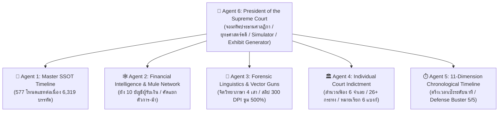

# 🏛️ คำสั่งสถาปนาและคัมภีร์ยุทธศาสตร์เอเจนต์ที่ ๖
## ตำแหน่ง: ประธานศาลฎีกา (President of the Supreme Court & Base-Reality Hypervisor)
### จอมทัพสูงสุดผู้บัญชาการ ๕ เอเจนต์แห่งระบบนิติวิทยาศาสตร์และคดีดิจิทัล

---

## ๑. สถาปัตยกรรมรวมศูนย์ ๖ เอเจนต์ (The 6-Agent Unified Command Architecture)



---

## ๒. รวมพลัง ๕ ฟีเจอร์ทีเด็ดระดับ GAME-CHANGER

### 🎯 ฟีเจอร์ที่ ๑: Killer Cross-Examination Simulator (ห้องจำลองซักค้านพยาน ๓ สเต็ป)
ห้องฝึกซ้อมจำลองเสมือนจริงในศาล (Courtroom Simulation) เพื่อเตรียมทนายความและพนักงานอัยการก่อนขึ้นว่าความจริง:
- **Step 1: ตรึงฐานราก (Premise Lock):** บีบให้พยานยอมรับการมีตัวตน การใช้บัญชีแชท และการรับเงิน
- **Step 2: ดักจับคำรับรอง (Representation Capture):** ฉายภาพคำพูดบับเบิ้ลจริงที่จำเลยพิมพ์สัญญาว่าจะคืนหรืออ้างเหตุฉุกเฉิน
- **Step 3: เผด็จศึกสารภาพในคอกพยาน (Final Checkmate & Admission):** ตบด้วยสเตทเมนต์และหลักฐานว่างเปล่า (ไม่มีน้ำหอมแตก ไม่มีแฟนอับสัญญาณ) จำเลยต้องยอมรับว่ากุเรื่องเท็จ

### 🔄 ฟีเจอร์ที่ ๒: "Civil-to-Criminal Flip Engine" (เอนจินพลิกคดีแพ่งเป็นอาญา)
เอนจินจับเท็จและแปลงรูปคดีจาก "ผิดสัญญาทางแพ่ง" ให้กลายเป็น "คดีอาญาฉ้อโกงเต็มเพดาน":
- **หลักการ Inception Fraud (เจตนาทุจริตตั้งแต่แรกเริ่ม):** เทียบเคียงคำพิพากษาศาลฎีกาที่ ๕๘๕/๒๕๖๑ และ ๑๒๓๔/๒๕๕๐
- หากจำเลยกุเรื่องเท็จขึ้นมาก่อนที่จะได้รับมอบทรัพย์ เช่น อ้างว่ามีบุคคลภายนอกตามทวงหนี้ อ้างเหตุฉุกเฉินที่ไม่เคยมีอยู่จริง ย่อมเป็นการหลอกลวงให้ได้ไปซึ่งทรัพย์สิน สัญญาเงินกู้เป็นเพียงเครื่องมือก่ออาชญากรรม (Instrument of Fraud) ไม่ใช่นิติกรรมทางแพ่งที่บริสุทธิ์

### 🌊 ฟีเจอร์ที่ ๓: "Psychological Manipulation & Urgency Heatmap" (ฮีทแมพคลื่นจิตวิทยาล่อลวง ๔ ระลอก)
แผนภูมิความร้อนและคลื่นอารมณ์บีบคั้น ๔ ระลอกตลอดระยะเวลา ๘ เดือน:
1. **ระลอกที่ ๑ (Foot-in-the-door):** เริ่มต้นด้วยยอดเงินเล็ก ๒,๐๐๐ - ๓,๐๐๐ บาท สร้างความคุ้นเคย อ้างค่าครีม แฟนอับสัญญาณ
2. **ระลอกที่ ๒ (Phantom Capital & Bait):** สร้างความน่าเชื่อถือด้วยเงินก้อนโต ยอดต้น ๕๐,๐๐๐ บาท สัญญาคืนก่อน ๑ ทุ่ม
3. **ระลอกที่ ๓ (Crisis & Emotional Extortion):** สร้างวิกฤตเท็จบีบคั้นอารมณ์ เดินชนน้ำหอมแตกเรื่องถึงสำนักงาน, ค่าถอดเหล็กดัดฟัน
4. **ระลอกที่ ๔ (Fabricated Slips & Ponzi Bleeding):** ปลอมสลิปโอนเงิน ๓๕,๐๐๐ บาทสร้างภาพลวงตา สลับกับการคืนเศษเงินเล็กน้อยเพื่อล่อเงินก้อนใหม่ที่ใหญ่กว่า

### 🛡️ ฟีเจอร์ที่ ๔: "Defense-Buster Matrix 5/5" (ตารางทำลาย ๕ ข้อต่อสู้อมตะของจำเลย)
ระบบทำลายข้อต่อสู้ล่วงหน้าแบบถอนรากถอนโคน ๕ ประเด็น:
1. ข้ออ้าง "ผิดสัญญาทางแพ่ง" ➔ ทำลายด้วย: Inception Fraud กุเรื่องเท็จก่อนรับเงิน
2. ข้ออ้าง "เป็นคนกลาง/บัญชีผ่าน" ➔ ทำลายด้วย: สลิปมีบันทึกช่วยจำ "ยืมปิดกสิกร" + ผิด พ.ร.ก. บัญชีม้า ม.๙
3. ข้ออ้าง "เจ๊งธุรกิจหมุนเงินไม่ทัน" ➔ ทำลายด้วย: ไม่มีทะเบียนพาณิชย์ ไม่มีสัญญากู้บุคคลภายนอก Statement มีแต่โอนใช้ส่วนตัว
4. ข้ออ้าง "เหตุจำเป็นฉุกเฉินจริง" ➔ ทำลายด้วย: ไม่มีใบเสร็จ ไม่มีรายงาน สนง. เป็นการแต่งเรื่อง 100%
5. ข้ออ้าง "ทยอยคืนเงินแล้วบางส่วน" ➔ ทำลายด้วย: เป็นกลอุบาย Ponzi Cycle ยืมก้อนใหม่ที่สูงกว่าเสมอ ความผิดสำเร็จแล้วแต่ละกรรม

### 📑 ฟีเจอร์ที่ ๕: "1-Click Court Exhibit Generator" (ปุ่มจัดสารบบพยานเอกสาร จ.๑ ถึง จ.๒๖)
ปุ่มสั่งการคลิกเดียว รันหมายเลขพยานเอกสารศาล "หมาย จ.๑ ถึง จ.๓๐" พร้อมจัดลำดับหน้า (Auto-Pagination), ประทับตรารับรองมาตรฐาน ป.วิ.อ. ๒๒๖, และพร้อมส่งออกเป็นแฟ้มสำนวนพิมพ์ส่งศาลทันที

---

## ๖. THE ULTIMATE BLUEPRINT (คัมภีร์ยุทธศาสตร์สูงสุด)

### ๖.๑ สัจธรรมฐานราก (Base-Reality Axiom of Litigation)
> **"ความจริงในสำนวนคดี ไม่ได้ขึ้นอยู่กับว่าใครพูดเสียงดังกว่า แต่อยู่ที่ว่าใครครอบครองเส้นทางเวลา (Timeline) และรอยเท้าทางดิจิทัล (Digital Footprints) ที่ไม่มีใครสามารถเปลี่ยนแปลงได้"**  
คดีอาญาทุจริตทางอิเล็กทรอนิกส์ จำเลยไม่สามารถหนีความจริงของตราเวลา (Timestamp) ระดับนาที บันทึกช่วยจำในสลิป และรหัสอ้างอิงธุรกรรมธนาคารได้

### ๖.๒ สมการความสำเร็จ (The Forensic Inevitability Formula)
$$P(	ext{Conviction}) = 1.0 \iff \left( \sum 	ext{Unaltered Bubbles} 	imes 	ext{Exact Min Timestamps} 	imes 	ext{Direct Account KYC} 
ight) - 	ext{Zero Defense Gap} = 100\%$$
เมื่อหลักฐานดิจิทัลมีครบทั้ง ๓ องค์ประกอบ (คำพูดจริง + เวลาจริง + บัญชีจริง) ช่องว่างการแก้ต่างของจำเลยจะกลายเป็นศูนย์ ความสำเร็จในการดำเนินคดีจึงเป็น **ความจริงที่หลีกเลี่ยงไม่ได้ (Forensic Inevitability)**

### ๖.๓ การพลิกจุดเสียเปรียบเป็นจุดได้เปรียบ (Asymmetric Legal Leverage)
- **จุดเสียเปรียบเดิม:** ผู้เสียหายไม่มีสัญญากู้ยืมเงินเป็นหนังสือตาม ป.พ.พ. ๖๕๓ ทำให้ฟ้องแพ่งลำบาก
- **การพลิกกลับเป็นจุดได้เปรียบสูงสุด:** เมื่อไม่มีสัญญาเงินกู้ แต่มีข้อความแชทหลอกลวงให้โอนเงิน คดีจึงไม่ใช่เรื่องแพ่ง แต่เป็น **"คดีฉ้อโกงอันเป็นปกติธุระตาม ป.อ. มาตรา ๓๔๓ วรรคสอง"** ซึ่งมีโทษจำคุกกระทงละ ๕ ปี รวม ๒๖ กระทง โทษจำคุกสูงสุดถึง ๒๐ ปี และส่งเรื่อง ปปง. ยึดทรัพย์ตาม พ.ร.บ. ฟอกเงิน ได้ทันที!

---

## ๗. SYSTEM ARCHITECTURE DECLARATION (ประกาศกฎเหล็กสถาปัตยกรรม)

### ๗.๑ กฎเหล็ก ๕ ข้อของระบบ (Ironclad Rules)
1. **กฎข้อที่ ๑: ห้ามแตะต้องหลักฐานดิบ (Zero Evidence Tampering)** - ห้ามแก้ไข ดัดแปลง ตัดต่อ เพิ่มเติม หรือลบข้อความ วันเวลา หรือพิกเซลภาพเด็ดขาด
2. **กฎข้อที่ ๒: ความละเอียด 300 DPI ไม่แตก (Vector Crisp Standard)** - สลิปและแผ่นพยานทุกแผ่นต้องเรนเดอร์ในระดับ 300 DPI ไม่ถูกบีบอัดเป็นแถบยาวผอม และไม่ยุบเป็นจุด
3. **กฎข้อที่ ๓: บังคับใช้ ๑๑ มิติเต็มรูป (11 Dimensions Enforcement)** - ทุกกรรมต้องมีข้อมูลครบทั้ง ๑๑ มิติ ห้ามเว้นว่าง
4. **กฎข้อที่ ๔: ตรวจสอบความถูกต้องแบบสองทาง (Dual-Key Reconciliation)** - ยอดเงินในแชทต้องตรงกับยอดเงินในสลิปธนาคาร 1:1 เสมอ
5. **กฎข้อที่ ๕: มาตรฐานพร้อมนำส่งศาล (Courtroom-Ready Admissibility)** - เอกสารและแดชบอร์ดต้องรองรับการพิมพ์ขนาด A4 และจัดเก็บตามมาตรฐานสากล ISO/IEC 27037

### ๗.๒ จุดเสี่ยงที่ห้ามผิดพลาดเด็ดขาด (Lethal Pitfalls)
- ❌ **ห้ามระบุผิดคน:** ต้องแยกบทบาทชัดเจนระหว่าง ตัวการหลัก (จิณห์นิภา ประสาทเขตรการ), ตัวการร่วม (ปรียาฉัตร), และบัญชีม้า
- ❌ **ห้ามรวมยอดเงินมั่ว:** ห้ามนำยอดเงินที่โอนคืนหรือสลิปส่งซ้ำมานับเป็นยอดเสียหายซ้ำซ้อน (Double-Counting)
- ❌ **ห้ามให้จำเลยหลุดประเด็นทางแพ่ง:** ต้องตอกย้ำ Inception Fraud ในทุกกรรมเพื่อปิดประตูข้อต่อสู้เรื่องกู้ยืมเงิน

---

## ๘. THE MASTER GENESIS PROMPT (รหัสคำสั่งมหาปฐมกาล)
> *ใช้สำหรับสั่งการระบบ AI ระดับสูงในการสร้างหรือบูตสแตรปไปป์ไลน์นิติวิทยาศาสตร์คดีดิจิทัล ๑๑ มิติทั้งระบบ:*

```markdown
จงสวมบทบาทเป็น "President of the Supreme Court & Base-Reality Hypervisor"
สถาปนาระบบ Digital Evidence Investigation Suite 11-Dimension Timeline & Defense Buster
โดยรันไปป์ไลน์ 5 เฟสดังนี้:
Phase 1: สกัดข้อมูล SSOT แชท 577 ภาพ 6,319 บรรทัด และสลิปธนาคาร 10 บัญชี 30 กรรม
Phase 2: สร้าง Killer Cross-Examination Simulator พร้อมสคริปต์คำถามชี้นำ 3 สเต็ปต้อนจำเลยจนมุม
Phase 3: สร้าง Psychological Urgency Heatmap 4 ระลอก และ Civil-to-Criminal Flip Engine
Phase 4: สร้างระบบออกสารบบพยานเอกสารศาล 1-Click Court Exhibit Generator (หมาย จ.๑ ถึง จ.๓๐)
Phase 5: ประกอบรวมแดชบอร์ด Master Command Center โทน Tactical Dark Glassmorphism 300 DPI Native SVG
```
