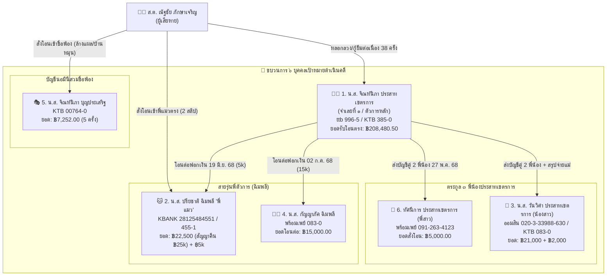

# ⚖️ แฟ้มสารบบคดีและสำนวนฟ้องร้องรายบุคคล (เรื่องที่ ๔)
> **ประเภทคดี:** คดีอาญา (ฉ้อโกงอันเป็นปกติธุระ / พระราชกำหนดการกู้ยืมเงินที่เป็นการฉ้อโกงประชาชน / พ.ร.บ.ฟอกเงิน / พ.ร.บ.คอมพิวเตอร์ / บัญชีม้า)
> **ผู้เสียหาย:** สิบตรี ณัฐชัย ภักษาเจริญ (ข้าราชการทหารบก)
> **กลุ่มบุคคลเป้าหมายดำเนินคดี:** ๖ บุคคล (ตระกูล ๓ พี่น้องประสาทเขตรการ, สายรุ่นพี่ตัวการฉิมพลี, และบัญชีนอมินีชื่อพ้อง)
> **ยอดความเสียหายสุทธิเจาะจงเป้าหมาย:** **`฿ 286,232.50 บาท`** (ตัดกลุ่มบัญชีสั่งโอนจ่ายแทน/เจ้าหนี้นอกระบบออก 100%)

---

## 📌 สารบัญแฟ้มสำนวนคดีรายบุคคล
1. [แผนผังโครงสร้างขบวนการร่วมกระทำความผิด (Criminal Enterprise Flow)](#-1-แผนผังโครงสร้างขบวนการร่วมกระทำความผิด-criminal-enterprise-flow)
2. [บุคคลเป้าหมายที่ ๑: น.ส. จิณห์นิภา ประสาทเขตรการ (จำเลยที่ ๑ / ตัวการหลัก)](#-2-บุคคลเป้าหมายที่-๑-นส-จิณห์นิภา-ประสาทเขตรการ-จำเลยที่-๑--ตัวการหลัก)
3. [บุคคลเป้าหมายที่ ๒: น.ส. ปรียชาติ ฉิมพลี 'พี่แมว' (จำเลยที่ ๒ / รุ่นพี่ตัวการร่วม)](#-3-บุคคลเป้าหมายที่-๒-นส-ปรียชาติ-ฉิมพลี-พี่แมว-จำเลยที่-๒--รุ่นพี่ตัวการร่วม)
4. [บุคคลเป้าหมายที่ ๓: นางสาว วันวิศา ประสาทเขตรการ (จำเลยที่ ๓ / น้องสาว-ฟอกเงิน)](#-4-บุคคลเป้าหมายที่-๓-นางสาว-วันวิศา-ประสาทเขตรการ-จำเลยที่-๓--น้องสาว-ฟอกเงิน)
5. [บุคคลเป้าหมายที่ ๔: นางสาว กัญญาภัค ฉิมพลี (จำเลยที่ ๔ / เครือข่ายฉิมพลี-ฟอกเงิน)](#-5-บุคคลเป้าหมายที่-๔-นางสาว-กัญญาภัค-ฉิมพลี-จำเลยที่-๔--เครือข่ายฉิมพลี-ฟอกเงิน)
6. [บุคคลเป้าหมายที่ ๕: น.ส. จิณห์นิภา บุญประเสริฐ (จำเลยที่ ๕ / บัญชีนอมินีสวมชื่อพ้อง)](#-6-บุคคลเป้าหมายที่-๕-นส-จิณห์นิภา-บุญประเสริฐ-จำเลยที่-๕--บัญชีนอมินีสวมชื่อพ้อง)
7. [บุคคลเป้าหมายที่ ๖: ทัศนีการ ประสาทเขตรการ (จำเลยที่ ๖ / พี่สาว-ร่วมรับเงิน)](#-7-บุคคลเป้าหมายที่-๖-ทัศนีการ-ประสาทเขตรการ-จำเลยที่-๖--พี่สาว-ร่วมรับเงิน)
8. [คำขอท้ายคำฟ้องและแนวทางการดำเนินคดีต่อพนักงานสอบสวน/ศาล](#-8-คำขอท้ายคำฟ้องและแนวทางการดำเนินคดีต่อพนักงานสอบสวนศาล)

---

## 🕸️ 1. แผนผังโครงสร้างขบวนการร่วมกระทำความผิด (Criminal Enterprise Flow)

---

## 🔴 2. บุคคลเป้าหมายที่ ๑: น.ส. จิณห์นิภา ประสาทเขตรการ (จำเลยที่ ๑ / ตัวการหลัก)
### 📋 ข้อมูลระบุตัวตนและบัญชี
- **ชื่อ-นามสกุล:** นางสาว จิณห์นิภา ประสาทเขตรการ
- **สถานะทางคดี:** **จำเลยที่ ๑ (ผู้กู้ / ผู้หลอกลวง / ตัวการหลักแห่งคดี)**
- **ช่วงวันเวลาเกิดเหตุ:** **มกราคม ๒๕๖๘ – กรกฎาคม ๒๕๖๘ (ตลอดระยะเวลา ๗ เดือน)**
- **บัญชีธนาคารปลายทาง:** ธนาคารทหารไทยธนชาต (ttb) เลขที่ `996-5`, ธนาคารกรุงไทย (KTB) เลขที่ `385-0`
- **ยอดเงินรับโอนตรงจากผู้เสียหาย:** **`฿ 208,480.50 บาท` (จำนวน ๓๘ รายการ)**
- **ยอดเงินสั่งโอนไปยังเครือข่าย:** **`฿ 77,752.00 บาท`** (ส่งต่อเข้า ปรียชาติ, กัญญาภัค, วันวิศา, ทัศนีการ, และ บุญประเสริฐ)
- **ยอดความเสียหายรวมในความรับผิดชอบ:** **`฿ 286,232.50 บาท`**

### ⚖️ ข้อหาความผิดและฐานกฎหมาย
1. **ความผิดฐานฉ้อโกงอันเป็นปกติธุระ** ตามประมวลกฎหมายอาญา มาตรา ๓๔๑, ๓๔๒ (๑) (๒) และ ๓๔๓ ประกอบมาตรา ๘๓ (ต้องระวางโทษจำคุกไม่เกิน ๕ ปี หรือปรับไม่เกิน ๑๐๐,๐๐๐ บาท หรือทั้งจำทั้งปรับ)
2. **ความผิดตามพระราชกำหนดการกู้ยืมเงินที่เป็นการฉ้อโกงประชาชน พ.ศ. ๒๕๒๗** มาตรา ๔, ๕, ๑๒ (ต้องระวางโทษจำคุกตั้งแต่ ๕ ปี ถึง ๑๐ ปี และปรับตั้งแต่ ๕๐๐,๐๐๐ บาท ถึง ๑,๐๐๐,๐๐๐ บาท)
3. **ความผิดตาม พ.ร.บ. ว่าด้วยการกระทำความผิดเกี่ยวกับคอมพิวเตอร์ พ.ศ. ๒๕๕๐ และแก้ไขเพิ่มเติม (ฉบับที่ ๒) พ.ศ. ๒๕๖๐** มาตรา ๑๔ (๑) นำเข้าสู่ระบบคอมพิวเตอร์ซึ่งข้อมูลคอมพิวเตอร์ปลอมหรือเท็จ
4. **ความผิดฐานฟอกเงิน** ตาม พ.ร.บ. ป้องกันและปราบปรามการฟอกเงิน พ.ศ. ๒๕๔๒ มาตรา ๓ (๓), ๕, ๙, ๖๐

### 💬 บริบทแชทมัดตัว (Smoking Dialogue Context)
- **[ช่วงเริ่ม ม.ค. 68]** *"@ เค้าสั่งครีมไปไง เงินมันขาด2000... 3,000 บาท ต้น 50000"* (เปิดฉากกลอุบายสต็อกสินค้า)
- **[15 ก.พ. 68]** *"เมื่อเช้าพี่แมวทักมา ถามหาว่าตัว ปล่อยเงินไหม... จะไปหาไหนให้พี่แมวทัน โทรมาร้องไห้ อีกละ คงเครียด"* (สร้างตัวละครพี่แมวกดดัน)
- **[04 เม.ย. 68]** *"กู้กรุงไทย 21000+15000... เงินน่าจะได้วันนี้ จัดการภาระเค้าก่อน เค้าจะโอนเงินให้"* (หลอกลวงว่ากู้เงินผ่านแล้ว)
- **[27 พ.ค. 68]** ส่งข้อความสั่งโอนเงินเข้าบัญชีพี่สาวและน้องสาว 26,000 บาท ในคราวเดียวกัน

---

## 🐱 3. บุคคลเป้าหมายที่ ๒: น.ส. ปรียชาติ ฉิมพลี 'พี่แมว' (จำเลยที่ ๒ / รุ่นพี่ตัวการร่วม)
### 📋 ข้อมูลระบุตัวตนและบัญชี
- **ชื่อ-นามสกุล:** นางสาว ปรียชาติ ฉิมพลี (หรือ ปรียชาติ จฉิมพลี, นามเรียกขานในแชท: **"พี่แมว"**)
- **สถานะทางคดี:** **จำเลยที่ ๒ (ตัวการร่วมเบื้องหลัง / ผู้สั่งการ / ผู้รับเงินกู้และให้ผลประโยชน์เกินอัตรา)**
- **ช่วงวันเวลาเกิดเหตุ:** **๑๕ กุมภาพันธ์ ๒๕๖๘ – ๑๙ มิถุนายน ๒๕๖๘**
- **บัญชีธนาคารปลายทาง:** ธนาคารกสิกรไทย (KBANK) เลขที่ `28125484551` (แชทตรง) และ `XXX-X-XX455-1` (บนสลิป)
- **ยอดเงินเกี่ยวข้องโดยตรง:** **`฿ 27,500.00 บาท`** (รับโอนตรง ฿22,500.00 + โอนส่งต่อจากจิณห์นิภา ฿5,000.00)
  - สลิปโอน 9,000 บาท (สัญญาคืน 10,000 บาท ข้ามวัน)
  - สลิปโอน 13,500 บาท (สัญญาคืน 15,000 บาท ข้ามวัน)
  - สลิปโอนต่อ 5,000 บาท จากบัญชี ttb จิณห์นิภา

### ⚖️ ข้อหาความผิดและฐานกฎหมาย
1. **ร่วมกันฉ้อโกงประชาชน และตัวการร่วมในการกู้ยืมเงินที่เป็นการฉ้อโกงประชาชน** (ป.อ. ม. ๓๔๑, ๓๔๓, ๘๓ / พ.ร.ก. กู้ยืมเงินฯ ม. ๔, ๕)
2. **ความผิดตาม พ.ร.บ. ห้ามเรียกดอกเบี้ยเกินอัตรา พ.ศ. ๒๕๖๐** มาตรา ๔ (เรียกดอกเบี้ยเกินกว่าร้อยละ ๑๕ ต่อปี ในลักษณะสัญญาผลตอบแทน 1,000-1,500 บ. ภายใน 24 ชม.)
3. **ความผิดฐานฟอกเงิน** ตาม พ.ร.บ. ป้องกันและปราบปรามการฟอกเงิน พ.ศ. ๒๕๔๒ มาตรา ๕, ๙

### 📸 พยานหลักฐานภาพชัดเจน (Smoking Gun Evidence)
#### 1. แชทตรงกับห้อง `< พี่แมว` ส่งเลขบัญชีรับเงิน (๒๖ พ.ค. ๒๕๖๘)

> 🔗 ลิงก์ไฟล์หลักฐาน: [EVIDENCE_4_PREEYACHAT_DIRECT_CHAT_ACCOUNT.png](file:///C:/Users/EVE/.gemini/antigravity/brain/c8211d09-030e-4b24-8837-3ce9589aa4a6/EVIDENCE_4_PREEYACHAT_DIRECT_CHAT_ACCOUNT.png)
> **ถอดรหัสแชท:** พี่แมวพิมพ์ว่า *"เงินน่าจะได้วันนี้ จัดการภาระเค้าก่อน เค้าจะโอนเงินให้"* พร้อมส่งเลขบัญชี **`28125484551 กสิกร ปรียชาติ ฉิมพลี`**

#### 2. สลิปโอนเงิน ๙,๐๐๐ บาท สัญญาคืน ๑๐,๐๐๐ บาท (๐๒ มิ.ย. ๒๕๖๘)

> 🔗 ลิงก์ไฟล์หลักฐาน: [EVIDENCE_2_PREEYACHAT_CHIMPLEE_SLIP_9000.png](file:///C:/Users/EVE/.gemini/antigravity/brain/c8211d09-030e-4b24-8837-3ce9589aa4a6/EVIDENCE_2_PREEYACHAT_CHIMPLEE_SLIP_9000.png)
> **บันทึกช่วยจำ (Memo):** **`"คืน 10000 วันที่ 3 มิ.ย."`** เข้าบัญชี น.ส. ปรียชาติ จฉิมพลี กสิกร 455-1

#### 3. สลิปโอนเงิน ๑๓,๕๐๐ บาท สัญญาคืน ๑๕,๐๐๐ บาท (๐๘ มิ.ย. ๒๕๖๘)

> 🔗 ลิงก์ไฟล์หลักฐาน: [EVIDENCE_3_PREEYACHAT_CHIMPLEE_SLIP_13500.jpg](file:///C:/Users/EVE/.gemini/antigravity/brain/c8211d09-030e-4b24-8837-3ce9589aa4a6/EVIDENCE_3_PREEYACHAT_CHIMPLEE_SLIP_13500.jpg)
> **บันทึกช่วยจำ (Memo):** **`"คืน 9/6 ยอด 15000"`** เข้าบัญชี น.ส. ปรียชาติ ฉิมพลี กสิกร 455-1

---

## 👧 4. บุคคลเป้าหมายที่ ๓: นางสาว วันวิศา ประสาทเขตรการ (จำเลยที่ ๓ / น้องสาว-ฟอกเงิน)
### 📋 ข้อมูลระบุตัวตนและบัญชี
- **ชื่อ-นามสกุล:** นางสาว วันวิศา ประสาทเขตรการ
- **สถานะทางคดี:** **จำเลยที่ ๓ (น้องสาวร่วมสายเลือด / ผู้รับโอนเงินกระจายทรัพย์สิน / บัญชีม้าเครือญาติ)**
- **ช่วงวันเวลาเกิดเหตุ:** **๐๘ กุมภาพันธ์ ๒๕๖๘ – ๒๗ พฤษภาคม ๒๕๖๘**
- **บัญชีธนาคารปลายทาง:** ธนาคารออมสิน เลขที่ `020-3-33988-630` และ ธนาคารกรุงไทย เลขที่ `083-0`
- **ยอดเงินเกี่ยวข้องโดยตรง:** **`฿ 23,000.00 บาท`**
  - คำสั่งโอนเข้าออมสิน 21,000.00 บาท (27 พ.ค. 68)
  - สลิปโอนเข้ากรุงไทย 2,000.00 บาท (08 ก.พ. / 06 พ.ค. 68)

### ⚖️ ข้อหาความผิดและฐานกฎหมาย
1. **ร่วมกันฉ้อโกง หรือสนับสนุนการกระทำความผิดฐานฉ้อโกง** (ป.อ. ม. ๓๔๑, ๘๓ หรือ ๘๖)
2. **ความผิดตาม พ.ร.ก. มาตรการป้องกันและปราบปรามอาชญากรรมทางเทคโนโลยี พ.ศ. ๒๕๖๖** มาตรา ๙ (ยินยอมให้ผู้อื่นใช้บัญชีเงินฝากหรือพร้อมเพย์ของตน โดยมิได้มีเจตนาใช้เพื่อตน หรือเพื่อกิจการที่ตนเกี่ยวข้อง โทษจำคุกไม่เกิน ๓ ปี หรือปรับไม่เกิน ๓๐๐,๐๐๐ บาท หรือทั้งจำทั้งปรับ)
3. **ความผิดฐานฟอกเงิน** ตาม พ.ร.บ. ป้องกันและปราบปรามการฟอกเงิน พ.ศ. ๒๕๔๒ มาตรา ๕, ๙

### 📸 พยานหลักฐานภาพชัดเจน (Smoking Gun Evidence)
#### 1. คำสั่งโอนเงินเข้าบัญชีออมสิน วันวิศา ๒๑,๐๐๐ บาท พร้อมพี่สาว (๒๗ พ.ค. ๒๕๖๘)

> 🔗 ลิงก์ไฟล์หลักฐาน: [EVIDENCE_1_PRASATKHETKARN_SISTERS_ACCOUNTS.png](file:///C:/Users/EVE/.gemini/antigravity/brain/c8211d09-030e-4b24-8837-3ce9589aa4a6/EVIDENCE_1_PRASATKHETKARN_SISTERS_ACCOUNTS.png)
> **ถอดรหัสแชท:** จิณห์นิภา ส่งข้อความ: *"วันวิศา ประสาทเขตรการ ธนาคารออมสิน 020-3-33988-630 ยอด 21,000 บาท"*

#### 2. สลิปโอนเงินเข้า วันวิศา ๒,๐๐๐ บาท แชทระบุ "สรุปจ่ายแม่" (๐๘ ก.พ. ๒๕๖๘)

> 🔗 ลิงก์ไฟล์หลักฐาน: [EVIDENCE_7_WANWISA_PAY_MOM_SLIP.jpg](file:///C:/Users/EVE/.gemini/antigravity/brain/c8211d09-030e-4b24-8837-3ce9589aa4a6/EVIDENCE_7_WANWISA_PAY_MOM_SLIP.jpg)
> **ถอดรหัสแชท:** โอนสำเร็จ 2,000 บาท ไปยัง น.ส. วันวิศา ประสาทเขตรการ บันทึก/แชทระบุ: **`"2004 สรุปจ่ายแม่"`** พิสูจน์การผันเงินเข้าสู่ผลประโยชน์ครอบครัวชัดเจน

---

## 👩‍💼 5. บุคคลเป้าหมายที่ ๔: นางสาว กัญญาภัค ฉิมพลี (จำเลยที่ ๔ / เครือข่ายฉิมพลี-ฟอกเงิน)
### 📋 ข้อมูลระบุตัวตนและบัญชี
- **ชื่อ-นามสกุล:** นางสาว กัญญาภัค ฉิมพลี
- **สถานะทางคดี:** **จำเลยที่ ๔ (เครือข่ายสายสกุลฉิมพลี / ผู้รับโอนเงินฟอกทรัพย์สิน)**
- **ช่วงวันเวลาเกิดเหตุ:** **๐๒ กรกฎาคม ๒๕๖๘**
- **บัญชีธนาคารปลายทาง:** พร้อมเพย์ เลขที่ `083-0` / `XXXXXXXX2926`
- **ยอดเงินเกี่ยวข้องโดยตรง:** **`฿ 15,000.00 บาท`** (รับโอนต่อก้อนใหญ่จากบัญชี ttb ของ น.ส. จิณห์นิภา ประสาทเขตรการ เมื่อ 02 ก.ค. 68 เวลา 21:04 น.)

### ⚖️ ข้อหาความผิดและฐานกฎหมาย
1. **ความผิดฐานฟอกเงิน** ตาม พ.ร.บ. ป้องกันและปราบปรามการฟอกเงิน พ.ศ. ๒๕๔๒ มาตรา ๓, ๕, ๙, ๖๐ (โอน รับโอน หรือเปลี่ยนสภาพทรัพย์สินที่เกี่ยวกับการกระทำความผิด)
2. **ร่วมกันฉ้อโกง หรือสนับสนุนการฉ้อโกง หรือรับของโจร** ตาม ป.อ. มาตรา ๓๔๑, ๓๕๗, ๘๓, ๘๖

---

## 🎭 6. บุคคลเป้าหมายที่ ๕: น.ส. จิณห์นิภา บุญประเสริฐ (จำเลยที่ ๕ / บัญชีนอมินีสวมชื่อพ้อง)
### 📋 ข้อมูลระบุตัวตนและบัญชี
- **ชื่อ-นามสกุล:** นางสาว จิณห์นิภา บุญประเสริฐ
- **สถานะทางคดี:** **จำเลยที่ ๕ (บัญชีนอมินีสวมรอยชื่อพ้อง / รับโอนเงินอำพรางสายตาผู้เสียหาย)**
- **ช่วงวันเวลาเกิดเหตุ:** **๑๕ กุมภาพันธ์ ๒๕๖๘ – ๑๘ มีนาคม ๒๕๖๘**
- **บัญชีธนาคารปลายทาง:** ธนาคารกรุงไทย (KTB) เลขที่ `XXX-X-XX764-0` / `00764-0`
- **ยอดเงินเกี่ยวข้องโดยตรง:** **`฿ 7,252.00 บาท` (โอนรวม ๕ ครั้ง)**
  - 15 ก.พ. 68: โอน 100 บาท (ทดสอบบัญชี)
  - 13 มี.ค. 68: โอน 1,500 บาท (ข้ออ้างล้างแผล)
  - 18 มี.ค. 68: โอน 3,000 บาท และยอดอื่น รวม 7,252 บาท

### ⚖️ ข้อหาความผิดและฐานกฎหมาย
1. **ร่วมกันฉ้อโกงโดยแสดงตนเป็นคนอื่น หรือสนับสนุนการฉ้อโกง** (ป.อ. ม. ๓๔๒ (๑), ๘๓, ๘๖)
2. **ความผิดตาม พ.ร.ก. มาตรการป้องกันและปราบปรามอาชญากรรมทางเทคโนโลยี พ.ศ. ๒๕๖๖** มาตรา ๙ (บัญชีม้า)
3. **ความผิดฐานฟอกเงิน** ตาม พ.ร.บ. ป้องกันและปราบปรามการฟอกเงิน พ.ศ. ๒๕๔๒ มาตรา ๕, ๙

### 📸 พยานหลักฐานภาพชัดเจน (Smoking Gun Evidence)
#### 1. สลิปโอน ๑,๕๐๐ บาท แชทอ้าง "ไปรับมาล้างแผล กลัวติดเชื้อ" (๑๓ มี.ค. ๒๕๖๘)

> 🔗 ลิงก์ไฟล์หลักฐาน: [EVIDENCE_5_BOONPRASERT_WOUND_SLIP.jpg](file:///C:/Users/EVE/.gemini/antigravity/brain/c8211d09-030e-4b24-8837-3ce9589aa4a6/EVIDENCE_5_BOONPRASERT_WOUND_SLIP.jpg)
> **ถอดรหัสแชท:** จิณห์นิภา พิมพ์: *"ไปรับมาล้างแผล ต้องไป... มันจะติดเชื้อเอานะ"* โอน 1,500 บาท เข้า น.ส. จิณห์นิภา บุญประเสริฐ กรุงไทย 764-0

#### 2. สลิปโอนเงิน แชทอ้าง "บ้านหมุน ไปทำงานไม่ไหว ไปหาหมอ" (๑๘ มี.ค. ๒๕๖๘)

> 🔗 ลิงก์ไฟล์หลักฐาน: [EVIDENCE_6_BOONPRASERT_DIZZY_SLIP.jpg](file:///C:/Users/EVE/.gemini/antigravity/brain/c8211d09-030e-4b24-8837-3ce9589aa4a6/EVIDENCE_6_BOONPRASERT_DIZZY_SLIP.jpg)
> **ถอดรหัสแชท:** *"ไปทำงานไม่ไหว ลุกไม่ได้บ้านหมุน เย็นๆ ไปหาหมอเค้าโอนให้นะ"* โอนเข้า น.ส. จิณห์นิภา บุญประเสริฐ กรุงไทย 764-0

---

## 👩 7. บุคคลเป้าหมายที่ ๖: ทัศนีการ ประสาทเขตรการ (จำเลยที่ ๖ / พี่สาว-ร่วมรับเงิน)
### 📋 ข้อมูลระบุตัวตนและบัญชี
- **ชื่อ-นามสกุล:** ทัศนีการ ประสาทเขตรการ
- **สถานะทางคดี:** **จำเลยที่ ๖ (พี่สาวร่วมสายเลือด / ผู้ร่วมรับโอนเงิน / บัญชีม้าเครือญาติ)**
- **ช่วงวันเวลาเกิดเหตุ:** **๒๗ พฤษภาคม ๒๕๖๘**
- **บัญชีธนาคารปลายทาง:** พร้อมเพย์ (PromptPay) หมายเลข `091-263-4123`
- **ยอดเงินเกี่ยวข้องโดยตรง:** **`฿ 5,000.00 บาท`** (สั่งโอนคู่กับน้องสาววันวิศา รวม 26,000 บาท)

### ⚖️ ข้อหาความผิดและฐานกฎหมาย
1. **ร่วมกันฉ้อโกง หรือสนับสนุนการกระทำความผิดฐานฉ้อโกง** (ป.อ. ม. ๓๔๑, ๘๓ หรือ ๘๖)
2. **ความผิดตาม พ.ร.ก. มาตรการป้องกันและปราบปรามอาชญากรรมทางเทคโนโลยี พ.ศ. ๒๕๖๖** มาตรา ๙ (บัญชีม้า / ยินยอมให้ใช้พร้อมเพย์)
3. **ความผิดฐานฟอกเงิน** ตาม พ.ร.บ. ป้องกันและปราบปรามการฟอกเงิน พ.ศ. ๒๕๔๒ มาตรา ๕, ๙

### 📸 พยานหลักฐานภาพชัดเจน (Smoking Gun Evidence)

> 🔗 ลิงก์ไฟล์หลักฐาน: [EVIDENCE_1_PRASATKHETKARN_SISTERS_ACCOUNTS.png](file:///C:/Users/EVE/.gemini/antigravity/brain/c8211d09-030e-4b24-8837-3ce9589aa4a6/EVIDENCE_1_PRASATKHETKARN_SISTERS_ACCOUNTS.png)
> **ถอดรหัสแชท:** จิณห์นิภา ส่งข้อความ: *"ทัศนีการ ประสาทเขตรการ พร้อมเพย์ 091-263-4123 ยอด 5,000 บาท"* เคียงข้าง วันวิศา 21,000 บาท

---

## ⚖️ 8. คำขอท้ายคำฟ้องและแนวทางการดำเนินคดีต่อพนักงานสอบสวน/ศาล
เพื่อให้การดำเนินคดีและการติดตามทรัพย์สินคืนให้แก่ผู้เสียหายสัมฤทธิผลโดยเร็ว ขอเสนอแนวทางดำเนินการดังนี้:

### 📌 1. การร้องทุกข์ดำเนินคดีอาญา (Criminal Complaint Formulation)
- ร้องทุกข์ดำเนินคดีต่อพนักงานสอบสวน กองบังคับการปราบปรามการกระทำความผิดเกี่ยวกับอาชญากรรมทางเศรษฐกิจ (บก.ปอศ.) หรือ กองบัญชาการตำรวจสืบสวนสอบสวนอาชญากรรมทางเทคโนโลยี (บช.สอท. / สอท.)
- แจ้งข้อกล่าวหาเรียงตัวบุคคลทั้ง ๖ ราย ตามฐานความผิดที่ระบุข้างต้น ในลักษณะ **"ร่วมกันกระทำความผิดเป็นขบวนการ (Criminal Syndicate)"** โดยแบ่งหน้าที่กันทำตาม ป.อ. มาตรา ๘๓

### 📌 2. การขอออกหมายเรียกพยานเอกสารและข้อมูลเดินบัญชี (Subpoena & Bank Inquiries)
ขอให้พนักงานสอบสวนมีหนังสือขอตรวจสอบรายการเดินบัญชีอย่างละเอียด (Full Bank Statements & KYC Logs) ดังนี้:
1. **ธนาคารกสิกรไทย:** ตรวจสอบบัญชี `28125484551` / `XXX-X-XX455-1` ของ น.ส. ปรียชาติ ฉิมพลี เพื่อดูรายการเงินเข้า-ออก และการโอนต่อไปยังบุคคลภายนอก
2. **ธนาคารออมสิน:** ตรวจสอบบัญชี `020-3-33988-630` ของ น.ส. วันวิศา ประสาทเขตรการ
3. **ธนาคารกรุงไทย:** ตรวจสอบบัญชี `00764-0` ของ น.ส. จิณห์นิภา บุญประเสริฐ และ `083-0` ของวันวิศา
4. **ธนาคารทหารไทยธนชาต (ttb):** ตรวจสอบบัญชี `996-5` ของ น.ส. จิณห์นิภา ประสาทเขตรการ เพื่อยืนยันเส้นทางการโอนต่อ 5,000 บ. เข้า ปรียชาติ และ 15,000 บ. เข้า กัญญาภัค ฉิมพลี

### 📌 3. การอายัดบัญชีธนาคารและการประสาน ปปง. (Asset Freezing & AMLC Action)
- อาศัยอำนาจตาม พ.ร.ก. มาตรการป้องกันและปราบปรามอาชญากรรมทางเทคโนโลยี พ.ศ. ๒๕๖๖ ขอให้อายัดบัญชีเงินฝากและพร้อมเพย์ของบุคคลทั้ง ๖ รายทันที
- ส่งเรื่องให้สำนักงานป้องกันและปราบปรามการฟอกเงิน (ปปง.) ดำเนินการยึดและอายัดทรัพย์สินตาม พ.ร.บ. ป้องกันและปราบปรามการฟอกเงิน พ.ศ. ๒๕๔๒ เพื่อนำทรัพย์สินมาคุ้มครองสิทธิของผู้เสียหายตามกฎหมาย
