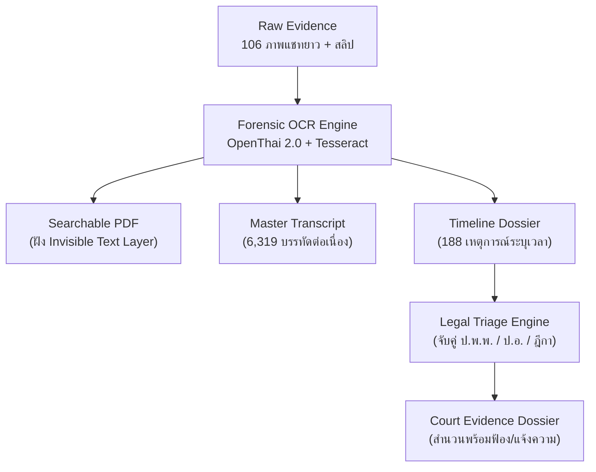

# 🧠 MASTER KNOWLEDGE BASE: DIGITAL FORENSICS, AI OCR & LEGAL TRIAGE
> **บันทึกองค์ความรู้ฉบับสมบูรณ์ (Master Knowledge Documentation)**  
> **โครงการ:** สารบบพยานหลักฐานดิจิทัลและการฟ้องคดีแชทออนไลน์ (ชวกม.2)  
> **ผู้จัดทำ:** THE ROOT-ACCESS ARCHITECT  
> **เวอร์ชัน:** 1.0.0 (Production & Court-Grade Reference)

---

## 📑 สารบัญเนื้อหา (Table of Contents)
1. [บทนำและภาพรวมของระบบ (System Overview)](#1-บทนำและภาพรวมของระบบ)
2. [สถาปัตยกรรมการตรวจพิสูจน์ไฟล์และคลังพยานหลักฐาน (Forensic File Audit)](#2-สถาปัตยกรรมการตรวจพิสูจน์ไฟล์และคลังพยานหลักฐาน)
3. [เทคโนโลยี OCR & เอกสารค้นหาได้ (OpenThai 2.0 & Searchable PDF Engine)](#3-เทคโนโลยี-ocr--เอกสารค้นหาได้)
4. [การประติดประต่อไทม์ไลน์นาทีต่อนาที (Chronological Timeline Reconstruction)](#4-การประติดประต่อไทม์ไลน์นาทีต่อนาที)
5. [ความจริงของระบบ LINE เมื่อลบเพื่อนหรือเปลี่ยนเครื่อง (LINE Forensic Anatomy)](#5-ความจริงของระบบ-line-เมื่อลบเพื่อนหรือเปลี่ยนเครื่อง)
6. [คู่มือปฏิบัติการจริง: การยื่นเรื่องต่อพนักงานสอบสวนและศาล (Action Blueprint)](#6-คู่มือปฏิบัติการจริง)
7. [ระบบชี้เป้าข้อกฎหมายแพ่งและอาญา (Legal Triage Engine & Statutory Reference)](#7-ระบบชี้เป้าข้อกฎหมายแพ่งและอาญา)
8. [ดัชนีไฟล์ระบบและเครื่องมือพร้อมใช้ (System Manifest & CLI Tools)](#8-ดัชนีไฟล์ระบบและเครื่องมือพร้อมใช้)

---

## 1. บทนำและภาพรวมของระบบ

เอกสารนี้รวบรวมองค์ความรู้ทั้งหมดที่เกิดขึ้นจากการสกัด ตรวจพิสูจน์ แปลงรหัส และจัดทำสำนวนพยานหลักฐานทางดิจิทัลจากภาพแคปหน้าจอแอปพลิเคชัน LINE และสลิปการโอนเงินธนาคาร เพื่อใช้ในการดำเนินคดีอาญา (ฉ้อโกง) และคดีแพ่ง (กู้ยืมเงิน/เรียกทรัพย์คืน) ตามมาตรฐานศาลยุติธรรมแห่งราชอาณาจักรไทย



---

## 2. สถาปัตยกรรมการตรวจพิสูจน์ไฟล์และคลังพยานหลักฐาน

### 2.1 การตรวจสอบความซ้ำซ้อนระดับไบนารี (MD5 Hash Deduplication)
* **โฟลเดอร์ต้นทาง:** `C:\Users\EVE\Downloads\ของมันคนเดียว-20261117T094313Z-1-003\ของมันคนเดียว`
* **ปริมาณข้อมูล:** 1,519 ไฟล์ รวมขนาด 1.96 GB
* **ผลการตรวจสอบแฮช:**
  - ไฟล์ Unique (เนื้อหาไม่ซ้ำกัน): **997 ไฟล์**
  - กลุ่มไฟล์ซ้ำซ้อน (Duplicate Groups): **355 กลุ่ม** (มีไฟล์ซ้ำ 522 ไฟล์)
  - ข้อมูลในโฟลเดอร์ `Duplicates` เป็นเพียงสำเนาซ้ำของไฟล์ในโฟลเดอร์หลัก ไม่สูญเสียข้อมูลสำคัญ

### 2.2 โครงสร้างโฟลเดอร์พยานหลักฐาน
* `แคปหน้า Ori/`: รวมภาพแคปหน้าจอแชทความละเอียดสูงต้นฉบับ 106 ภาพ (เช่น ขนาด 644 x 6,200 พิกเซล)
* `สนทนาแนบสลิป/`: รวมหน้าแชทที่มีการส่งสลิปหลักฐานการโอนเงินของธนาคาร
* `แชทA4/`: ภาพที่ถูกจัดหน้าสำหรับพิมพ์ลงกระดาษ A4

---

## 3. เทคโนโลยี OCR & เอกสารค้นหาได้

### 3.1 OpenThai 2.0 OCR Markdown (`iapp/OpenThai2.0-OCR-Markdown`)
* **โครงสร้างโมเดล:** โมเดล Vision-Language ขนาด 2.52 GB พัฒนาบนพื้นฐาน `nvidia/nemotron` รองรับการแปลงภาพเอกสารภาษาไทย ตาราง และมาร์กดาวน์
* **ตำแหน่งติดตั้งในเครื่อง:** `D:\Models\OpenThai2.0-OCR-Markdown`
* **การปรับจูนฮาร์ดแวร์:** เนื่องจาก GPU ของเครื่องเป็น NVIDIA GeForce GTX 1050 (VRAM 2GB) ไม่เพียงพอสำหรับโมเดล 2.5GB ระบบจึงคอนฟิกให้รันบน CPU (`torch.float32`) ใช้เวลาประมวลผลประมาณ 30-40 วินาทีต่อหน้ากระดาษ A4

### 3.2 สถาปัตยกรรม High-Speed Hybrid OCR (Tesseract + OpenThai)
* สำหรับการค้นหาและสกัดข้อความความเร็วสูง ได้ใช้ **Tesseract OCR v5.5** ควบคู่กับฐานข้อมูลฟอนต์ภาษาไทย `D:\Models\tessdata\tha.traineddata`
* รันแบบ Multi-threading 8 คอร์พร้อมกัน สามารถสแกนและดึงข้อความจากภาพแชทยาว 106 ภาพเสร็จสิ้นภายใน **55 วินาที**

### 3.3 การสร้าง Searchable PDF (Invisible Text Layer)
Searchable PDF คือเทคโนโลยีที่ทำให้ไฟล์ PDF สแกนหรือรูปภาพ สามารถกด `Ctrl + F` เพื่อค้นหาคำ และสามารถลากคลุมเพื่อ Copy ตัวอักษรภาษาไทยได้ โดยที่ภาพภายนอกยังคงสภาพเดิม 100%

* **หลักการทำงาน:**
  1. โหลดภาพสแกนความละเอียดสูงขึ้นมาเป็นพื้นหลัง
  2. สกัดพิกัดกล่องข้อความ (Bounding Box `x, y, w, h`) และตัวอักษรภาษาไทย
  3. ฝังตัวอักษรภาษาไทยลงไปในพิกัดเดียวกันด้วย `render_mode = 3` (Invisible Text)
  4. ฝังแบบอักษร TrueType ของระบบ Windows: `C:\Windows\Fonts\tahoma.ttf` เพื่อให้โปรแกรม Adobe Acrobat, Microsoft Edge, Google Chrome เข้ารหัสภาษาไทยได้ถูกต้อง 100%
* **ไฟล์ที่สร้างเสร็จแล้ว:** `d:\Project\ชวกม.2\FINAL_EVIDENCE_JINNIPHA_Searchable.pdf`

---

## 4. การประติดประต่อไทม์ไลน์นาทีต่อนาที

### 4.1 ค้นหาพยานวัตถุสำคัญ: "น้ำหอมแตก"
* **ข้อความเป้าหมาย:** *"ตัว ตัวถามกู้เงินให้เค้า 2000 สิ เดี๋ยวเลิกงานเค้าโอนให้เลยอันนี้ เดินชนน้ำหอมแตก จะมาจ่ายร้าน ครึ่งราคา..."*
* **เวลาที่เกิดขึ้น:** `16:04 น.` ต่อเนื่องจนถึง `16:20 น.`
* **ไฟล์ต้นฉบับ:** `LINE_capture_800253185.789705.jpg` ในโฟลเดอร์ `แคปหน้า Ori`

### 4.2 การร้อยเรียง Master Transcript & Dossier
* **Master Transcript ([MASTER_TRANSCRIPT_CHRONOLOGICAL.md](file:///d:/Project/ชวกม.2/MASTER_TRANSCRIPT_CHRONOLOGICAL.md)):** รวมเนื้อหาแชททั้งหมด 6,319 บรรทัด เรียงลำดับตั้งแต่วันแรกจนถึงวันสุดท้าย โดยตัดข้อความที่ซ้อนทับกันระหว่างรอยต่อของภาพแคปหน้าจอออกอัตโนมัติ
* **Court Timeline Dossier ([COURT_TIMELINE_DOSSIER.md](file:///d:/Project/ชวกม.2/COURT_TIMELINE_DOSSIER.md)):** ตารางสรุป 188 เหตุการณ์ แยกตาม วัน, เวลา, ผู้พูด, ข้ออ้างขอยืมเงิน, ยอดเงิน, และชื่อไฟล์ภาพอ้างอิง

---

## 5. ความจริงของระบบ LINE เมื่อลบเพื่อนหรือเปลี่ยนเครื่อง

### 5.1 โครงสร้างฐานข้อมูลภายในเครื่อง (Local SQLite Anatomy)
LINE PC บันทึกข้อมูลลงในฐานข้อมูล SQLite ที่โฟลเดอร์:  
`C:\Users\EVE\AppData\Local\LINE\Data\db\`  
โดยเฉพาะไฟล์ `qw4640eee40f83e9e48e39a16a1e1488.edb` (ขนาด 55.8 MB) และไฟล์ Write-Ahead Log (`.edb-wal` ขนาด 5.2 MB)

1. **การลบเพื่อน (Delete Friend):** ตัดเฉพาะความสัมพันธ์คู่สนทนา ไม่ได้ลบข้อความในเครื่อง
2. **การลบห้องแชท (Delete Chat):** SQLite ทำเครื่องหมายว่าเป็น `Free Page` ข้อความเดิมยังค้างอยู่ในฐานข้อมูลจนกว่าจะถูกคำสั่ง `VACUUM` หรือมีข้อมูลใหม่มาเขียนทับ
3. **การเข้ารหัส:** ไฟล์ `.edb` เข้ารหัสด้วย SQLCipher (AES-256) ผูกกับ Machine Key ของเครื่อง

### 5.2 ทำไมภาพแคปหน้าจอ 106 ภาพจึงมีน้ำหนักเหนือกว่าฐานข้อมูล?
* **ประจักษ์พยานด้วยตา (Primary Visual Evidence):** ศาลและพนักงานสอบสวนต้องการเห็นภาพโปรไฟล์, กรอบแชทสีเขียว/ขาว, สติกเกอร์, และเวลาที่ปรากฏชัดเจน มากกว่าข้อมูลแถวตัวหนังสือในตารางฐานข้อมูล
* **กาลเวลา 1 ปีทำลายภาพไม่ได้:** ภาพแคปหน้าจอคือ **Frozen State** ที่เก็บรักษาข้อมูลระดับพิกเซลไว้สมบูรณ์ตั้งแต่วันเกิดเหตุ
* **ตัวล็อกตายตัว (Unhackable Anchor):** สลิปโอนเงินของธนาคารมีรหัสอ้างอิงธุรกรรม (Transaction ID) ซึ่งธนาคารแห่งประเทศไทยกำหนดให้ธนาคารทุกแห่งเก็บข้อมูลย้อนหลัง 5-10 ปี ทำให้เชื่อมโยงกับแชทได้ 100%

---

## 6. คู่มือปฏิบัติการจริง

### 6.1 เอกสารที่ต้องเตรียมใส่แฟ้ม (1 เล่ม มี 4 ส่วน)
1. **หน้าปกและสรุปยอดความเสียหาย:** สรุปชื่อคู่กรณี, ยอดรวมเงินที่โอนทั้งหมด, ช่วงวันเวลาที่เกิดเหตุ
2. **ตารางไทม์ไลน์นาทีต่อนาที:** พิมพ์จาก `COURT_TIMELINE_DOSSIER.md`
3. **ภาพแชทคู่สลิปโอนเงิน:** พิมพ์จาก `FINAL_EVIDENCE_JINNIPHA_Searchable.pdf`
4. **Bank Statement ของตนเอง:** สเตทเมนต์ย้อนหลังช่วงเกิดเหตุ ขอจากแอปธนาคาร (กสิกร, กรุงไทย ฯลฯ) เพื่อยืนยันว่าเงินออกจากบัญชีจริง

### 6.2 สองเส้นทางในการดำเนินการ
* **เส้นทางอาญา (สถานีตำรวจท้องที่):**
  - แจ้งข้อหา: **ฉ้อโกง (ป.อ. มาตรา 341)**
  - คำพูด: *"มาแจ้งความดำเนินคดีข้อหาฉ้อโกง คู่กรณีหลอกลวงด้วยข้อความเท็จให้โอนเงินแล้วขาดการติดต่อ มีพยานหลักฐานแชท สลิป และสรุปไทม์ไลน์มาครบถ้วน"*
  - ผลลัพธ์: ร้อยเวรจะลงบันทึกประจำวันคดีอาญา และออกหมายเรียกผู้ต้องหาตามที่อยู่ในทะเบียนราษฎร์
* **เส้นทางแพ่ง (ทนายความ หรือ ศาลแขวง):**
  - ฟ้องคดี: **ผิดสัญญากู้ยืมเงิน (ป.พ.พ. มาตรา 653)**
  - คดีมโนสาเร่ (ยอดไม่เกิน 300,000 บาท): ไปที่ศาลแขวง นิติกรศาลช่วยร่างคำฟ้องให้ฟรี เสียค่าธรรมเนียมศาลเพียง 1% หรือหลักร้อยบาท ศาลจะนัดไกล่เกลี่ยทันที

---

## 7. ระบบชี้เป้าข้อกฎหมายแพ่งและอาญา

อ้างอิงจากคลังกฎหมาย `D:\Project\Digital Evi - Codex\RAW\thai_law_master_reference.json` รายงานชี้เป้าได้รับการจัดทำไว้ที่ [LEGAL_TRIAGE_DOSSIER.md](file:///d:/Project/ชวกม.2/LEGAL_TRIAGE_DOSSIER.md):

```text
📊 ผลการจับคู่ข้อกฎหมายในสำนวน:
- ตรวจพบพฤติการณ์ทางกฎหมาย: 90 รายการ
- เข้าข่ายกฎหมายแพ่ง (Civil): 92 จุด
- เข้าข่ายกฎหมายอาญา (Criminal): 5 จุด
```

### 7.1 กฎหมายแพ่ง (Civil Liabilities)
1. **ป.พ.พ. มาตรา 653 วรรคหนึ่ง (สัญญากู้ยืมเงินมีหลักฐานเป็นหนังสือ):**
   - ประกอบ **พ.ร.บ.ว่าด้วยธุรกรรมทางอิเล็กทรอนิกส์ พ.ศ. 2544 มาตรา 7, 8, 9**
   - **บรรทัดฐานศาลฎีกาที่ 6757/2560:** ข้อความแชทที่ตกลงขอยืมเงิน คู่กับสลิปโอนเงิน ถือเป็นสัญญากู้ยืมเงินที่มีหลักฐานเป็นหนังสือ ฟ้องร้องบังคับคดีได้ตามกฎหมาย
2. **ป.พ.พ. มาตรา 193/14 (1) (การรับสภาพหนี้ทำให้อายุความสะดุดหยุดลง):**
   - **บรรทัดฐานศาลฎีกาที่ 2085/2559:** เมื่อลูกหนี้ส่งข้อความยอมรับหนี้ เช่น *"เกิน 1 ทุ่ม จะโอนคืนให้หมด"*, *"ต้องเคลียร์วันนี้"*, *"ออกก็โอน"* ทำให้อายุความสะดุดหยุดลงและเริ่มนับ 1 ใหม่ จึงแก้ปัญหาเรื่องเวลาผ่านไปเป็นปีได้อย่างเด็ดขาด
3. **ป.พ.พ. มาตรา 224 (ดอกเบี้ยผิดนัด):**
   - เรียกดอกเบี้ยผิดนัดได้ร้อยละ 5 ต่อปี นับแต่วันที่โอนเงินแต่ละยอด

### 7.2 กฎหมายอาญา (Criminal Penalties)
1. **ประมวลกฎหมายอาญา มาตรา 341, 343 (ความผิดฐานฉ้อโกง):**
   - การแสดงข้อความอันเป็นเท็จหรือปกปิดข้อความจริง (เช่น อ้างว่าเดินชนน้ำหอมแตกต้องจ่ายเงิน, อ้างเรื่องจะถึงสำนักงาน, อ้างถอดเหล็ก) เพื่อหลอกลวงให้โอนเงิน มีโทษจำคุกไม่เกิน 3 ปี ปรับไม่เกิน 60,000 บาท
2. **พ.ร.บ.ว่าด้วยการกระทำความผิดเกี่ยวกับคอมพิวเตอร์ พ.ศ. 2550 มาตรา 14 (1):**
   - นำเข้าข้อมูลอันเป็นเท็จเข้าสู่ระบบคอมพิวเตอร์ (LINE) โดยทุจริต

---

## 8. ดัชนีไฟล์ระบบและเครื่องมือพร้อมใช้

| รายการไฟล์ | เส้นทาง (Path) | หน้าที่และความสำคัญ |
| :--- | :--- | :--- |
| **Searchable PDF** | [FINAL_EVIDENCE_JINNIPHA_Searchable.pdf](file:///d:/Project/ชวกม.2/FINAL_EVIDENCE_JINNIPHA_Searchable.pdf) | เอกสารรวมหน้าแชทหลักฐานที่ฝัง Invisible Text Layer ค้นหาคำได้ใน 0.01 วินาที |
| **Master Transcript** | [MASTER_TRANSCRIPT_CHRONOLOGICAL.md](file:///d:/Project/ชวกม.2/MASTER_TRANSCRIPT_CHRONOLOGICAL.md) | บันทึกการสนทนายาวต่อเนื่อง 6,319 บรรทัด ตัดรอยต่อภาพซ้ำออกทั้งหมด |
| **Timeline Dossier** | [COURT_TIMELINE_DOSSIER.md](file:///d:/Project/ชวกม.2/COURT_TIMELINE_DOSSIER.md) | สารบัญคดี 188 เหตุการณ์ เรียงลำดับวัน เวลา นาทีต่อนาที พร้อมยอดเงิน |
| **Legal Triage Dossier** | [LEGAL_TRIAGE_DOSSIER.md](file:///d:/Project/ชวกม.2/LEGAL_TRIAGE_DOSSIER.md) | รายงานชี้เป้าฐานความผิด 90 จุด ระบุมาตรา ป.พ.พ. และ ป.อ. ตามมาตรฐานศาล |
| **OCR CLI Command** | `openthai-ocr-markdown.cmd` | คำสั่งรัน OpenThai 2.0 OCR ใน Terminal |
| **Search PDF CLI** | `make-searchable-pdf.cmd` | คำสั่งแปลง PDF สแกนให้ค้นหาตัวอักษรไทยได้ |
| **Evidence Search CLI**| `search-evidence.cmd` | คำสั่งค้นหาพยานหลักฐานด้วย BM25 + NLP |

---
> **เอกสารนี้คือ Single Source of Truth (SSOT)** ที่บันทึกรากฐานทั้งหมดของระบบสืบสวนและดำเนินคดีพยานหลักฐานดิจิทัล สามารถนำไปศึกษา ขยายผล หรืออ้างอิงในการประชุมร่วมกับที่ปรึกษากฎหมายได้ทันที
