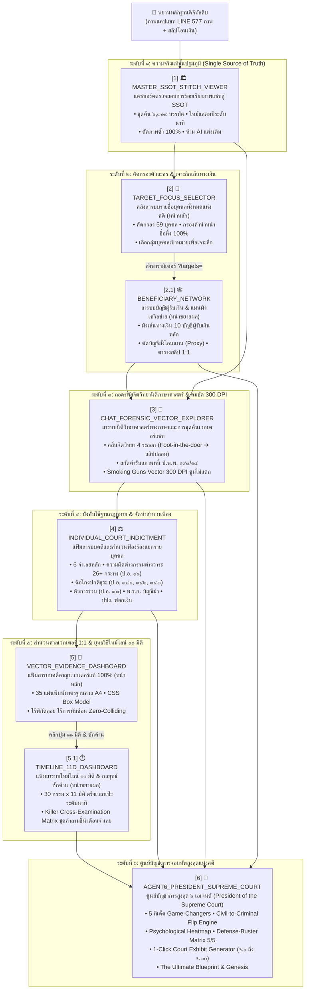

# 🏛️ ระบบโฟลว์ข้อมูลและผังสถาปัตยกรรมสารบบคดีดิจิทัล (System Data Flow Architecture)
### มาตรฐานศาลยุติธรรมไทย (ป.วิ.อ. มาตรา ๒๒๖, พ.ร.บ.ว่าด้วยธุรกรรมทางอิเล็กทรอนิกส์, ISO/IEC 27037)
**ระบบสารบบพยานหลักฐานดิจิทัลคดีฉ้อโกงประชาชน เครือข่ายบัญชีม้า และการฟอกเงิน**

---

## 📌 สารบบโครงสร้างลำดับหน้า (System Information Architecture)
ตามข้อกำหนดมาตรฐานสถาปัตยกรรมระบบ:
* **หน้าหลัก (Primary Dashboards):** กำหนดเป็น **"เลขตัวเดียว" (1, 2, 3, 4, 5, 6)**
* **หน้าถัดไป / หน้าขยายรายละเอียด (Deep-Dive / Extension Dashboards):** กำหนดเป็น **"เลขทศนิยม" (X.X เช่น 2.1, 5.1)**

```
📦 DIGITAL FORENSIC SYSTEM SUITE
├── [1] MASTER_SSOT_STITCH_VIEWER.html        (หน้าหลัก: สายธารแชทต้นฉบับ 577 ภาพ สู่แกนเวลาเดียว)
├── [2] TARGET_FOCUS_SELECTOR.html            (หน้าหลัก: คลังสารบบรายชื่อบุคคลทั้งหมดแห่งคดี 59 รายการ)
│    └── [2.1] BENEFICIARY_NETWORK_DASHBOARD.html (หน้าขยายผล: ผังเส้นทางเงิน & สารบบบัญชีผู้รับเงิน 10 บัญชี)
├── [3] CHAT_FORENSIC_VECTOR_EXPLORER.html    (หน้าหลัก: นิติวิทยาศาสตร์ภาษา RAG & สลิปเวกเตอร์ 300 DPI)
├── [4] INDIVIDUAL_COURT_INDICTMENT_DASHBOARD.html (หน้าหลัก: แฟ้มสำนวนฟ้องร้องแยกรายบุคคล 6 จำเลย 26+ กระทง)
├── [5] VECTOR_EVIDENCE_DASHBOARD.html         (หน้าหลัก: แฟ้มสารบบคดีอาญาเวกเตอร์แท้ 35 แผ่นศาล)
│    └── [5.1] TIMELINE_11D_DASHBOARD.html    (หน้าขยายผล: ไทม์ไลน์ ๑๑ มิติ & กลยุทธ์ซักค้านเผด็จศึกพยาน)
└── [6] AGENT6_PRESIDENT_SUPREME_COURT_DASHBOARD.html (หน้าหลัก: ศูนย์บัญชาการสูงสุด ประธานศาลฎีกา)
```

---

## 🔄 แผนผังสายธารข้อมูล (End-to-End Data Flow Pipeline)



---

## 📑 รายละเอียดเจาะลึก ๘ หมุดหมายสารบบ (System Node Registry)

### [1] 🏛️ แดชบอร์ดตรวจสอบการร้อยเรียงภาพแชททุกภาพสู่ SSOT (Single Line Stream Audit)
* **สถานะ:** `หน้าหลัก (Primary)`
* **URL:** `http://127.0.0.1:5500/EDOK_NUI/MASTER_SSOT_STITCH_VIEWER.html`
* **ที่ตั้งไฟล์:** `d:\Project\ชวกม.2\EDOK_NUI\MASTER_SSOT_STITCH_VIEWER.html`
* **ข้อมูลนำเข้า:** ภาพแคปหน้าจอแชท LINE ต่อเนื่องจำนวน 577 ภาพ
* **กระบวนการทำงาน:**
  1. สแกนไทม์แสตมป์บับเบิ้ล 530 โหนด ด้วย OCR บริสุทธิ์
  2. กรองและตัดภาพซ้ำซ้อน 100%
  3. ร้อยเรียงบทสนทนา 6,319 บรรทัดลงในแถบเวลาเดียว (Single Line Continuous Stream) ปลอดการตัดต่อ
* **ผลลัพธ์เชิงนิติวิทยาศาสตร์:** ฐานข้อมูลความจริงแท้ชั้นปฐมภูมิ (Ground Truth Single Source of Truth) เพื่อคุ้มครองความสมบูรณ์แห่งพยานหลักฐานตามมาตรฐาน ISO/IEC 27037

---

### [2] 🎯 คลังสารบบรายชื่อบุคคลทั้งหมดแห่งคดี (Target Focus Discovery Gateway)
* **สถานะ:** `หน้าหลัก (Primary)`
* **URL:** `http://127.0.0.1:5500/EDOK_NUI/TARGET_FOCUS_SELECTOR.html`
* **ที่ตั้งไฟล์:** `d:\Project\ชวกม.2\EDOK_NUI\TARGET_FOCUS_SELECTOR.html`
* **ข้อมูลนำเข้า:** ฐานข้อมูลธุรกรรมและสลิปโอนเงินทั้งหมดจากข้อ [1]
* **กระบวนการทำงาน:**
  1. กรองคำนำหน้าชื่อทิ้ง 100% (นาย, นาง, นางสาว, ยศ) ยึดหลัก "ชื่อตรง นามสกุลตรง นั้นคือถูก"
  2. สกัดรายชื่อบุคคลและบัญชีที่เกี่ยวข้องทั้งหมด 59 รายการ
  3. จัดกลุ่มตามยอดเงินสูงสุด, จำนวนสลิป, และตัวอักษร ก-ฮ
  4. ผู้ใช้คลิกเลือกบุคคลเป้าหมาย (Focus Targets) เพื่อส่งต่อพารามิเตอร์เข้าสู่หน้าขยายผล
* **ผลลัพธ์เชิงนิติวิทยาศาสตร์:** ประตูกรองเพื่อป้องกันการล้นทะลักของข้อมูล (Cognitive Overload) และแยกแยะตัวละครในคดีอย่างเด็ดขาด

---

### [2.1] 🕸️ สารบบบัญชีผู้รับโอนเงินและแผนผังเครือข่ายทางการเงิน (Strict Target Focus)
* **สถานะ:** `หน้าถัดไป / ขยายรายละเอียด (Extension of Node 2)`
* **URL:** `http://127.0.0.1:5500/EDOK_NUI/BENEFICIARY_NETWORK_DASHBOARD.html?targets=jinnipha%2Cpreeyachat%2C`
* **ที่ตั้งไฟล์:** `d:\Project\ชวกม.2\EDOK_NUI\BENEFICIARY_NETWORK_DASHBOARD.html`
* **ข้อมูลนำเข้า:** พารามิเตอร์ `targets` จากข้อ [2]
* **กระบวนการทำงาน:**
  1. กรองเข้มงวด 100% (Strict Target Focus) แสดงเฉพาะเส้นทางเงินที่ไหลเข้าสู่บุคคลเป้าหมาย
  2. ตัดกลุ่มบัญชีสั่งโอนแทน (Proxy Beneficiaries) เช่น ค่าน้ำมัน, ค่าซ่อมรถ, ค่าของชำ
  3. เจาะลึก 10 บัญชีผู้รับเงินหลัก (น.ส. จิณห์นิภา, น.ส. ปรียชาติ, น.ส. วันวิศา ฯลฯ)
  4. สร้างแผนผัง Interactive Visual Graph เชื่อมโยงบัญชีธนาคารและพร้อมเพย์
* **ผลลัพธ์เชิงนิติวิทยาศาสตร์:** แผนผังเส้นทางการเงิน (Money Trail Chart) พิสูจน์จุดหมายปลายทางของเงินที่ได้ไปจากการกระทำความผิด

---

### [3] 🧠 สารบบนิติวิทยาศาสตร์ทางภาษาและการขุดค้นเวกเตอร์แชท (Agent 3 Forensic Linguistics RAG)
* **สถานะ:** `หน้าหลัก (Primary)`
* **URL:** `http://127.0.0.1:5500/EDOK_NUI/CHAT_FORENSIC_VECTOR_EXPLORER.html`
* **ที่ตั้งไฟล์:** `d:\Project\ชวกม.2\EDOK_NUI\CHAT_FORENSIC_VECTOR_EXPLORER.html`
* **ข้อมูลนำเข้า:** บทสนทนา 6,319 บรรทัด + สลิปโอนเงิน + Smoking Gun Evidence
* **กระบวนการทำงาน:**
  1. ถอดรหัสจิตวิทยาล่อลวง 4 ระลอก (Foot-in-the-door, Phantom Capital, Crisis Extortion, Fake Slips)
  2. สกัดคำรับสภาพหนี้ตาม ป.พ.พ. มาตรา ๑๙๓/๑๔ ตัดข้อต่อสู้เรื่องคดีขาดอายุความ
  3. แปลงภาพหลักฐานจุดตายคดี (Smoking Guns) เป็น SVG Vector ความละเอียด 300 DPI คมชัดทุกเม็ดพิกเซล ซูมตรวจสลิปไม่แตก
* **ผลลัพธ์เชิงนิติวิทยาศาสตร์:** พยานหลักฐานพิสูจน์เจตนาทุจริต (Mens Rea) และสภาวะจิตใจของจำเลยขณะหลอกลวง

---

### [4] ⚖️ แฟ้มสารบบคดีและสำนวนฟ้องร้องแยกรายบุคคล (Agent 4 Court Indictment Engine)
* **สถานะ:** `หน้าหลัก (Primary)`
* **URL:** `http://127.0.0.1:5500/EDOK_NUI/INDIVIDUAL_COURT_INDICTMENT_DASHBOARD.html`
* **ที่ตั้งไฟล์:** `d:\Project\ชวกม.2\EDOK_NUI\INDIVIDUAL_COURT_INDICTMENT_DASHBOARD.html`
* **ข้อมูลนำเข้า:** พฤติการณ์แห่งคดีและเส้นทางเงินของจำเลยแต่ละราย
* **กระบวนการทำงาน:**
  1. จัดทำสำนวนฟ้องแยกรายบุคคลสำหรับ 6 จำเลย/ผู้ต้องหา
  2. บังคับใช้ฐานความผิดเต็มเพดาน:
     - ฉ้อโกงอันเป็นปกติธุระ (ป.อ. มาตรา ๓๔๑, ๓๔๒, ๓๔๓)
     - ตัวการร่วมและผู้สนับสนุน (ป.อ. มาตรา ๘๓, ๘๖)
     - ความผิดต่างกรรมต่างวาระ รวม 26+ กระทง (ป.อ. มาตรา ๙๑)
     - พ.ร.ก. มาตรการป้องกันและปราบปรามอาชญากรรมทางเทคโนโลยี พ.ศ. ๒๕๖๖ (พ.ร.ก. บัญชีม้า)
     - ประสาน ปปง. ยึดอายัดทรัพย์ตาม พ.ร.บ. ป้องกันและปราบปรามการฟอกเงิน พ.ศ. ๒๕๔๒
  3. จัดเตรียมคำขอหมายเรียกสเตทเมนต์ธนาคาร (Bank Subpoena)
* **ผลลัพธ์เชิงนิติวิทยาศาสตร์:** ร่างคำฟ้องอาญาและสำนวนคดีรายบุคคลพร้อมส่งพนักงานอัยการหรือฟ้องตรงต่อศาล

---

### [5] 📑 แฟ้มสารบบคดีอาญาเวกเตอร์แท้ 100% (Responsive Master Dashboard - CODEX CERTIFIED)
* **สถานะ:** `หน้าหลัก (Primary)`
* **URL:** `http://127.0.0.1:5500/EDOK_NUI/VECTOR_EVIDENCE/VECTOR_EVIDENCE_DASHBOARD.html`
* **ที่ตั้งไฟล์:** `d:\Project\ชวกม.2\EDOK_NUI\VECTOR_EVIDENCE\VECTOR_EVIDENCE_DASHBOARD.html`
* **ข้อมูลนำเข้า:** พยานเอกสาร 35 แผ่นพิมพ์ศาล พร้อมภาพแคปแชทและสลิปคู่ประกบ
* **กระบวนการทำงาน:**
  1. เรนเดอร์เอกสาร A4 แนวตั้งด้วย CSS Table Box Model บริสุทธิ์
  2. คุมความสูงและระยะเว้นวรรคแนวตั้ง (Vertical Middle Balance) ปลอดการทับเส้นตาราง
  3. รองรับการแสดงผลแบบ Responsive เต็มจอและพร้อมสั่งพิมพ์/แปลงเป็น PDF แบบ Zero-Blank-Page
* **ผลลัพธ์เชิงนิติวิทยาศาสตร์:** ชุดพยานเอกสารในสำนวนคดี (Court Exhibits) ที่ตรงตามข้อกำหนดศาลยุติธรรม 100%

---

### [5.1] ⏱️ แฟ้มสารบบไทม์ไลน์ ๑๑ มิติ & กลยุทธ์ทำลายข้อต่อสู้ในชั้นศาล (Agent 5 Supreme Edition)
* **สถานะ:** `หน้าถัดไป / ขยายรายละเอียด (Extension of Node 5)`
* **URL:** `http://127.0.0.1:5500/EDOK_NUI/TIMELINE_11D_DASHBOARD.html`
* **ที่ตั้งไฟล์:** `d:\Project\ชวกม.2\EDOK_NUI\TIMELINE_11D_DASHBOARD.html`
* **ข้อมูลนำเข้า:** กรรมการกระทำความผิด 30 กรรม
* **กระบวนการทำงาน:**
  1. วิเคราะห์และตรึงเหตุการณ์ครบทั้ง ๑๑ มิติ:
     1. ลำดับกรรม
     2. การอ้างอิงภาพหลักฐาน (Responsive Sheet & SVG)
     3. บริบทแชท (Chat Dialogue Ground Truth)
     4. พฤติการณ์หลอกลวง (Modus Operandi)
     5. วันเวลาตราประทับเป๊ะระดับนาที (Timestamp)
     6. ยอดเงินความเสียหายสุทธิ (Net Loss)
     7. บัญชีคู่กรณี & สลิป
     8. ฐานความผิดทางกฎหมาย
     9. จุดตายคดี (Smoking Gun)
     10. กลยุทธ์พลิกเกมส์ (Litigation Strategy)
     11. คำขอต่อศาลยุติธรรม
  2. สถาปนา **Killer Cross-Examination Matrix**: ชุดคำถามซักค้านชี้นำ (Leading Questions) ต้อนจำเลยจนมุมในคอกพยาน
* **ผลลัพธ์เชิงนิติวิทยาศาสตร์:** แผนที่ยุทธวิธีดำเนินคดีในชั้นพิจารณาและทำลายข้อต่อสู้ทุกมิติ

---

### [6] 👑 Agent 6: President of the Supreme Court (ศูนย์บัญชาการสูงสุด ๖ เอเจนต์)
* **สถานะ:** `หน้าหลัก (Primary - Supreme Command Center)`
* **URL:** `http://127.0.0.1:5500/EDOK_NUI/AGENT6_PRESIDENT_SUPREME_COURT_DASHBOARD.html`
* **ที่ตั้งไฟล์:** `d:\Project\ชวกม.2\EDOK_NUI\AGENT6_PRESIDENT_SUPREME_COURT_DASHBOARD.html`
* **ข้อมูลนำเข้า:** องค์ความรู้ การเชื่อมโยงข้อมูล และสถานะจากเอเจนต์ 1 ถึง 5
* **กระบวนการทำงาน (5 Game-Changers):**
  1. **Killer Cross-Examination Simulator:** ห้องจำลองซักค้านพยาน ๓ สเต็ป
  2. **Civil-to-Criminal Flip Engine:** เอนจินแสดงเจตนาทุจริตแต่แรกเริ่ม (Inception Fraud) พลิกคดีกู้ยืมทางแพ่งเป็นอาญา
  3. **Psychological Manipulation & Urgency Heatmap:** แผนผังความเร่งเร้าทางจิตวิทยา ๔ ระลอก
  4. **Defense-Buster Matrix 5/5:** ตารางทำลาย ๕ ข้อต่อสู้อมตะของจำเลย
  5. **1-Click Court Exhibit Generator:** สารบบรันหมายเลขพยานเอกสารศาล "จ.๑ ถึง จ.๓๐" พร้อมพิมพ์
  6. **The Ultimate Blueprint:** คัมภีร์ยุทธศาสตร์คดีและสมการความสำเร็จแห่งการพิสูจน์พยาน
* **ผลลัพธ์เชิงนิติวิทยาศาสตร์:** ศูนย์ควบคุมและตัดสินใจเชิงยุทธศาสตร์ระดับประธานศาลฎีกา สรุปสำนวนเผด็จศึกจำเลย 100%

---

## 🧭 มาตรฐานการเชื่อมโยงระบบนำทาง (Universal Navigation Architecture)

เพื่อให้ผู้ใช้งานและทนายความสามารถกดสลับหน้าได้อย่างรวดเร็วและแม่นยำ ทุกหน้าจอในระบบได้รับการจัดระเบียบปุ่มนำทาง (Header Pills & Suite Navigation) ตามรหัสตัวเลขมาตรฐานนี้อย่างเป็นเอกภาพ:

```
[1] 🏛️ SSOT Chat 577 ภาพ ➔ [2] 🎯 สารบบรายชื่อบุคคล (หลัก) ➔ [2.1] 🕸️ ผังเส้นทางเงิน (ขยายผล) ➔ [3] 🧠 นิติภาษาศาสตร์ 300 DPI ➔ [4] ⚖️ สำนวนฟ้อง 6 จำเลย ➔ [5] 📑 แฟ้มสารบบ 35 แผ่น (หลัก) ➔ [5.1] ⏱️ ไทม์ไลน์ 11 มิติ (ขยายผล) ➔ [6] 👑 ศูนย์บัญชาการประธานศาลฎีกา
```

---
*เอกสารนี้ได้รับการบันทึกและรับรองเป็นพิมพ์เขียวหลัก (Source of Truth Architecture) ประจำโครงการ ชวกม.๒*
