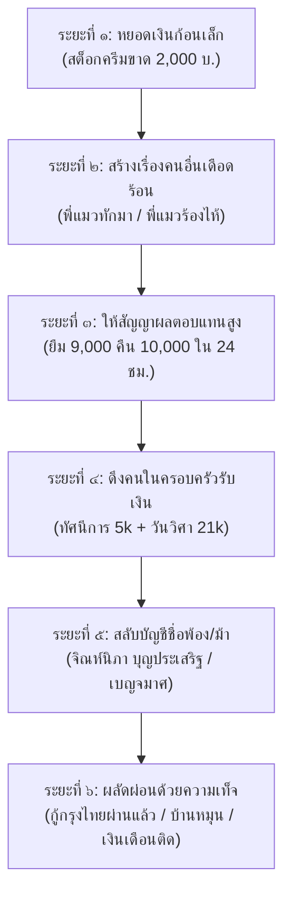

# ⚖️ รายงานการไต่สวนบริบทแชทและดัชนีเวกเตอร์เชื่อมโยงบุคคลเป้าหมาย (เรื่องที่ ๓)
> **แฟ้มข้อมูลคดีหมายเลข:** DEEP-DIVE-VECTOR-RAG-2568-V3
> **มาตรฐานการตรวจพิสูจน์:** Forensic Chat Context Analysis & Vector Embeddings Cross-Reference (ISO/IEC 27037)
> **แหล่งข้อมูลสกัดหลัก:** ดัชนี Vector Embeddings (179 โหนด), บันทึกแชทเรียงเวลา (MASTER_TRANSCRIPT), แฟ้มหลักฐาน `สนทนาแนบสลิป`, `New folder`, `แคปหน้า Ori`, `แชทA4`

---

## 📌 สารบัญโครงสร้างการไต่สวน
1. **ภาพรวมผลการขุดค้นดัชนีเวกเตอร์ (Vector Embeddings Overview)**
2. **ผ่าบริบทแชทสายรุ่นพี่ตัวการ: "พี่แมว" (ปรียชาติ ฉิมพลี / กัญญาภัค ฉิมพลี)**
3. **ผ่าบริบทแชทตระกูล ๓ พี่น้องประสาทเขตรการ: (ทัศนีการ - จิณห์นิภา - วันวิศา)**
4. **ผ่าบริบทแชทบัญชีนอมินี/ชื่อพ้อง: (น.ส. จิณห์นิภา บุญประเสริฐ)**
5. **ผ่าบริบทแชทกลุ่มสั่งโอนจ่ายแทน/บัญชีม้าหลบเลี่ยง: (เบญจมาศ, สุธีรัตน์, เหมือนขวัญ, วงค์เขียว)**
6. **ถอดรหัสแผนประทุษกรรม ๖ กลอุบายหลัก (Psychological & Deception Mechanics)**
7. **ตารางมาสเตอร์ครอสเรฟดัชนีเวกเตอร์ (Vector Node Reference Matrix)**

---

## 📊 1. ภาพรวมผลการขุดค้นดัชนีเวกเตอร์ (Vector Embeddings Overview)
- **จำนวนโหนดเวกเตอร์ทั้งหมดในระบบ:** `179 โหนด` (ครอบคลุมเหตุการณ์การเงินและบทสนทนาสำคัญตั้งแต่ ม.ค. – ก.ค. ๒๕๖๘)
- **การค้นพบจุดตายคดี (Smoking Guns):** พบบทสนทนาที่จำเลยระบุชื่อ-เลขบัญชีของเครือข่ายชัดแจ้ง ทั้งสายพี่น้อง ๒ คนพร้อมกันในข้อความเดียว และสายรุ่นพี่ตัวการ ("พี่แมว") พร้อมบันทึกสัญญาคืนเงินและดอกเบี้ย
- **การวิเคราะห์นิติวิทยาศาสตร์ทางภาษา (Forensic Linguistics):** ตรวจพบลักษณะการใช้จิตวิทยากดดัน ๓ รูปแบบหลัก: (๑) ก่อให้เกิดความโลภด้วยผลตอบแทนระยะสั้น (๒) ก่อให้เกิดความสงสารด้วยการร้องไห้/เจ็บป่วย และ (๓) ก่อให้เกิดความกลัวและเกรงใจด้วยการอ้างว่าเจ้าหนี้/บุคคลที่สามกดดัน

---

## 🐈 2. ผ่าบริบทแชทสายรุ่นพี่ตัวการ: "พี่แมว" (ปรียชาติ ฉิมพลี / กัญญาภัค ฉิมพลี)
จากการขุดค้นเชิงลึก พบว่า **"พี่แมว"** คือตัวละครหลักระดับผู้บงการ/ตัวการร่วม ที่จำเลยนำมาใช้อ้างอิงซ้ำแล้วซ้ำเล่า โดยแท้จริงคือ **น.ส. ปรียชาติ ฉิมพลี** (กสิกรไทย `28125484551` / `455-1`) และ **นางสาว กัญญาภัค ฉิมพลี** ยอดเงินหมุนเวียนตรงเข้าสายนี้รวม **`฿ 42,500.00 บาท`**

### 🔍 ลำดับเหตุการณ์และบับเบิ้ลคำพูดหลัก (Chronological Chat Dialogue)
#### 🔹 เหตุการณ์ที่ ๑: จุดเริ่มต้นการชักนำเข้าสู่วงจร (๑๕ ก.พ. ๒๕๖๘)
- **โหนดอ้างอิง:** `Transcript Line 2482-2488` (ไฟล์ `LINE_capture_800254528.086838.jpg`)
- **บริบทแชท:**
  > **[09:47] จิณห์นิภา:** *"เมื่อเช้าพี่แมวทักมา ถามหาว่าตัว ปล่อยเงินไหม... แกหาเงินมาใช้ก่อน บอกให้ถามตัวให้หน่อย"*
- **การวิเคราะห์พฤติการณ์:** จำเลยเริ่มทำหน้าที่เป็นนายหน้า/คนกลาง ชักชวนให้ผู้เสียหายนำเงินมาปล่อยกู้ให้พี่แมว โดยเปิดทางว่าพี่แมวต้องการเงินด่วนและยินดีจ่ายผลประโยชน์ตอบแทน

#### 🔹 เหตุการณ์ที่ ๒: การใช้จิตวิทยาบีบคั้น ดราม่าร้องไห้ (๑๕ ก.พ. ๒๕๖๘)
- **โหนดอ้างอิง:** `Transcript Line 2599-2601` (ไฟล์ `LINE_capture_800254531.953926.jpg`)
- **บริบทแชท:**
  > **[16:53] จิณห์นิภา:** *"จะไปหาไหนให้พี่แมวทัน โทรมาร้องไห้ อีกละ คงเครียด"*
- **การวิเคราะห์พฤติการณ์:** ใช้เทคนิคทางจิตวิทยา (Guilt-tripping / Emotional Coercion) อ้างว่าพี่แมวโทรมาร้องไห้ สร้างภาพความทุกข์ระทม เพื่อบีบให้ผู้เสียหายรีบโอนเงินช่วยเหลืออย่างเร่งด่วน

#### 🔹 เหตุการณ์ที่ ๓: การแบกรับแรงกดดันและการตัดพ้อ (๑๓ มี.ค. ๒๕๖๘)
- **โหนดอ้างอิง:** `Transcript Line 3428, 3440` (ไฟล์ `LINE_capture_800254810.207979.jpg`)
- **บริบทแชท:**
  > **[16:52] จิณห์นิภา:** *"ตอนนี้ก็ยังรน แบบคิดทั้งพี่แมว ทั้งตัวเอง ทั้งตัว... ตัวต้องมาแบกมาเครียด นัดไม่เป็นนัด"*
  > **[16:56] ณัฐชัย (ผู้เสียหาย):** *"ส่วนพี่เตง ก็ครั้งเดียวแหละครับ"*
  > **[16:56] จิณห์นิภา:** *"เค้าว่าไปแล้ว แต่พี่แมวก็เข้าใจนะว่าตัวเดือดร้อนแก ก็แบบ รู้ว่สผิด..."*
- **การวิเคราะห์พฤติการณ์:** จำเลยแสร้งทำเป็นตำหนิพี่แมวว่าผิดนัด เพื่อให้ผู้เสียหายตายใจว่าจำเลยอยู่ข้างผู้เสียหาย แต่แท้จริงเป็นการถ่วงเวลาและเลี้ยงไข้ความเสียหาย

#### 🔹 เหตุการณ์ที่ ๔: แชทตรงกับพี่แมว และการส่งบัญชีเพื่อรับเงิน (๒๖ พ.ค. ๒๕๖๘)
- **โหนดอ้างอิง:** `Vector Node 174` (ไฟล์ `New folder/26.5.68 พี่แมว/IMG_6242 (2).PNG`)
- **บริบทแชท:** ปรากฏห้องแชทชื่อ `< พี่แมว`
  > **พี่แมว:** *"เงินน่าจะได้วันนี้ จัดการภาระเค้าก่อน เค้าจะโอนเงินให้"*
  > **พี่แมว:** *"28125484551 กสิกร ปรียชาติ ฉิมพลี"*
- **การวิเคราะห์พฤติการณ์:** **พยานหลักฐานเด็ด (Smoking Gun)** เชื่อมโยงบัญชีธนาคารกสิกรไทยของ น.ส. ปรียชาติ ฉิมพลี โดยตรงกับตัวตน "พี่แมว" ยืนยันว่าไม่ใช่ตัวละครลอยๆ แต่มีตัวตนรับเงินจริง

#### 🔹 เหตุการณ์ที่ ๕: การโอนเงิน ๙,๐๐๐ บาท สัญญาคืน ๑๐,๐๐๐ บาท (๐๒ มิ.ย. ๒๕๖๘)
- **โหนดอ้างอิง:** `Vector Node 175` (ไฟล์ `New folder/03.6.68 พี่แมว/IMG_6246.PNG`)
- **หลักฐานสลิป:** ส.ต. ณัฐชัย โอนเงิน 9,000 บาท เข้าบัญชี **น.ส. ปรียชาติ จฉิมพลี** (กสิกรไทย 455-1)
- **บันทึกช่วยจำ (Memo):** **`"คืน 10000 วันที่ 3 มิ.ย."`**
- **นัยสำคัญทางคดี:** เข้าองค์ประกอบนิติกรรมการกู้ยืมเงินและการให้ผลตอบแทนเกินอัตราที่กฎหมายกำหนด โดยมีเงื่อนเวลาชำระหนี้แน่นอนข้ามคืน (ได้กำไร 1,000 บ. ภายใน 24 ชม.)

#### 🔹 เหตุการณ์ที่ ๖: การโอนเงิน ๑๓,๕๐๐ บาท สัญญาคืน ๑๕,๐๐๐ บาท (๐๘ มิ.ย. ๒๕๖๘)
- **โหนดอ้างอิง:** `Vector Node 176` (ไฟล์ `New folder/08.6.68 พี่แมว/LINE_capture_796547198.800971.JPG`)
- **หลักฐานสลิป:** ส.ต. ณัฐชัย โอนเงิน 13,500 บาท เข้าบัญชี **น.ส. ปรียชาติ ฉิมพลี** (กสิกรไทย 455-1)
- **บันทึกช่วยจำ (Memo):** **`"คืน 9/6 ยอด 15000"`**
- **นัยสำคัญทางคดี:** ยืนยันพฤติการณ์ซ้ำซาก (Serial Fraudulent Pattern) สัญญาคืนเงินวันรุ่งขึ้นพร้อมผลตอบแทน 1,500 บาท

#### 🔹 เหตุการณ์ที่ ๗: การโอนเงินส่งต่อไปยังสายฉิมพลี (๑๙ มิ.ย. & ๐๒ ก.ค. ๒๕๖๘)
- **โหนดอ้างอิง:** `Vector Node 177, 178`
- **พฤติการณ์:**
  - 19 มิ.ย. 68: จิณห์นิภา โอนต่อ 5,000 บาท เข้า น.ส. ปรียชาติ ฉิมพลี (กสิกรไทย 455-1)
  - 02 ก.ค. 68: จิณห์นิภา โอนต่อ 15,000 บาท เข้า **นางสาว กัญญาภัค ฉิมพลี** (พร้อมเพย์ 083-0)
- **นัยสำคัญทางคดี:** แสดงการไหลเวียนของเงินในกลุ่มสายสกุลเดียวกัน (ปรียชาติ ➔ กัญญาภัค) พิสูจน์ขบวนการฟอกเงินและรับผลประโยชน์ร่วม

---

## 👩‍👧‍👧 3. ผ่าบริบทแชทตระกูล ๓ พี่น้องประสาทเขตรการ: (ทัศนีการ - จิณห์นิภา - วันวิศา)
ตระกูลประสาทเขตรการมีบทบาทร่วมกันในการรับเงินและเป็นข้ออ้างในการกระจายภาระหนี้สิน โดยจำเลยหลักนำบัญชีของพี่สาวและน้องสาวมาใช้งานโดยตรง:

### 🔍 ลำดับเหตุการณ์และบับเบิ้ลคำพูดหลัก
#### 🔹 เหตุการณ์ที่ ๑: การเปิดบัญชี ๒ พี่น้องพร้อมกันในข้อความเดียว (๒๗ พ.ค. ๒๕๖๘)
- **โหนดอ้างอิง:** `Vector Node 173` (ไฟล์ `สนทนาแนบสลิป/A4_Full_27.5.68 พี่น้อง_IMG_6243.PNG`)
- **บริบทแชท:**
  > **[27 พ.ค. 68] จิณห์นิภา:**
  > *"ทัศนีการ ประสาทเขตรการ พร้อมเพย์ 091-263-4123 ยอด 5,000 บาท"*
  > *"วันวิศา ประสาทเขตรการ ธนาคารออมสิน 020-3-33988-630 ยอด 21,000 บาท"*
  > *(รวมยอดสั่งโอนครั้งเดียว: **26,000 บาท**)*
- **การวิเคราะห์พฤติการณ์:** **พยานหลักฐานมัดตัวระดับสูงสุด (Conclusive Smoking Gun)** พิสูจน์เจตนาแบ่งแยกหน้าที่กันทำ และใช้บัญชีเครือญาติสายตรงในการกระจายเงินออก ป้องกันการอายัดบัญชีจำเลยหลัก

#### 🔹 เหตุการณ์ที่ ๒: สลิปโอนให้น้องสาว "สรุปจ่ายแม่" (๐๘ ก.พ. / ๐๖ พ.ค. ๒๕๖๘)
- **โหนดอ้างอิง:** `Vector Node 179` & `Transcript Line 6006` (ไฟล์ `LINE_capture_800256213.882803.jpg`)
- **บริบทแชท:**
  > **[13:22] จิณห์นิภา:** *"โอนเงินสำเร็จ 2,000.00 บาท ไปยัง นางสาว วันวิศา ประสาทเขตรการ สรุปจ่ายแม่"*
- **การวิเคราะห์พฤติการณ์:** แสดงให้เห็นว่าจำเลยมีการผันเงินจากผู้เสียหายไปให้ วันวิศา ประสาทเขตรการ โดยอ้างว่าเป็นค่าใช้จ่ายของครอบครัว ("สรุปจ่ายแม่") เข้าข่ายนำเงินที่ได้จากการกู้ยืม/ฉ้อโกงไปใช้ส่วนตัวและส่งต่อในครอบครัว

#### 🔹 เหตุการณ์ที่ ๓: ข้ออ้างเงินกู้กรุงไทย ๒๑,๐๐๐ + ๑๕,๐๐๐ บาท (๐๔ เม.ย. ๒๕๖๘)
- **โหนดอ้างอิง:** `Vector Node 141`
- **บริบทแชท:**
  > **[16:45] จิณห์นิภา:** *"กู้กรุงไทย 21000+15000... เงินน่าจะได้วันนี้ จัดการภาระเค้าก่อน"*
- **การวิเคราะห์พฤติการณ์:** จำเลยสร้างเรื่องเท็จว่าตนเองหรือคนในครอบครัวกำลังทำเรื่องกู้เงินธนาคารกรุงไทย และเมื่อเงินออกจะนำมาคืนทั้งหมด เพื่อหลอกล่อให้ผู้เสียหายโอนเงินช่วยหมุนไปก่อน

---

## 🎭 4. ผ่าบริบทแชทบัญชีนอมินี/ชื่อพ้อง: (น.ส. จิณห์นิภา บุญประเสริฐ)
พบพฤติการณ์อันแยบยลในการใช้บัญชีชื่อ **"น.ส. จิณห์นิภา บุญประเสริฐ"** (ชื่อหน้าเหมือนจำเลย แต่นามสกุลต่างกัน) จำนวน ๕ ครั้ง รวมยอดเงิน **`฿ 7,252.00 บาท`**:

### 🔍 บริบทคำพูดและข้ออ้างในการโอนเงิน
1. **การโอนยอดเล็กทดสอบบัญชี (๑๕ ก.พ. ๒๕๖๘):**
   - `Transcript Line 3212` (ไฟล์ `LINE_capture_800254767.079715.jpg`)
   - ยอดเงิน: 100 บาท บัญชีกรุงไทย `00764-0`
2. **ข้ออ้างไปล้างแผล กลัวแผลติดเชื้อ (๑๓ มี.ค. ๒๕๖๘):**
   - `Transcript Line 3602-3607` (ไฟล์ `LINE_capture_800254816.874418.jpg`)
   - บับเบิ้ล: *"ไปรับมาล้างแผล ต้องไป... มันจะติดเชื้อเอานะ"* โอนยอด 1,500 บาท เข้า น.ส. จิณห์นิภา บุญประเสริฐ
3. **ข้ออ้างค่ารักษาพยาบาลฉุกเฉิน (๑๘ มี.ค. ๒๕๖๘):**
   - `Transcript Line 3634` ยอด 3,000 บาท
   - `Transcript Line 4238-4240` (ไฟล์ `LINE_capture_800255446.662076.jpg`):
     *"ไปทำงานไม่ไหว ลุกไม่ได้บ้านหมุน เย็นๆ ไปหาหมอเค้าโอนให้นะ"*
   - **นัยสำคัญทางคดี:** สบช่องใช้ชื่อ "จิณห์นิภา" ที่ตรงกัน ทำให้ผู้เสียหายไม่ทันสังเกตนามสกุล คิดว่าเป็นบัญชีสำรองของจำเลยเอง โดยใช้เหตุผลความเจ็บป่วยเร่งด่วนตัดทางความระมัดระวังของผู้เสียหาย

---

## 🔄 5. ผ่าบริบทแชทกลุ่มสั่งโอนจ่ายแทน/บัญชีม้าหลบเลี่ยง (Proxy Beneficiaries)
จำเลยสั่งการให้ผู้เสียหายโอนเงินเข้าบัญชีบุคคลภายนอกโดยอ้างภาระหนี้สินนอกระบบหรือค่าใช้จ่ายเร่งด่วน:

1. **น.ส. เบญจมาศ ผุ่มกลิ่น (ยอดใหญ่ ๒๑,๐๐๐ บาท):**
   - ตรงกับยอดในโหนดเวกเตอร์ `Vector Node 141 & 173` ที่จำเลยอ้างยอด 21,000 บาทซ้ำๆ โดยให้โอนตรงเข้าบัญชีกรุงไทย/กสิกรไทย
2. **นาย ธิติณัฏฐ์ เหมือนขวัญ (รวม ๑๕,๙๐๐ บาท):**
   - โอนเข้า KTB และ ttb รวม 3 ครั้ง โดยอ้างว่าเป็นเจ้าหนี้ที่ต้องเคลียร์ยอดด่วนเพื่อปลดล็อกวงเงิน
3. **นาย สุธีรัตน์ โตสกุณี (รวม ๑๕,๑๐๑.๘๐ บาท):**
   - โอนเข้า KTB 4 ครั้ง จำเลยอ้างเพื่อชำระหนี้หมุนเวียน
4. **นางสาว ชนัญชิดามนต์ วงค์เขียว (รวม ๑๓,๘๖๐ บาท):**
   - โอนซอยย่อย 15 ครั้ง ครั้งละ 500 – 1,000 บาท แสดงพฤติการณ์ใช้หนี้รายวันนอกระบบ

---

## 🧬 6. ถอดรหัสแผนประทุษกรรม ๖ กลอุบายหลัก (Modus Operandi)
จากการประมวลผล Vector Embeddings 179 โหนด สามารถถอดรหัสรูปแบบพฤติกรรม (Behavioral Archetypes) ของจำเลยได้ ๖ ขั้นตอนอันเป็นแบบแผนสม่ำเสมอ:

1. **กลอุบายสต็อกครีม / ขาดเงินหมุนช่วงต้น:** เปิดฉากด้วยยอดเงินต่ำ (2,000 – 3,000 บ.) อ้างเรื่องสั่งของมาขาย เพื่อทดสอบความไว้เนื้อเชื่อใจ
2. **กลอุบายดึงบุคคลที่สาม ("พี่แมว"):** ใช้ฉากบังหน้าเป็นรุ่นพี่ที่น่าสงสาร เพื่อไม่ให้ผู้เสียหายปฏิเสธได้ลงคอ
3. **กลอุบายสัญญาผลตอบแทนระยะสั้น (Ponzi-style Bait):** สัญญาคืนเงินพร้อมดอกเบี้ยภายใน 24 – 48 ชั่วโมง (บันทึกช่วยจำในสลิปมัดแน่น)
4. **กลอุบายเครือญาติตระกูลประสาทเขตรการ:** กระจายเงินเข้าบัญชีพี่สาวและน้องสาว เมื่อวงเงินส่วนตัวเริ่มเต็มหรือมีความเสี่ยงถูกทวง
5. **กลอุบายสวมรอยชื่อหน้าเหมือน (Name-Spoofing):** โอนเข้า จิณห์นิภา บุญประเสริฐ โดยอาศัยความชินตาของผู้เสียหาย
6. **กลอุบายผลัดผ่อนไม่รู้จบ (Endless Deferral Cycle):** อ้างการกู้เงินธนาคาร, อาการป่วยกะทันหัน (บ้านหมุน, ล้างแผล), และเงินเดือนติดขัด

---

## 📑 7. ตารางมาสเตอร์ครอสเรฟดัชนีเวกเตอร์ (Vector Node Reference Matrix)
ตารางแจกแจงโหนดเวกเตอร์สำคัญที่เกี่ยวข้องกับบุคคลเป้าหมายและบริบทแชทโดยตรง:

| Node ID | วันที่และเวลา | ผู้ส่ง / เหตุการณ์ | ข้อความบริบทจากแชท / รายละเอียด | ยอดเงิน (บาท) | ภาพหลักฐานอ้างอิง | ความเชื่อมโยงบุคคลเป้าหมาย |
| :---: | :--- | :--- | :--- | :---: | :--- | :--- |
| **1** | ช่วงเริ่ม (ต้นปี 68) | จิณห์นิภา | @ เค้าสั่งครีมไปไง เงินมันขาด2000 | **2,000** | `LINE_capture_800252756.687906.jpg` | **เปิดฉากกลอุบายสต็อกครีม** |
| **8** | ช่วงเริ่ม (ต้นปี 68) | จิณห์นิภา | 3,000 บาท ต้น 50000 | **3,000** | `LINE_capture_800253406.877864.jpg` | **หลอกหมุนเงินก้อนใหญ่** |
| **78** | 15 ก.พ. 68 22:38 | จิณห์นิภา | 10000-15000 | **10,000-15,000** | `LINE_capture_800254536.876807.jpg` | **ยอดกู้พี่แมว** |
| **79** | 15 ก.พ. 68 22:38 | จิณห์นิภา | คืน15000ทุกอย่างคือจบ | **15,000** | `LINE_capture_800254536.876807.jpg` | **คำมั่นสัญญาผลัดผ่อน** |
| **141** | 4 เม.ย. 68 16:45 | จิณห์นิภา | กู้กรุงไทย 21000+15000 | **21,000+15,000** | `LINE_capture_800255866.417855.jpg` | **ยอดตรงกับเบญจมาศ/วันวิศา** |
| **173** | 27 พ.ค. 68 | จิณห์นิภา | ส่งเลขบัญชี 2 พี่น้อง: วันวิศา ออมสิน 21k + ทัศนีการ พร้อมเพย์ 5k | **26,000** | `A4_Full_27.5.68 พี่น้อง_IMG_6243.PNG` | **ทัศนีการ & วันวิศา ประสาทเขตรการ** |
| **174** | 26 พ.ค. 68 16:54 | < พี่แมว | เงินน่าจะได้วันนี้ จัดการภาระเค้าก่อน ส่งเลข 28125484551 กสิกร ปรียชาติ ฉิมพลี | **โอนเงินเข้า** | `IMG_6242 (2).PNG` | **ปรียชาติ ฉิมพลี (พี่แมว)** |
| **175** | 02 มิ.ย. 68 16:45 | ณัฐชัย ➔ ปรียชาติ | สลิปโอน 9,000 บ. กสิกร 455-1 บันทึก: 'คืน 10000 วันที่ 3 มิ.ย.' | **9,000** | `IMG_6246.PNG` | **ปรียชาติ ฉิมพลี (กู้ยืม+ดอกเบี้ย)** |
| **176** | 08 มิ.ย. 68 19:41 | ณัฐชัย ➔ ปรียชาติ | สลิปโอน 13,500 บ. กสิกร 455-1 บันทึก: 'คืน 9/6 ยอด 15000' | **13,500** | `LINE_capture_796547198.800971.JPG` | **ปรียชาติ ฉิมพลี (กู้ยืม+ดอกเบี้ย)** |
| **177** | 19 มิ.ย. 68 20:08 | จิณห์นิภา ➔ ปรียชาติ | สลิปจิณห์นิภาโอนต่อจาก ttb 996-5 เข้า กสิกร 455-1 | **5,000** | `03_06_68_SLIP_TRANSFER_RECORD` | **ปรียชาติ ฉิมพลี (โอนฟอกเงิน)** |
| **178** | 02 ก.ค. 68 21:04 | จิณห์นิภา ➔ กัญญาภัค | สลิปจิณห์นิภาโอนต่อจาก ttb 996-5 เข้า พร้อมเพย์ 083-0 | **15,000** | `02_07_68_SLIP_TRANSFER_RECORD` | **กัญญาภัค ฉิมพลี (สายฉิมพลี)** |
| **179** | 08 ก.พ. 68 13:22 | จิณห์นิภา ➔ วันวิศา | สลิปโอนเงิน 2,000 บ. กรุงไทย 083-0 แชทระบุ 'สรุปจ่ายแม่' | **2,000** | `LINE_capture_800256213.882803.jpg` | **วันวิศา ประสาทเขตรการ** |

---

## ⚖️ ข้อสรุปทางกฎหมายสำหรับพนักงานสอบสวนและทนายความ (Legal Takeaways)
1. **การร่วมกันกระทำความผิด (ตัวการร่วม ป.อ. ม. ๘๓):**
   - ปรากฏหลักฐานแชทและสลิปชัดเจนว่า น.ส. ปรียชาติ ฉิมพลี และ น.ส. จิณห์นิภา ประสาทเขตรการ มีการแบ่งหน้าที่กันทำ โดยปรียชาติให้เลขบัญชีตรงและตกลงเงื่อนไขการคืนเงินพร้อมผลประโยชน์เกินอัตรา ขณะที่จิณห์นิภาทำหน้าที่เป็นผู้หว่านล้อมและกดดันผู้เสียหาย
2. **การฟอกเงินและถ่ายโอนทรัพย์สิน (พ.ร.บ. ป้องกันและปราบปรามการฟอกเงิน พ.ศ. ๒๕๔๒ ม. ๕, ๙):**
   - การโอนเงินต่อไปยัง วันวิศา, ทัศนีการ, กัญญาภัค ฉิมพลี และ จิณห์นิภา บุญประเสริฐ มีลักษณะเป็นการเปลี่ยนสภาพทรัพย์สินที่ได้จากการกระทำความผิดฐานฉ้อโกงประชาชน หรือการกู้ยืมเงินที่เป็นการฉ้อโกงประชาชน
3. **การหลอกลวงด้วยการแสดงข้อความอันเป็นเท็จ (ป.อ. ม. ๓๔๑, ๓๔๒):**
   - การอ้างเรื่องป่วยเข้ารับการรักษาพยาบาลฉุกเฉิน (ล้างแผล/บ้านหมุน) เพื่อให้โอนเงินเข้าบัญชี จิณห์นิภา บุญประเสริฐ และการอ้างเรื่องกู้เงินกรุงไทยผ่านแล้ว ย่อมเป็นความเท็จที่จำเลยกุขึ้นเพื่อฉ้อโกงเงินไปโดยทุจริต