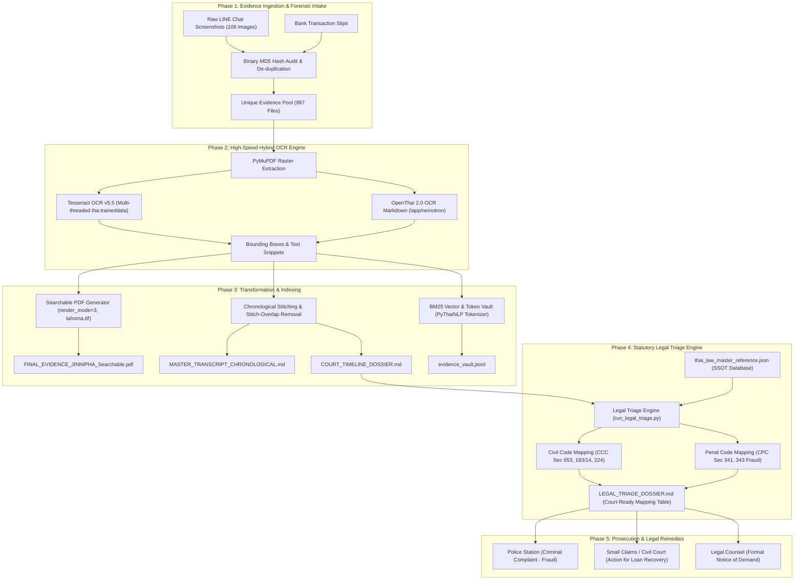

# 🔄 PROJECT FLOW: ชวกม.2 (Digital Evidence & Court Dossier Architecture)

## 1. System Interaction Architecture (Mermaid)

---

## 2. Step-by-Step Data Flow

1. **Step 1 (Ingestion):** User inputs scattered screenshots from LINE chat and bank transfer slips.
2. **Step 2 (De-duplication):** MD5 binary hash verifies unique files and removes redundant copies across subfolders.
3. **Step 3 (Dual OCR Engine):**
   - High-speed multi-threaded Tesseract OCR extracts raw tokens and timestamps within seconds.
   - OpenThai 2.0 OCR parses complex layout, headers, and Thai tabular structures.
4. **Step 4 (Invisible Layer Rendering):** PyMuPDF embeds invisible Thai Unicode text directly atop the scanned raster image matching exact coordinate boxes, rendering the PDF searchable via `Ctrl + F` in standard PDF viewers without altering visual appearance.
5. **Step 5 (Chronological Reconstruction):** Timestamps (`16:04 น.`, `16:20 น.`, etc.) and consecutive text overlaps are resolved to generate a continuous transcript narrative.
6. **Step 6 (Legal Triage Mapping):** The statutory knowledge base matches borrowing expressions, repayment promises, and false pretense excuses with specific sections of the Thai Civil and Commercial Code and Criminal Code, citing binding Supreme Court precedents.
7. **Step 7 (Court Package Export):** Outputs structured markdown dossiers and searchable PDFs ready for printing and filing with investigative authorities.

---

## 3. Business Logic Constraints

- **Zero-AI-Hallucination:** Transcripts must strictly reflect OCR text verified against image pixels.
- **Thai Unicode Preservation:** Text layers must utilize native TrueType fonts (`tahoma.ttf`) to prevent missing glyphs or broken tone marks.
- **PDPA & Evidence Confidentiality:** Personal identifiers, raw screenshots, and sensitive financial logs are shielded from public repository commits via `.gitignore`.
