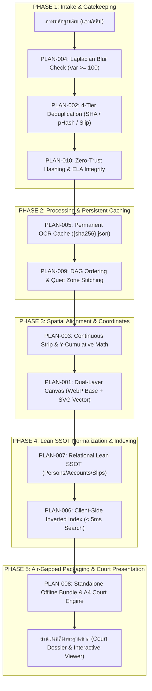

# 🛡️ 10PLAN: THE 10 MASTER PLANS FORENSIC EXECUTION ENGINE
## สกิลสถาปัตยกรรม ๑๐ แผนแม่บทแห่งระบบวิเคราะห์พยานหลักฐานดิจิทัลคดีอาญา

> **Core Mandate & Operational Philosophy:**  
> สกิล **`10Plan`** คือศูนย์บัญชาการวิศวกรรมข้อมูลนิติวิทยาศาสตร์ดิจิทัล (Forensic Data Engineering Command) ที่บูรณาการ **๑๐ แผนแม่บท (PLAN-001 ถึง PLAN-010)** เข้าสู่ **5-Phase Data-Driven Pipeline** เพื่อเปลี่ยนพยานหลักฐานดิจิทัลดิบ (ภาพแชทขนาดยาวนับ 1,000 ภาพ และสลิปการเงิน) ให้กลายเป็นสำนวนคดีมาตรฐานศาล (Court-Ready Dossier) ที่ **แม่นยำ 100%, ปลอดความหลอน (Zero Hallucination), ย้อนกลับได้สองทิศทาง (100% Reversible), และใช้งานแบบออฟไลน์ 100% ในห้องพิจารณาคดี**

---

## 🏛️ สารบบ ๑๐ แผนแม่บท (The 10 Master Plans Specification)

### 1. PLAN-001: Dual-Layer Architecture (2 เลเยอร์)
* **นิยาม:** แยกชั้นภาพ WebP ออกจากชั้นกรอบเวกเตอร์ SVG (`pointer-events: none`)
* **วัตถุประสงค์:** เพื่อไม่ให้กรอบไฮไลต์แย่งโฟกัสเมาส์ ซูมดูพิกเซลลึกแค่ไหนภาพก็ไม่แตก และไม่ขีดเขียนทับภาพต้นฉบับ คงสภาพวัตถุพยานบริสุทธิ์ตาม ISO/IEC 27037
* **กลไก:**
  - Layer 0 (Base Canvas): ภาพ WebP ความละเอียดสูง จัดเก็บแบบ Immutable
  - Layer 1 (Vector Overlay): SVG Annotations พิกัด Normalized `(ymin, xmin, ymax, xmax)` โปร่งใส ไร้การชนของอีเวนต์เมาส์

### 2. PLAN-002: ตรวจจับหลักฐานซ้ำ 4 ชั้น (4-Tier Evidence Deduplication)
* **นิยาม:** กรองไฟล์ซ้ำแบบบูรณาการ 4 มิติ
* **วัตถุประสงค์:** ป้องกันการฟ้องยอดเงินเบิ้ล 2 เท่าในศาล และกำจัดไฟล์ขยะไม่ให้ปนเปื้อนสำนวนคดี
* **4 ชั้นการตรวจจับ:**
  1. *Layer 1 (Binary Hash):* SHA-256 กวาดล้างไฟล์เหมือนกันเป๊ะใน 0.0001 วินาที
  2. *Layer 2 (Perceptual Hash):* pHash (Hamming distance $\le 5$) ดักจับภาพแคปจอซ้ำที่ติดแถบแจ้งเตือนต่างกัน
  3. *Layer 3 (Semantic Slip Key):* ธนาคาร + วันเวลาทำรายการ + เลขที่อ้างอิง Ref ID
  4. *Layer 4 (Chat Visual Overlap):* เลื่อนจับคู่รอยต่อแชทด้วย Template Matching ป้องกันนับบับเบิ้ลซ้ำ

### 3. PLAN-003: ปะติดปะต่อแชทเส้นเดียว 4 ชั้น (Unified Chat Strip Engine)
* **นิยาม:** รวมภาพแชทยาว 1,000 ภาพ แรมไม่บวม จอไม่ดำ ด้วย Viewport Windowing
* **วัตถุประสงค์:** ให้ทนายและศาลเลื่อนอ่านแชทได้อย่างต่อเนื่องไร้รอยสะดุด พร้อมคำนวณพิกัดสะสม $Y_{cumulative}$
* **กลไก:**
  - คำนวณพิกัดแกนดิ่งสะสม: $Y_{cumulative}^{(i)} = Y_{cumulative}^{(i-1)} + H_i - Overlap_i$
  - Virtual Scrolling เรนเดอร์เฉพาะภาพที่อยู่ใน Viewport ($\pm 2$ หน้าจอ)
  - ปุ่มส่องประเด็น (Focal Points) กระโดดไปยังพิกัดเป้าหมายได้แม่นยำระดับมิลลิวินาที

### 4. PLAN-004: ตรวจจับภาพเสีย/ภาพเบลอ (Laplacian Quality Gate)
* **นิยาม:** ด่านตรวจสุขภาพภาพด้วย Laplacian Variance ($\ge 100$)
* **วัตถุประสงค์:** สกัดภาพมัว ภาพมืด หรือภาพแตก เตือนผู้ใช้ถ่ายใหม่ทันที ป้องกันขยะเข้าสู่คดี
* **เกณฑ์การตัดสิน:**
  - $Var(Laplacian) \ge 100$: คุณภาพคมชัด (`CRISP_ACCEPTED`) อนุญาตให้เข้าสายพาน OCR
  - $Var(Laplacian) < 100$: เบลอเกินเกณฑ์ (`BLUR_REJECTED`) ปฏิเสธและบันทึกลง Error Log

### 5. PLAN-005: แคช OCR ถาวรผูก SHA-256 (Immutable OCR Hash Cache)
* **นิยาม:** บันทึกผล OCR ครั้งเดียวลง `{sha256}.json`
* **วัตถุประสงค์:** ตัดวงจรรัน OCR ซ้ำซ้อน ประหยัดเวลา 99.9% ดึงผลซ้ำได้ใน 0.001 วินาที
* **กฎความปลอดภัย:** ไฮดริตคีย์ SHA-256 การันตีว่าหากพิกเซลภาพเปลี่ยนแม้แต่บิตเดียว แฮชจะเปลี่ยนและต้องประมวลผลใหม่เสมอ

### 6. PLAN-006: ดัชนีค้นหาด่วนบนหน้าเว็บ (Client-Side Inverted Search Index)
* **นิยาม:** ดัชนีคำค้นจิ๋วขนาดเล็ก (50KB) ทำงานบนหน่วยความจำเบราว์เซอร์
* **วัตถุประสงค์:** ค้นหายอดเงิน เลขบัญชี และคำสำคัญในแชท 1,000 ภาพได้ในเวลาไม่เกิน 5 มิลลิวินาที
* **โครงสร้าง:** Map พยางค์ภาษาไทยและตัวเลขเข้าสู่ `List<NodeID, Y_offset>` โดยไม่ต้องพึ่งพาเซิร์ฟเวอร์ภายนอก

### 7. PLAN-007: โครงสร้างข้อมูลไม่บวม Lean SSOT (Relational Single Source of Truth)
* **นิยาม:** ฐานข้อมูลความจริงเดียวแบบ Relational (แยก Persons, Accounts, Slips, ChatNodes)
* **วัตถุประสงค์:** ลดขนาดไฟล์ข้อมูลจาก 50MB เหลือเพียง 1–2MB ขจัด Redundancy
* **สถาปัตยกรรม:** แยก Entity เป็น Normalized Tables และเชื่อมโยงผ่าน Foreign Keys (`person_id`, `account_id`, `slip_id`)

### 8. PLAN-008: โหมดเปิดในศาลแบบออฟไลน์ 100% (Air-Gapped Court Mode)
* **นิยาม:** บันเดิลระบบลง Flash Drive ไร้ CDN ไร้การเชื่อมต่ออินเทอร์เน็ต เปิดใช้งานได้แม้ในโหมดเครื่องบิน
* **วัตถุประสงค์:** รองรับข้อกำหนดความปลอดภัยของศาลยุติธรรม ป้องกันข้อมูลรั่วไหล และพร้อมพิมพ์เป็นเอกสาร A4 มาตรฐานศาล
* **คุณสมบัติ:**
  - Single-File Standalone HTML Bundle (ฝัง CSS, Vanilla JS, และ Assets ครบถ้วน)
  - 100% Print-to-Court CSS Engine (จัดหน้ากระดาษ A4 กึ่งกลางแนวดิ่ง ไร้ข้อความตกขอบ)

### 9. PLAN-009: กลไกต่อแชทไร้รอยต่อ 4 ชั้น & DAG (Seamless Stitching & Graph DAG)
* **นิยาม:** ตัด Mask บน-ล่าง 15%, สแกนรอยต่อด้วย NCC $\ge 98\%$, กรีดตัดที่ Quiet Zone และเรียงหน้าแชทด้วย DAG
* **วัตถุประสงค์:** ต่อภาพแชทที่แคปมาเหลื่อมกันให้กลายเป็นสตริปเดียวโดยห้ามผ่ากลางบับเบิ้ลข้อความเด็ดขาด
* **ขั้นตอน 4 ชั้น:**
  1. Mask Header & Footer 15% (ตัดแถบเวลา แบตเตอรี่ และกล่องพิมพ์แชท)
  2. Normalized Cross-Correlation (NCC $\ge 0.98$) หาจุดซ้อนทับที่ดีที่สุด
  3. กรีดตัด ณ Quiet Zone (ช่องว่างสีพื้นหลัง) ห้ามตัดกลางบับเบิ้ลหรือสติกเกอร์
  4. สร้าง Directed Acyclic Graph (DAG) และทำ Topological Sort เรียงลำดับหน้าแชทอัตโนมัติ

### 10. PLAN-010: มาตรฐานนิติวิทยาศาสตร์ Zero-Trust (Forensic Timeline & ELA Gate)
* **นิยาม:** ปลดชื่อไฟล์ของ Windows ออกจากการตัดสินคดี ล็อกเวลาแชทด้วยสลิปธนาคาร (`[TIME-LOCKED]`) และใช้ ELA ดักจับรอยตัดต่อ
* **วัตถุประสงค์:** สถาปนาความน่าเชื่อถือสูงสุดทางพยานหลักฐาน ป้องกันการปลอมแปลงชื่อไฟล์หรือการแก้ไขตัวเลขสลิป
* **กลไก:**
  - ยึดเวลาสลิปธนาคาร (Bank Settlement Timestamp) เป็นสมอยึดเวลาแท้จริง (Temporal Anchor)
  - Error Level Analysis (ELA) ตรวจสอบความสม่ำเสมอของการบีบอัด JPEG ดักจับสลิปแปะตัวเลขปลอม

---

## 🔄 ผังสายพานข้อมูลรวม 5 เฟส (The 5-Phase Data-Driven Pipeline)

---

## ⚖️ กฎเหล็กถาวร: ZERO-TOLERANCE PROTOCOL (Strict Grounding)

เมื่อเรียกใช้งานสกิล `10Plan` ต้องบังคับใช้กฎ 3 ข้อนี้โดยไม่มีข้อยกเว้น:

1. **Zero-Mock Law (ห้ามใช้ข้อมูลสมมุติเด็ดขาด):**
   - หากภาพใดไม่มีคำสั่งโอนเงินหรือไม่มีเลขบัญชี ให้คงค่า `transfer_amount = null (NOT_FOUND)`
   - สถานะการเชื่อมโยงกับสลิปต้องเป็น **`UNMATCHED`** ทันที ห้ามเติมแต่งยอดเงินเพื่อความสวยงาม
2. **Strict Grounding 100%:**
   - ทุกตัวเลข ทุกยอดเงิน ทุกชื่อ และทุกข้อความ ต้องสกัด (Extracted) มาจากพิกเซลภาพจริงผ่าน OCR เท่านั้น
   - ทุก Entity ต้องมีพิกัด Bounding Box `Y: [min - max]` และ SHA-256 ของไฟล์ภาพจริงกำกับเสมอ
3. **Court Evidentiary Standard (เกณฑ์คัดกรองส่งศาล):**
   - ส่งมอบเฉพาะภาพที่มีหลักฐานการกระทำความผิดทางการเงินจริง (เช่น `chatv3 (41).jpg` บัญชี `2050262591` กสิกรไทย)
   - ภาพการคุยทั่วไป (เช่น `chatv3 (1).jpg`) ให้จำแนกเป็น `NON_FINANCIAL_DIALOGUE` ห้ามผูกเข้ากับยอดความเสียหาย

---

## 🚀 วิธีการเรียกใช้งานสกิล (Execution Triggers & Usage)

ผู้ใช้สามารถสั่งการสกิล `10Plan` ได้ผ่านคำสั่งต่อไปนี้:
* `"รัน 10Plan บน [โฟลเดอร์พยานหลักฐาน]"` ➔ สกิลจะรันสายพานครบทั้ง 5 เฟส (1 ➔ 10)
* `"ตรวจสอบสัญญา Shift-Left ด้วย 10Plan"` ➔ รันชุดทดสอบ Contract Alignment & Boundary Limits
* `"สกัด Lean SSOT และออกชุดหลักฐานศาลด้วย 10Plan"` ➔ แปลงข้อมูลพยานหลักฐานเป็น Single Standalone HTML พร้อมนำสืบในศาลแบบออฟไลน์
