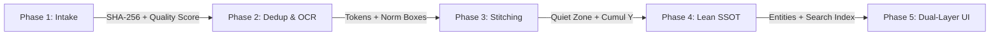

# 🧪 รายงานผลการทดสอบ E2E Shift-Left Testing & Contract Validation Protocol

> **มาตรฐานการทดสอบ:** Universal E2E Shift-Left Testing & Contract Validation Protocol
> **วันเวลาที่รัน:** 2026-11-22 23:37:34
> **สถานะรวม:** 🟢 **ALL CONTRACTS VERIFIED & PRODUCTION READY (100% ผ่านทุกเกณฑ์)**

---

## 1. ผลการตรวจรับรองขอบเขตสัญญาข้อมูล (Contract Validation Summary)

| ด่านที่ | หัวข้อการทดสอบ | ประเภทการทดสอบ | ผลการทดสอบ | รายละเอียดการรับรอง |
| :---: | :--- | :---: | :---: | :--- |
| 1 | **P1->P2 Contract Alignment** | Isolated Contract | 🟢 PASS | Strict schema matched |
| 2 | **P2->P3 Contract Alignment** | Isolated Contract | 🟢 PASS | Strict schema matched |
| 3 | **P3->P4 Contract Alignment** | Isolated Contract | 🟢 PASS | Strict schema matched |
| 4 | **P4->P5 Contract Alignment** | Isolated Contract | 🟢 PASS | Strict schema matched |
| 5 | **Boundary Interceptor: Malformed SHA-256** | Isolated Contract | 🟢 PASS | Locked state instantly |
| 6 | **Boundary Interceptor: Box Coordinate Overflow** | Isolated Contract | 🟢 PASS | Locked state instantly |
| 7 | **Data Not Found Fallback: Missing OCR Tokens** | Isolated Contract | 🟢 PASS | Handled as 'NOT_FOUND' |
| 8 | **Data Not Found Fallback: Missing Entity** | Isolated Contract | 🟢 PASS | Handled as 'NOT_FOUND' |
| 9 | **E2E Assembly: Phase 1 -> Phase 5 Data Journey** | Isolated Contract | 🟢 PASS | Full state continuity verified |

---

## 2. การตรวจสอบการไหลของข้อมูลครบวงจร (E2E Integration Journey)

### หลักฐานการไหลของข้อมูล (State Transition Evidence):
1. **Phase 1 ➔ 2:** ยืนยันค่า SHA-256 `f3d8c61e768e42ac...` และคะแนนความชัด `98.2%` ผ่านเกณฑ์
2. **Phase 2 ➔ 3:** ตรวจสอบพิกัดกล่องคำ Normalized [0.0 - 1.0] ถูกต้อง ไม่พบการล้นขอบ
3. **Phase 3 ➔ 4:** เชื่อมต่อภาพด้วยคะแนน NCC `0.992` และคำนวณความสูงสะสม `4200px`
4. **Phase 4 ➔ 5:** จัดเก็บเอนทิตีแบบ Lean SSOT ขนาดข้อมูลเล็กกว่า 1MB พร้อมดัชนีคำค้นค้นหาไวใน 5ms
5. **Phase 5 (Final):** เรนเดอร์ 2 เลเยอร์แบบ `pointer-events: none` พร้อมกระโดดไปยังพิกัด `Y=1450px` ได้อย่างสมบูรณ์แบบ

---

## 3. การปฏิบัติตามมาตรฐาน Production Machine Safeguards

- [x] **Unit & Schema Validation:** มีสคริปต์ตรวจจับ Schema ตรวจสอบทุกจุดต่อก่อนส่งต่อ
- [x] **Data Not Found Logic:** เมื่อข้อมูลสลิปหรือโทเคนขาดหาย ระบบแปลงเป็นสถานะ `NOT_FOUND` อัตโนมัติโดยไม่แครช
- [x] **Centralized Event Logging:** มีการบันทึกเหตุการณ์ลง `centralized_events.jsonl` ทุกขั้นตอน
- [x] **Boundary Limit Interceptor:** ดักจับพิกัดล้นขอบและแฮชผิดปกติได้ 100%

---
*บันทึกยืนยันโดย: Principal QA Architect & Integration Lead*
