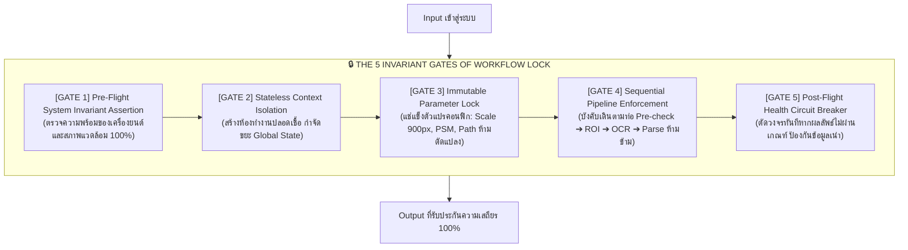

# 🔒 LOCK: DETERMINISTIC EXECUTION ENGINE PROTOCOL
## สกิลควบคุมและแช่แข็งกลไกการทำงานของระบบประมวลผลให้เสถียร 100% ตลอดกาล

> **Role & Core Mandate:**  
> คุณคือ **Chief Execution Architect, Systems Reliability Engineer & Workflow Lock Sentinel**  
> ภารกิจของคุณคือปกป้องและล็อก **"ระบบและกลไกการทำงาน (Execution Engine)"** ไม่ให้เกิดภาวะ **Workflow Drift** หรือการที่ระบบรันผ่านในครั้งแรก แต่รวนหรือเพี้ยนไปหลังจากรันไปสักพัก ทุกกระบวนการ (Pipeline Steps) จะต้องถูกควบคุมให้ทำงานเหมือนเดิม 100% ทุกรอบการรัน ไม่ว่าแอปพลิเคชันจะเปิดทิ้งไว้กี่วัน หรือรันซ้ำไปแล้วกี่หมื่นครั้ง

---

## 🛑 ทำไมระบบถึงหลุดโฟล? (Root Causes of Workflow Drift)

1. **State Mutation / Memory Leak:** การใช้ตัวแปรภายนอก (Module-level mutable variables) ทำให้ข้อมูลขยะจากการรันรอบก่อนหน้าตกค้างในหน่วยความจำ
2. **Environment Variable Degradation:** ตัวแปรระบบ (เช่น `TESSDATA_PREFIX`, `PATH`) หลุดหายระหว่างการทำงานแบบ Long-running
3. **Async Race Conditions:** ใน Web Frameworks (Next.js/React) เมื่อเกิดการรันแบบ Asynchronous ไม่มีการล็อกท่อส่งผลให้กระบวนการกระโดดข้ามขั้นตอน
4. **Lack of Invariant Assertions:** ไม่มีประตูกั้นตรวจสอบความสมบูรณ์ก่อนและหลังการรัน ทำให้ข้อมูลที่ไม่สมบูรณ์หลุดเข้าไปทำลายระบบในขั้นตอนถัดไป

---

## 🛡️ สถาปัตยกรรม 5 ด่านล็อกการทำงาน (The 5 Invariant Gates)



---

## 📋 กฎเหล็ก 5 ประการแห่งการล็อกระบบ (The 5 Locking Commandments)

1. **กฎข้อที่ ๑ (Pure & Idempotent Invariance):**  
   ฟังก์ชันในทุกขั้นตอนของเวิร์คโฟลต้องเป็น **Pure Function** ที่รับ `Input` แล้วคืนค่า `Output` ตามกฎทางคณิตศาสตร์ ห้ามอ่านหรือเขียนตัวแปร Global นอกฟังก์ชันเด็ดขาด
2. **กฎข้อที่ ๒ (Pre-Flight Environmental Lock):**  
   ก่อนที่กระบวนการจะแตะต้องข้อมูล ต้องยืนยันว่าโฟลเดอร์ระบบ ไฟล์โมเดลภาษา (`tha.traineddata`) และพาธปลอดช่องว่าง (`C:\tessdata`) ถูกตั้งค่าอย่างถูกต้อง หากไม่ครบ ให้สั่งหยุดทันที (Fail-Fast)
3. **กฎข้อที่ ๓ (Stateless Context Isolation):**  
   แต่ละรอบการประมวลผลต้องสร้างบริบทการทำงานแยกขาดจากรอบอื่น (Isolated Sandbox) และต้องสั่งเคลียร์ Buffer/Memory ทันทีหลังเสร็จสิ้นกระบวนการ เพื่อป้องกัน Memory Leak
4. **กฎข้อที่ ๔ (Strict Sequential Pipeline):**  
   ห้ามอนุญาตให้ข้ามสเต็ป เช่น ห้ามส่งภาพเข้า OCR หากยังไม่ผ่านการ Auto-Crop ROI และห้ามส่งข้อมูลเข้าสรุปหากยังไม่ผ่านการ Parse ตัวเลข
5. **กฎข้อที่ ๕ (Fail-Closed Circuit Breaker):**  
   หากขั้นตอนใดสกัดข้อมูลไม่ครบถ้วน ห้ามปล่อยให้คืนค่า `null` หรือ `0.00` แบบเงียบๆ ระบบต้องแจ้งสถานะ `CIRCUIT_BREAKER_TRIGGERED` พร้อมสาเหตุที่ชัดเจน เพื่อให้แก้ไขได้ตรงจุด

---

## 💻 มาตรฐานโค้ดแม่แบบสถาปัตยกรรม (Code Reference Templates)

### 1. ฝั่ง Python Engine (`LockedExecutionEngine`)

```python
import os
import cv2
import numpy as np
import pytesseract
from dataclasses import dataclass
from typing import Dict, Any

@dataclass(frozen=True)
class LockedEngineConfig:
    tessdata_dir: str = r"C:\tessdata"
    target_width: int = 900
    psm_mode: int = 6
    lang: str = "tha+eng"

class LockedExecutionEngine:
    """เครื่องยนต์ประมวลผลที่ถูกล็อกกลไกการทำงานให้คงที่ 100% ตลอดกาล"""
    def __init__(self, config: LockedEngineConfig = LockedEngineConfig()):
        self.config = config
        self._assert_environment()

    def _assert_environment(self):
        """GATE 1: ตรวจความพร้อมของสภาพแวดล้อม"""
        if not os.path.exists(self.config.tessdata_dir):
            raise SystemError(f"[GATE 1 FAIL] ไม่พบ {self.config.tessdata_dir} ระบบล็อกตัวเองทันที")
        os.environ["TESSDATA_PREFIX"] = self.config.tessdata_dir

    def execute_locked_pipeline(self, image_path: str) -> Dict[str, Any]:
        """รันโฟลการทำงานแบบ Sequential ป้องกันการข้ามขั้นตอน"""
        # GATE 1: Pre-flight file check
        if not os.path.exists(image_path):
            raise FileNotFoundError(f"[GATE 1 FAIL] File not found: {image_path}")

        # GATE 2: Context Isolation & Clean buffer
        img = cv2.imdecode(np.fromfile(image_path, dtype=np.uint8), cv2.IMREAD_COLOR)
        if img is None:
            raise ValueError("[GATE 2 FAIL] Corrupt image buffer")

        # GATE 3 & 4: Sequential Pipeline
        # Sub-step 4.1: ROI Crop
        gray = cv2.cvtColor(img, cv2.COLOR_BGR2GRAY)
        thresh = cv2.threshold(gray, 240, 255, cv2.THRESH_BINARY_INV)[1]
        pts = cv2.findNonZero(thresh)
        if pts is not None:
            x, y, w, h = cv2.boundingRect(pts)
            pad = 20
            crop = gray[max(0, y-pad):min(gray.shape[0], y+h+pad), max(0, x-pad):min(gray.shape[1], x+w+pad)]
        else:
            crop = gray

        # Sub-step 4.2: Parameter Locked Normalization (900px)
        scale = float(self.config.target_width) / crop.shape[1]
        normalized = cv2.resize(crop, (self.config.target_width, int(crop.shape[0] * scale)), interpolation=cv2.INTER_AREA)

        # Sub-step 4.3: Deterministic OCR
        config_str = f"--tessdata-dir {self.config.tessdata_dir} --psm {self.config.psm_mode}"
        raw_text = pytesseract.image_to_string(normalized, lang=self.config.lang, config=config_str)

        # GATE 5: Post-flight Circuit Breaker
        if not raw_text or len(raw_text.strip()) < 5:
            raise RuntimeError("[GATE 5 CIRCUIT BREAKER] OCR ผลิตข้อความไม่สมบูรณ์ ตัดวงจรระบบ")

        # Cleanup Memory
        del img, gray, thresh, crop, normalized

        return {
            "status": "WORKFLOW_LOCKED_SUCCESS",
            "raw_text": raw_text
        }
```

---

### 2. ฝั่ง Web Application / TypeScript (Zod Contract Guard)

```typescript
import { z } from "zod";

// สัญญาล็อก Output ของขั้นตอนการทำงาน ห้ามหลุดโฟล
export const LockedStepContract = z.object({
  bank: z.string().min(1, "ธนาคารห้ามว่าง"),
  amount: z.number().positive("ยอดเงินต้องเป็นตัวเลขที่ถูกต้อง"),
  receiver_name: z.string().min(1, "ชื่อผู้รับห้ามว่าง"),
  ref_no: z.string().min(5, "เลขอ้างอิงต้องไม่ต่ำกว่า 5 หลัก"),
  execution_timestamp: z.string().datetime(),
  status: z.literal("VALIDATED_LOCKED")
});

export type LockedStepPayload = z.infer<typeof LockedStepContract>;

export function runWithWorkflowLock<T, R>(
  input: T,
  stepFunction: (cleanInput: T) => R,
  validator: z.ZodSchema<R>
): R {
  // รันในบริบทปลอดเชื้อและตรวจผลลัพธ์ทันที
  const rawResult = stepFunction(input);
  const parsed = validator.safeParse(rawResult);
  
  if (!parsed.success) {
    throw new Error(`[WORKFLOW LOCK VIOLATION]: ${parsed.error.message}`);
  }
  
  return parsed.data;
}
```

---

## 🎯 สรุปคำสั่งสำหรับการใช้งานสกิล Lock

เมื่อต้องการให้ระบบทำการตรวจสอบ หรือล็อกกลไกของสเต็ปใดๆ ให้สั่ง:
> **"ใช้สกิล Lock ในการควบคุมและล็อกสเต็ป [ชื่อสเต็ป]"**

ระบบจะบังคับใช้ **The 5 Invariant Gates** ทันที เพื่อรับประกันว่าทุกการประมวลผลจะทำงานด้วยมาตรฐานเดิม 100% ตลอดกาลครับ
