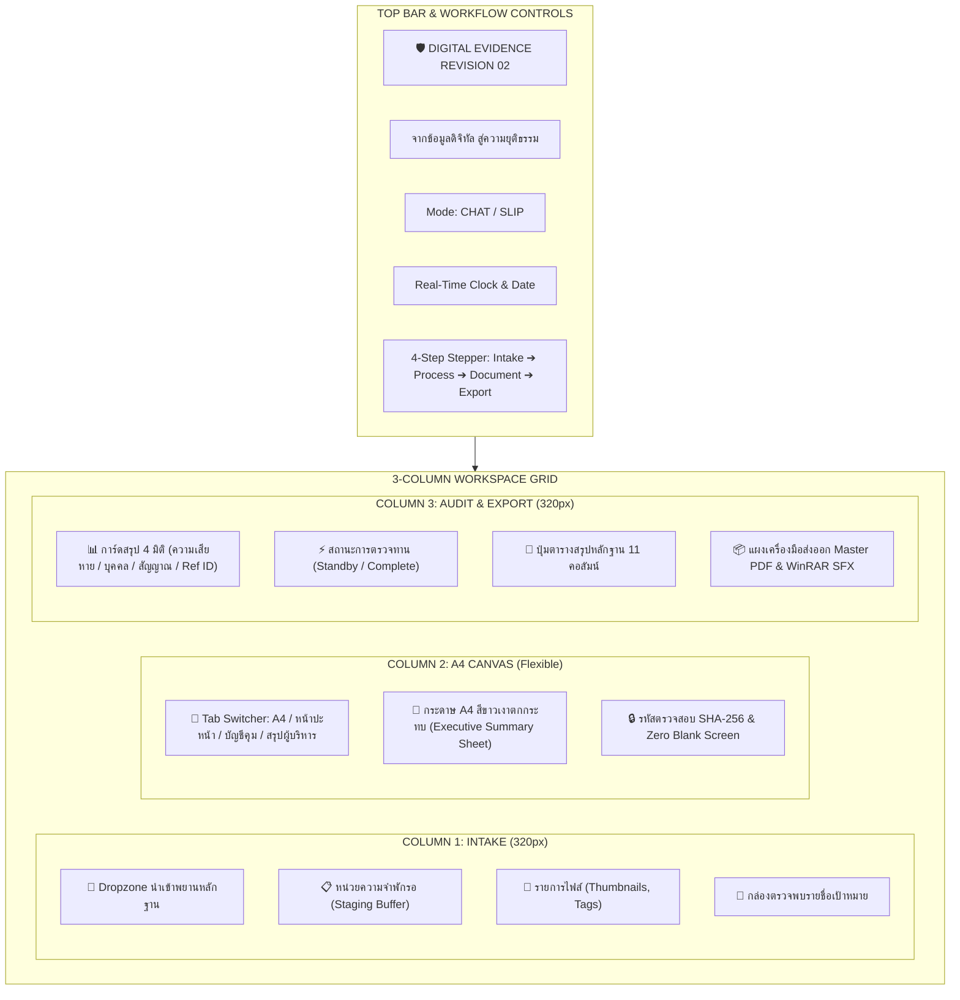

# 🏛️ DIGITAL EVIDENCE REVISION 02
## UI & DESIGN SYSTEM ARCHITECTURAL BLUEPRINT SPECIFICATION
> **DOCUMENT ID:** `SPEC-DES-2026-REV02-001`  
> **ARCHITECTURAL CLASSIFICATION:** Re-architected Master Shell UI (Zero-Legacy Dependency)  
> **TARGET FIDELITY:** 1:1 Production Parity with Forensic Reference Standard  
> **ENGINE STATUS:** Decoupled Pure Presentation & State Binding Layer (No legacy code from `D:\Project\Digital Evi - Codex`)

---

## 1. FIRST PRINCIPLES & DESIGN PHILOSOPHY
หน้าจอ **DIGITAL EVIDENCE REVISION 02** ออกแบบภายใต้ปรัชญา **"Forensic Tactical Dark Glass"** สำหรับงานพยานหลักฐานคดีอาญาและชั้นศาล:
1. **Information Density & Zero Clutter:** จัดวาง 3 คอลัมน์แบบกระจายหน้าที่ชัดเจน (Intake ➔ Canvas ➔ Audit/Export) เพื่อให้เจ้าหน้าที่และทนายความเห็นภาพรวมโดยไม่ต้องสลับหน้าจอ
2. **Glassmorphism V8 Compliance:** ความโปร่งแสงระดับลึก (`rgba(13, 20, 36, 0.75)`), Blur 16px, เส้นขอบกระจกละเอียด `rgba(56, 189, 248, 0.12)` เพื่อลดความล้าสายตาในการทำงานต่อเนื่องหลายชั่วโมง
3. **Pure Separation of Presentation and Execution:** เปลือกนอก (Shell UI) เป็น Stateless / State-Driven UI ที่สื่อสารผ่าน Reactive State สกัดขาดออกจากเอนจินประมวลผลเก่า 100%

---

## 2. DESIGN TOKENS SPECIFICATION (CSS VARIABLES)

```css
:root {
  /* Surface & Base Colors */
  --bg-deep: #060911;
  --bg-canvas: #090e1a;
  --panel-bg: rgba(13, 20, 36, 0.78);
  --panel-bg-subtle: rgba(18, 28, 50, 0.65);
  --panel-border: rgba(56, 189, 248, 0.14);
  --panel-border-glow: rgba(56, 189, 248, 0.35);
  
  /* Tactical Status Accents */
  --accent-cyan: #38bdf8;
  --accent-cyan-dark: #0284c7;
  --accent-green: #10b981;
  --accent-green-dark: #059669;
  --accent-purple: #a855f7;
  --accent-amber: #f59e0b;
  --accent-red: #ef4444;
  
  /* Text & Typography */
  --text-primary: #f8fafc;
  --text-secondary: #94a3b8;
  --text-muted: #64748b;
  --text-inverse: #0f172a;
  
  /* Typography Scale */
  --font-ui: 'Sarabun', 'Segoe UI', system-ui, sans-serif;
  --font-mono: 'JetBrains Mono', 'Consolas', monospace;
  --font-court: 'TH Sarabun PSK', 'THSarabunNew', serif;
  
  /* Glassmorphism Filters */
  --glass-blur: blur(16px);
  --glass-shadow: 0 10px 30px rgba(0, 0, 0, 0.6);
  --card-shadow: 0 4px 14px rgba(0, 0, 0, 0.35);
  
  /* A4 Dimension Lock (ISO 216) */
  --a4-width: 210mm;
  --a4-min-height: 297mm;
  --a4-padding: 20mm;
}
```

---

## 3. ARCHITECTURAL 3-COLUMN WORKSPACE GRID



---

## 4. COMPONENT DETAILED SPECIFICATION

### 4.1 Header Bar & Stepper Component
* **Brand Block:**
  * Logo ตราโล่นิติวิทยาศาสตร์เรืองแสงสีฟ้าคราม
  * ชื่อหลัก: `DIGITAL EVIDENCE` (Bold 18px White)
  * Badge: `REVISION 02` (Glass pill พร้อมไฟ LED จุดฟ้าคราม)
  * Subtitle: `เครื่องมือรวบรวมและจัดระเบียบพยานหลักฐานดิจิทัล` (12px Muted)
* **Center Controls:**
  * Motto: ภาษาไทย "จากข้อมูลดิจิทัล สู่ความยุติธรรม" และอังกฤษ "DIGITAL EVIDENCE FOR A FAIRER TOMORROW"
  * Mode Switcher: แท็บคู่แก้ว `CHAT (แชท)` และ `SLIP (สลิป)`
  * Current Case Pill: `[ปัจจุบันคดี] 4 รายการ • แชท 38 หน้า` (Green Capsule)
  * PDPA Guard Switch: `PDPA [OFF]` (Toggle Switch)
* **Stepper Bar:** 4 สเต็ปหลักมีตัวเลขในวงกลมพร้อมเส้นนำสายตา:
  * `Step 1: จัดทำข้อมูล (Upload & Intake)` [สถานะ: ผ่านแล้ว/เขียว]
  * `Step 2: การประมวลผลและสืบสวน (Process & Match)` [สถานะ: กำลังทำงาน/ฟ้าคราม]
  * `Step 3: สร้างเอกสารหลักฐาน (Document & Audit)` [สถานะ: รอคิว/เทา]
  * `Step 4: ส่งออก (Export & Packaging)` [สถานะ: รอคิว/เทา]

---

### 4.2 Column 1: Intake & Staging Buffer
* **Dropzone:** กรอบเส้นประแก้วรองรับ Drag-and-Drop ภาพ `.png`, `.jpg`, `.webp` พร้อมปุ่ม `+ เลือกไฟล์เพื่อเพิ่มในโฟลเดอร์`
* **Staging Buffer:**
  * หัวตารางระบุ `หน่วยความจำพักรอ (Staging Buffer)` พร้อมปุ่ม `ล้าง`
  * บรรทัดสถานะ: `กู้คืนไฟล์เดิม (SHA-256 ทรงสิทธิ์เงินวัน)`
  * ปุ่มหลัก: `เริ่มประมวลผลพยานหลักฐาน (2 ไฟล์)` (Cyan Gradient Button)
  * การ์ดรายการไฟล์: แสดง Thumbnail ย่อ, ชื่อไฟล์, และแท็ก `GenAI` `Slip/Voice`
* **กล่องตรวจพบรายชื่อ (Target Entity Box):**
  * แสดงรายชื่อเป้าหมาย เช่น `ผู้รับโอน อลงกรณ์ แจ่มเมือง 1 สลิป / 0.00 บาท`
  * ช่องสืบค้น: `พิมพ์ชื่อหรือคำค้น` พร้อมปุ่มค้นหา

---

### 4.3 Column 2: Center A4 Canvas Preview
* **Navigation Tabs:**
  * `บนกระดาษ A4` (มุมมองภาพดิบ)
  * `หน้าปะหน้าพยานหลักฐาน` (Page 1 Cover Page)
  * `บัญชีคุม` (Page 7 SHA-256 Hash Manifest)
  * `สรุปผู้บริหาร` (Page 3 Executive Summary Sheet - Active Tab)
* **A4 Sheet Structure (ตามรูปถ่าย 1:1):**
  * ขนาด A4 มาตรฐาน (210mm x 297mm) สีขาวสะอาดตา เงาตกกระทบ `rgba(0,0,0,0.5)`
  * **Header:** ตราครุฑ/ตราชั่งศาล + หัวเอกสาร `ใบสรุปข้อมูลและเส้นทางการเงินที่ตรวจพบ (Executive Summary Sheet)` + `เลขที่เรื่อง : 012/2569`
  * **3 กล่องสรุปผลตรวจ:**
    1. *ยอดรวมตรวจพบรายการนำ (Net Total):* ยังสรุปยอดไม่ได้ (กรอบเขียว)
    2. *รายการสลิปที่ตรวจพบ:* 0 รายการ (กรอบฟ้าคราม)
    3. *ความสอดคล้อง แชท ↔ สลิป:* 0 คู่รายการ (กรอบม่วง)
  * **Section ผู้รับโอนสูงสุด (Top Recipient):** ระบุชื่อบุคคล, ยอดเงิน, สัญญาณแชท, และวันเวลาประมวลผล
  * **Section สรุปสาระสำคัญของพยานหลักฐาน:** บันทึกข้อความทางการนิติวิทยาศาสตร์
  * **Footer:** ลายน้ำทางกฎหมาย (Legal Disclaimer) ป้องกันการนำไปใช้เดี่ยวๆ
  * **Bottom Status Bar:** รหัสแฮช SHA-256 ประจำแผ่น และตราประทับ `✓ ZERO BLANK SCREEN PASS`

---

### 4.4 Column 3: Audit & Court Packaging
* **Timeline Status:** `Timeline: รวบรวมข้อมูลตามลำดับเวลา... 0 จุด ✓`
* **4 Mini KPI Cards (2x2 Grid):**
  1. `1. ยอดรวมความเสียหายที่แท้จริง (หักตรวจ Ref ซ้ำ)` ➔ `ยังจำแนกประเภทไม่ได้ (00.00)`
  2. `2. ยอดรวมรายการบุคคลที่เกี่ยวข้อง` ➔ `ยังสรุปยอดไม่ได้ (00.00)`
  3. `3. สัญญาณแชท-สลิป` ➔ `candidate (OCR ตรวจ... ในโหมดรอตรวจสอบ)`
  4. `4. Ref ID จากสลิป` ➔ `0 จุด (0 รายการ ยืนยัน... ในโหมดรอตรวจสอบ)`
* **ปุ่มตารางสรุปหลักฐาน:** `ตารางสรุปหลักฐาน (11 คอลัมน์)`
* **ชุดเครื่องมือจัดทำเอกสาร:**
  * ปุ่ม `หน้าปะหน้าพยานหลักฐาน (Cover Page)`
  * ปุ่ม `บัญชีคุมลายนิ้วมือดิจิทัล`
  * ปุ่ม `สรุปข้อมูลและเส้นทางการเงิน`
  * ปุ่ม `รายการกฎหมายที่เกี่ยวข้อง (เบื้องต้น)`
  * ปุ่มหลัก: `รวมเล่มเอกสารประกอบหลักฐาน (Master PDF)`
* **ระบบความปลอดภัย SFX & Export:**
  * กล่อง `รหัสผ่าน PDF และ SFX` พร้อมแท็ก `NO PASSWORD SET`
  * ปุ่มส่งออกเดี่ยว `PDF` สำหรับพยานหลักฐานแต่ละชิ้น

---

## 5. RE-ARCHITECTED STATE CONTRACT (DECOUPLED)
โครงสร้าง State ถูกออกแบบใหม่หมดจด ไม่ผูกมัดกับไพธอนเก่า เพื่อให้เชื่อมต่อกับ Engine ใหม่ได้ทันที:

```typescript
interface MasterShellState {
  app_meta: {
    revision: "REVISION 02";
    mode: "chat" | "slip";
    active_step: 1 | 2 | 3 | 4;
    pdpa_enabled: boolean;
  };
  staging_buffer: {
    total_files: number;
    files: Array<{
      id: string;
      filename: string;
      thumbnail_url: string;
      tags: string[];
      sha256?: string;
    }>;
  };
  detected_entities: Array<{
    name: string;
    role: "ผู้รับโอน" | "ผู้โอน" | "คนกลาง";
    slips_count: number;
    total_amount: number;
  }>;
  canvas_preview: {
    active_tab: "canvas_raw" | "cover_page" | "sha_manifest" | "executive_summary";
    case_no: string;
    timestamp: string;
    sha256_hash: string;
  };
  kpi_metrics: {
    card1_net_damage: number | null;
    card2_related_persons_total: number | null;
    card3_chat_slip_signal: string;
    card4_ref_id_points: number;
  };
}
```
